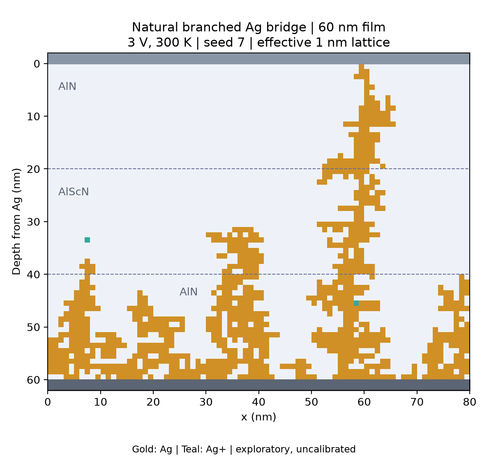

# AlScN — Ag细丝形貌KMC模型

Ag/AlN(20 nm)/AlScN(20 nm)/AlN(20 nm)/Pt的二维形貌优先基础模型，参考Zhao等（2016）事件框架，引入AlScN有效内建场和外层补偿场。

- [模型说明与参数](ag/README.md)
- [九轨迹运行报告](ag/results/study/运行报告.md)
- [九轨迹形貌对照](ag/results/study/morphology_comparison.png)
- [自然生长过程](ag/results/seed7/evolution.png)
- [内建场对照](ag/results/study/built_in_field.png)



## 运行

```powershell
python -m pip install -r ag/requirements.txt
python -m unittest discover -s ag -p test_physics.py -v
python ag/run.py --controls --output results/new_run
```

本轮九条轨迹中8条形成几何金属桥、1条达到事件预算后截断，Ag账本误差均为0，5项物理检查通过。1 nm有效格点和动力学参数尚未实验标定；当前模型不含电流、限流与热反馈。

本目录于2026-11-04从Breeze1y/ai4alscn的ag子目录迁移，保留全部68个已上传文件。
