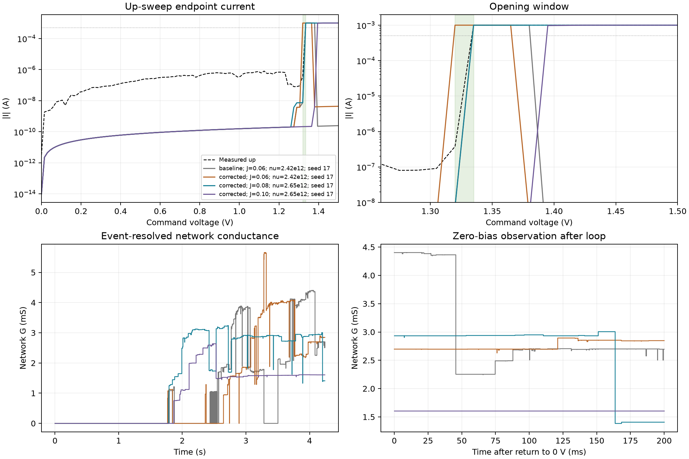

# AlScN：Ag 导电细丝 KMC

Ag/AlN(20 nm)/AlScN(20 nm)/AlN(20 nm)/Pt 的 KMC 项目位于 [`ag/`](ag/README.md)。当前采用无限 Ag 源、三态六事件、分层极化场、电流限流反馈，以及成桥后和回零期间的连续演化。

截至 2026-11-16，已修正桥后局部电子库电势并完成 20 组首桥筛选、9 条新的完整回环及 18 组同构型条件保持对照。**开启窗口、全程贯通与电导稳定性尚未同时拟合通过**。SET/RESET 循环仍待实现，PINN 暂缓。

- [项目结构、运行命令及当前结果](ag/README.md)
- [当前 KMC 事件与计算方法](ag/docs/当前KMC过程详述与论文方法底稿-20261109.md)
- [完整回环与失败对照](ag/results/bridge_stability_20261116/运行结果与参数选择.txt)
- [清理记录](ag/docs/cleanup_20261116.json)及[整理后验证](ag/docs/cleanup_verification_20261116.json)

```powershell
cd ag
python -m pip install -r requirements.txt
python -m unittest test_kmc -v
python run_kmc.py --config configs/current_kmc.json --max-events 20000000 --max-wall-s 1800 --output results/new_forming
```



原始拟合数据、论文、紧凑特征表与关键结果随项目保存。大型预处理长表只在原工作目录保留，详见 [大数据范围](ag/README.md#github-与大文件范围)。

本项目于 2026-11-04 从 `Breeze1y/ai4alscn` 迁入。最初九轨迹版本仍可在 [历史提交 d687e48](https://github.com/Breeze1y/AlScN/tree/d687e48/ag) 查阅；其首桥冻结模型与当前连续回环模型的结果不能混用。
