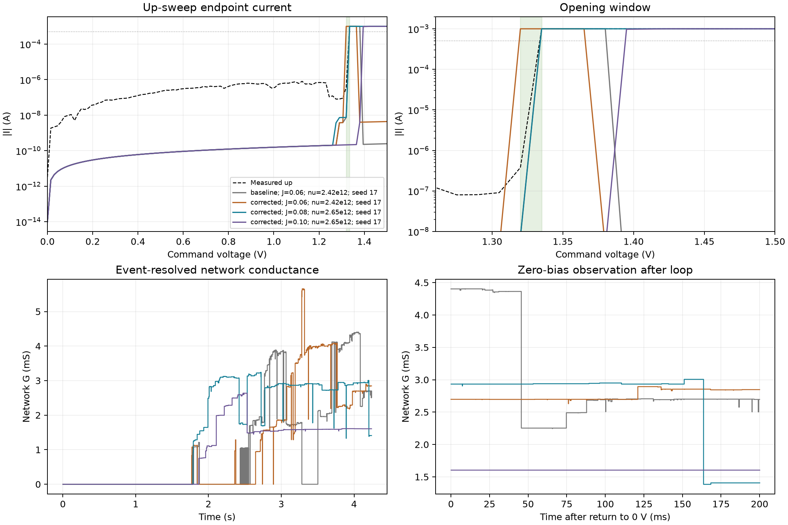

# Ag/AlN/AlScN/AlN/Pt 导电细丝 KMC

本项目研究 Ag 离子迁移、还原成丝和回零后的结构保持。当前采用无限 Ag 顶电极、三态六事件、分层极化场和带限流的电阻网络；氮空位以静态位点能影响表示。唯一运行入口为 `run_kmc.py`，详细事件、公式和验证边界见 [当前 KMC 方法说明](docs/当前KMC过程详述与论文方法底稿-20261109.md)。

## 当前进度（2026-11-16）

Forming 的形成、桥后连续演化和回零观察已实现，**开启窗口与稳定性尚未同时拟合通过**。默认使用原始 202 点 0→1.5→0 V、名义 20 ms/点、1 mA 限流，再观察 200 ms 零偏压。20 ms 来自 50 Hz、PLC=1 的假设，原始记录没有完整积分时序。

| 配置 / seed 17 | 点末开启 | 全程几何断连 | 末 100 ms 逐事件 G 极差 | 结论 |
|---|---:|---:|---:|---|
| [当前诊断基线](configs/current_kmc.json) | 1.320 V | 5 | 7.1080% | 仍有断连，精确实验采样格未匹配 |
| [开启窗口候选](results/bridge_stability_20261116/opening_candidate_config.json) | 1.335 V | 0 | 55.1860% | 开启匹配，回零支路电导不稳定 |
| [稳定性对照](results/bridge_stability_20261116/stability_control_config.json) | 1.395 V | 0 | 0.03892% | 短时稳定，开启偏晚 |

完整证据：[运行结果与参数选择](results/bridge_stability_20261116/运行结果与参数选择.txt)、[全部完整回环对照](results/bridge_stability_20261116/full_loop_comparison.json)、[全部 20 组首桥筛选](results/bridge_stability_20261116/all_scouts.json)。失败对照和不同种子记录均保留，不能把不同参数的首桥和末态拼成成功轨迹。



下一阶段先解决 forming 的联合验收，再从 forming 回零末态执行一次 RESET，随后验证已有 Ag 残留上的 SET/RESET 重建。当前尚未完成负压循环拟合，PINN 暂缓。`docs/` 中的任务 CSV 是历史规划资料，进度以本文和当前方法说明为准。

## 安装与运行

建议 Python 3.10 或更高版本，在本目录执行：

```powershell
python -m pip install -r requirements.txt
python -m unittest test_kmc -v

# 从空白介质开始；输出目录必须尚不存在
python run_kmc.py --config configs/current_kmc.json --max-events 20000000 --max-wall-s 1800 --output results/new_forming

# 达到单次时间预算后，读取同一目录继续
python run_kmc.py --resume results/new_forming --max-events 20000000 --max-wall-s 1800

# 仅导入已登记的首桥形貌，进行冻结网络诊断
python run_kmc.py --restore-filament --output results/new_shape_check
```

本机也可用 `D:\Al4memorister\ai4alscn\.venv\Scripts\python.exe` 替代 `python`。单次时间预算不是完成整条曲线的保证；应查看输出状态，必要时续算。完整回环检查点包含 RNG 与待事件，首桥形貌归档不包含可续算的原 RNG。物理代码哈希不一致的旧检查点不能直接用新版续算。

## 项目结构

| 位置 | 内容 |
|---|---|
| `kmc_model.py` | 格点、六类事件、分层静电场、源库账本与首桥 |
| `forming_iv.py` | 金属与隧穿网络、背景漏电、串联电阻和限流 |
| `fast_kmc.py` | 保持随机轨迹一致的事件率缓存 |
| `dynamic_kmc.py` | 桥后局部金属电势、持续演化和回零稳定性 |
| `morphology_metrics.py` | 四邻连通、缺格、最小顶点割等指标 |
| `run_kmc.py` / `test_kmc.py` | 唯一运行入口 / 30 项维护中的回归检查 |
| `configs/` | 当前默认、形貌参考及标注日期的历史配置 |
| `forming_data/` | forming、用户指定 SET/RESET 和厚度系列原始实验；当前循环拟合源为 `set-reset-data.csv` |
| `results/` | 当前完整回环、关键形貌参考、历史拟合汇总和必要版本证据 |
| `evidence/` | 冻结哈希、恢复样例、保留的关键验证与旧循环反例 |
| `docs/` | 唯一当前 KMC 方法说明、历史任务 CSV、清理与验证记录 |
| `papers/` / `reports/literature/` | 论文原文、图与摘录 / 已有文献调研 |
| `reports/` / `deliverables/` | 已交付的阶段报告和汇报文件 |
| `data/` / `datasets/` | 最新实验整理及暂停阶段的 ML 特征、标签和来源清单 |
| `.agents/skills/` | 项目文献调研说明 |

## 保留结果的用途

- `bridge_stability_20261116/`：当前主结果，9 条独立完整轨迹、18 组同构型条件保持及 20 组筛选摘要。`evaluate.py` 可对保留的完整检查点作只读复核；`baseline_sources/` 仅供旧模型哈希与结果审计。
- `opening_calibration_20261113/`：旧桥后实现的开启标定，保留选定完整回环、参考首桥与所有筛选指标；不能视作新版拟合结果。
- `vacancy_forming_20261108/`、`morphology_reproduction_20261112/`：用户指定的形貌与六组精确重算，用于区分缺陷影响和协议差异。
- `morphology_reference_zero1s_20261112/`：参考快扫后 1 s 零偏压反例；保持贯通仍不等于电导稳定。
- `forming_refit_20261109/`：早期冻结形貌拟合的汇总、参数和来源；已删除大批搜索中间态。
- `infinite_ag_restored_20261112/`：历史首桥导入诊断。

未选中的首桥扫描检查点、弃用有限电极/Pan 模型试跑、过期扫描脚本、重复分析版本与渲染缓存已清理，详见 [清理清单](docs/cleanup_20261116.json)。保留的旧清单是当时的记录，其中指向已清理中间态的路径不再表示可用检查点。历史源码 ZIP 仅用于追溯已保留结果，不是另一套日常运行入口。

## GitHub 与大文件范围

仓库位置为 [Breeze1y/AlScN 的 ag 目录](https://github.com/Breeze1y/AlScN/tree/main/ag)。代码、当前说明、原始 forming/SET/RESET/厚度系列数据、文献、紧凑特征表和上述关键结果随项目提交。

以下可再整理的大型长表保留在本机，正常 Git 提交排除：

- `data/*processed_20261104/waveform_points.csv` 与 `file_inventory.csv`；
- `datasets/set_reset_ml_20261104/cycle_waveform_points.csv`；
- `forming_data/diff/organized/all_iv_points.csv`。

其精确路径、字节数与 SHA-256 记录在 [本地大数据清单](docs/local_data_inventory_20261116.json)。ML 目录保留一份完整波形长表，本次删除了经哈希确认完全相同的旧副本。远程克隆可直接运行 KMC 与 30 项检查，但不会自动获得这些大型预处理长表；重做完整 ML 数据整理需另行取得长表或源数据。

更大批次的原始实验位于项目外 `D:\Al4memorister\ai4alscn\device_data\nature_data` 及其 `A/` 子目录，本次未移动、删除或上传该外部目录。`data/` 与 `datasets/` 中的来源清单记录其相对文件信息；这些历史标签、配对与分组尚未等同于经过验证的器件循环真值。

后续新运行默认不纳入 Git；需要保存为正式证据时，应先复核并明确加入保留范围。论文原文与数据按其各自来源和使用范围管理，本项目未另行授予第三方材料再分发许可。
