# Experimental and Simulation Study of Resistive Switches for Memory Applications

> 📝 English version
> Companion files: `*.zh-full.md` (Abstract + Chapter 2 full paragraph-by-paragraph translation), `*.zh.md` (Chinese structured summary)

## 1. Metadata & TL;DR

- **Authors**: Feng Pan
- **Affiliation**: Electrical Engineering and Computer Sciences, University of California at Berkeley
- **Venue**: **PhD Dissertation** (Engineering – EECS), also released as Technical Report **UCB/EECS-2013-38**
- **Year**: Fall 2012 (report dated May 1, 2013)
- **Advisor / Chair**: Prof. Vivek Subramanian; committee: Tsu-Jae King Liu, Ronald Gronsky, Sayeef Salahuddin
- **Link**: http://www.eecs.berkeley.edu/Pubs/TechRpts/2013/EECS-2013-38.html
- **Field**: Solid-state electronic devices / `RRAM` memristors / `ECM` (`CBRAM`) metallic filament physics / `Kinetic Monte Carlo` atomistic simulation
- **Extent**: 118 pages, 5 chapters, 244,783 characters (complete text layer, not scanned)

- **TL;DR**: A dissertation of **two mutually decoupled halves**. **Part I (Ch 2) builds a 2D `KMC` simulator self-consistently coupled to the `Poisson equation` (FDM)**, decomposing metallic `conductive filament` formation in `ECM` `RRAM` into **10 atomistic processes with assigned activation energies** (oxidation / reduction × adatom/step/hole sites + adsorption / desorption / bulk diffusion / surface diffusion). It reproduces the three-regime forming-time–voltage law, the scaling laws ($V_{Form}\propto$ thickness, $V_{Form}$ logarithmic in area and in sweep rate), the `Weibull` distribution of `SET` time, `filament overgrowth`, and the dependence of the `RESET` rupture location on the lateral field — all validated against `Ag/Ag2S/W` and `Cu/H2O/Cu` lateral-cell experiments. **Part II (Ch 3+4) is an independent `YSZ` experimental study**: `Ti/YSZ` (`VO`-type, hopping conduction) is shown to outperform `Cu/YSZ` (ECM-type, metallic conduction) in endurance (>10⁴ vs ≈180 cycles), retention and noise; on that basis a **4-level `MLP`** cell is demonstrated ($R_{on}$~8 kΩ, $R_{off}$ up to ~2 MΩ), and `ISPP` pushes endurance beyond 10⁴ cycles while eliminating both stuck-at-LRS and stuck-at-HRS failures.

## 2. Motivation & Method

### 2.1 Problem

**Ch 2**: The essence of `RRAM` is **randomness** — `ECM` operation involves atomistically random chemical reactions and physical diffusion (`VO`-type additionally involves random trap generation), causing stochastic creation/annihilation of `conductive filament`s that directly determine device characteristics. Two failure modes of continuum approaches (explicitly argued on p64):

1. The **`Butler-Volmer` equation handles only interfacial charge transfer** at the electrode/dielectric boundary, not ion transport on the deposited metal surface or inside the dielectric — it must be coupled to drift-diffusion equations, and the whole problem is a **function of both time and position**.
2. In such a nano-device **the charge distribution is discrete**, so continuously varying charge-concentration functions become **ambiguous**.

`MD` also fails: capturing atomic vibration requires ~10⁻¹⁵ s steps, capping simulated time at ~**1 µs**, whereas forming/`SET` span µs–s. `KMC` sidesteps this by tracking **only the transitions that actually move the system to a new state**, skipping the uneventful thermal vibration at a site.

**Ch 3/4**: `MLP` is decisive for `RRAM` replacing Flash, but the `SET`-side route (tuning CC) suffers **capacitive discharge** and **history-dependent $R_{on}$ instability**; the `RESET`-side route requires a material with intrinsically **smooth RESET**, whose physics was unclear (the existing "medium bandgap + `VO` as donor" criterion cannot explain why `CuxO`/`NiO`, which satisfy it, still switch abruptly).

### 2.2 Core Method

**Method**: a **KMC ↔ Poisson (FDM) self-consistent simulator** (no proprietary name given in the dissertation; the author's related prior work is [4][7][19][20]).

#### 2.2.1 The ten atomistic processes and their activation energies (Figure 2.2 caption — the only complete parameter table in the thesis)

| # | Process | Site | $E_a$ (eV) |
|---|---|---|---|
| (1) | `oxidation` | `adatom` site | 0.65 |
| (2) | `oxidation` | `step site` | 0.70 |
| (3) | `oxidation` | `hole site` | 0.75 |
| (4) | `reduction` | `adatom` site | 0.35 |
| (5) | `reduction` | `step site` | 0.30 |
| (6) | `reduction` | `hole site` | 0.25 |
| (7) | `adsorption` | — | 0.15 |
| (8) | `desorption` | — | 0.30 |
| (9) | `bulk diffusion` | — | 0.15 |
| (10) | `surface diffusion` | — | 0.20 |

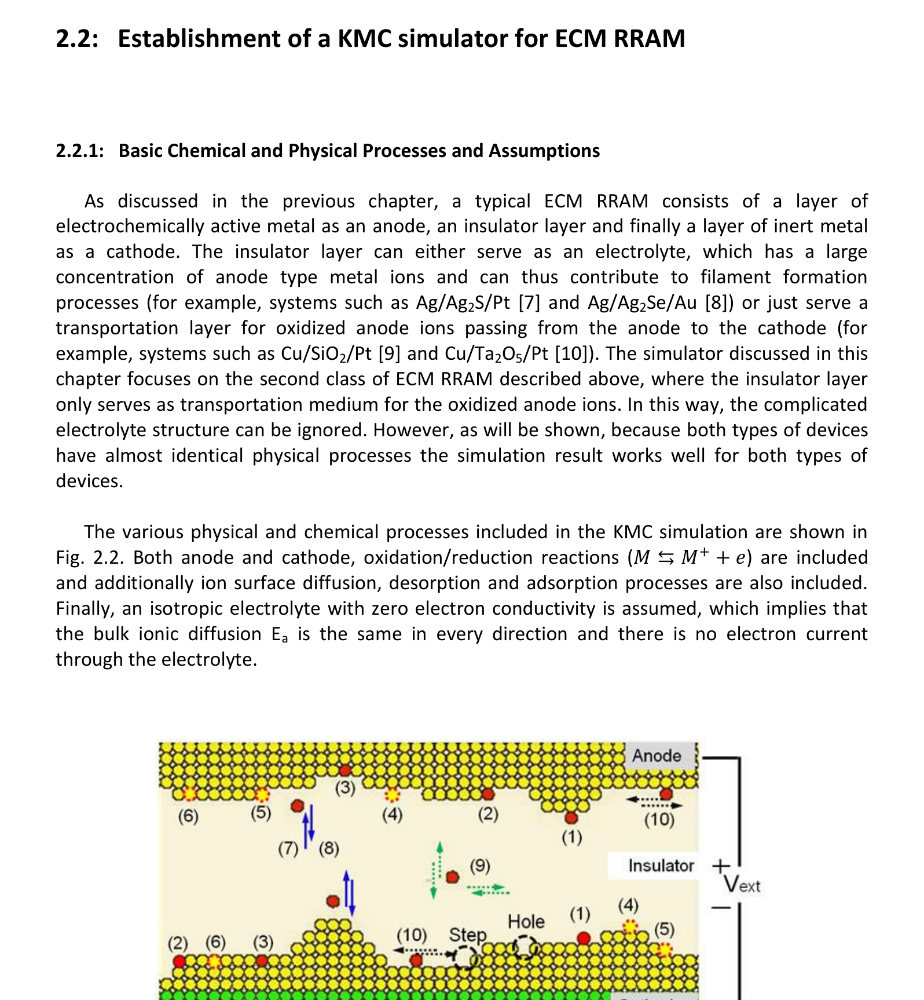
*Figure 2.2: All processes included in the KMC simulation with their respective $E_a$ (PDF p55)*

**Three design intents encoded in the table**: `reduction` $E_a$ **decreases** with increasing coordination (0.35→0.30→0.25 — ions preferentially reduce at step/hole sites, the microscopic origin of isotropic dense deposition at low bias); `oxidation` trends the **opposite** way (0.65→0.70→0.75); `oxidation` is systematically **larger** than `reduction` (representing Cu/Ag — metals with large positive `SEP`, easy to capture electrons and precipitate, hard to oxidize).

#### 2.2.2 KMC mathematical skeleton (`transition state theory` + `VSSM`)

$$p_{stay,i}(t)=\exp(-\Gamma_i t)\ \ (1)\qquad p_i(t)=\Gamma_i\exp(-\Gamma_i t)\ \ (2)$$
$$\Gamma_{tot}=\sum_i\Gamma_i\ \ (3)\qquad \tau=\frac{1}{\Gamma_{tot}}\ \ (5)\qquad \Delta t=-\frac{\ln r}{\Gamma_{tot}}\ \ (6)$$

Field-free `TST` rates ($\nu_o\approx10^{13}$ s⁻¹, roughly the atomic vibration frequency):
$$\Gamma_f=\nu_o\exp\!\left(-\frac{E_A}{k_BT}\right)\ (7)\qquad \Gamma_r=\nu_o\exp\!\left(-\frac{E_B}{k_BT}\right)\ (8)$$

Under a field, forward/reverse $E_a$ are corrected by $\alpha q\Delta V$ and $(1-\alpha)q\Delta V$ respectively, with **`symmetry factor` α typically 0.5**. The field may arise from **both the ion space-charge distribution and the external supply**.

#### 2.2.3 ★ The rate expression actually used by the simulator (eq 9 — the core of the model)

$$\sum_i\Gamma_i=\sum_i\nu_o\exp\!\left(-\frac{qE_{a,i}}{k_BT}\right)\exp\!\left(\frac{q\left(V_{initial,i}-V_{final,i}\right)}{2k_BT}\right)\exp\!\left(-\frac{qV_{self,i}}{2k_BT}\right)\tag{9}$$

> **Note the $\sum_i$ on BOTH sides** — matching the text "both **individual and total** transition rates can be calculated": the left-hand side $\sum_i\Gamma_i$ is $\Gamma_{tot}$ of eq (3) (what eq (6) needs); the summand with the summation removed is the single-event rate $\Gamma_i$ (the numerator of the VSSM step-3 selection probability $\Gamma_i/\Gamma_{tot}$). **One equation yields both the individual and the total rate.**

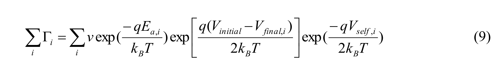
*eq (9), 8× high-resolution crop from PDF p60*

| Factor | Role |
|---|---|
| ① $\nu_o\exp(-qE_{a,i}/k_BT)$ | Field-free `TST` rate; $E_{a,i}$ looked up by (process type × site type) |
| ② $\exp(q(V_{initial,i}-V_{final,i})/2k_BT)$ | Field-induced barrier lowering; **the 2 in the denominator is exactly $\alpha=0.5$** (equivalently $k_BT/\alpha$) |
| ③ $\exp(-qV_{self,i}/2k_BT)$ | **Excludes self potential** [16] — an ion's own potential does not help lower its own $E_a$ |

#### 2.2.4 Main loop (Figure 2.6 flowchart)

```
init: 150 atoms per electrode layer, 10 nm insulator, t=0, pristine configuration
while stop condition not met:
  1. solve Poisson equation (FDM, periodic BC) -> potential V at every site
  2. exclude self potential (V <- V - V_self)
  3. enumerate all allowed transitions; compute Gamma_i via eq(9)
  4. Gamma_tot = sum Gamma_i                                   eq(3)
  5. dt = -ln(RN)/Gamma_tot ;  t <- t + dt                      eq(6)
  6. select event i with probability Gamma_i/Gamma_tot (2nd RN)  VSSM step 3
  7. execute event -> update all atom/ion configuration
  8. during overgrowth/RESET: update the voltage distribution across
     each filament layer, used as new BC for the next KMC step
  -> back to 1
current extraction: I = (# metal ions reaching cathode per interval x q) / interval
```

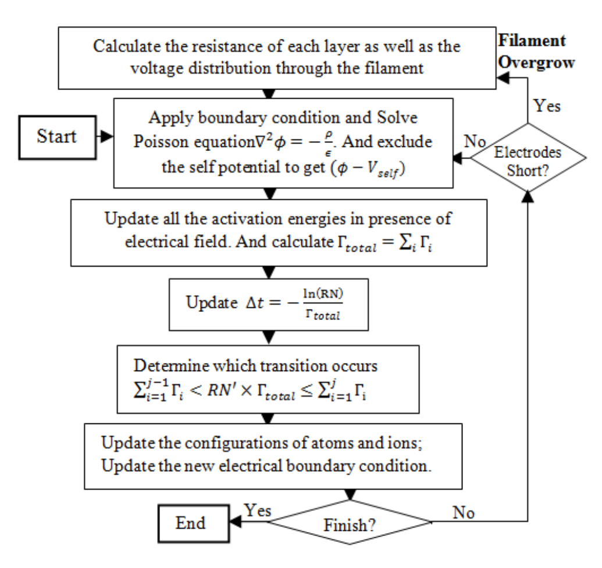
*Figure 2.6: The flowchart of the KMC simulation process (PDF p59)*

#### 2.2.5 Geometry, boundary conditions and stated approximations

| Item | Setting |
|---|---|
| Dimensionality | **2D** (3D too costly; **out-of-plane field ignored**) |
| Atoms per electrode layer | **150** |
| Insulator thickness | **10 nm** |
| Boundary condition | **Periodic** (for the Poisson solve) → edge effects ignored; requires large width/thickness aspect ratio |
| Poisson solver | **Finite difference (FDM)**, **re-solved after every KMC event** |
| Electrolyte | **Isotropic, zero electronic conductivity** (no electron current through it) |
| Neutral-atom diffusion | **Ignored** (rate far below that of ions under an external field) |

Four phenomenological approximations (p56–58, explicitly labelled as such by the author):
1. **Anode `oxidation` uses mechanism (c)**, field-assisted ion injection, whereas Willis's experiment [11] supports only (d), chemically assisted oxidation (at T<450–500 °C, E<1 MV/cm). The author's stated remedy: "assign a smaller $E_a$ for oxidation".
2. **Crystallization simplified**: all adsorbed ions are assumed to **remain charged**, and **only adsorbed ions may diffuse on the surface** (skipping the real adion partial-charge-transfer path). Justified as retaining generality because kink/step sites remain more stable than `adatom` sites.
3. **Chemical-reaction $E_a$ values come from experimental fitting**, not first principles (Bronshtein's three theoretical difficulties [12]: strong reactant–electrode coupling, pathway dependence on interfacial structure, rate dependence on solvent dynamics).
4. **The `RESET`-stage lateral field is reduced to a binary approximation** (small → ions may accumulate at the filament tip; large → they may not), to avoid the cost of fully modelling cathode topography.

**Differences vs prior work**: vs `MD` — time scale extended from 1 µs to seconds; vs pure `Butler-Volmer`/Tafel continuum models — retains charge discreteness and self-consistently couples bulk transport; vs Schindler's analytic model [9] — which assumes **all voltage drops at the cathode/SiO₂ interface** and that neither anode oxidation nor bulk transport is rate-limiting, an assumption the author calls questionable.

**Ch 3/4 method**: `YSZ` device fabrication (Structure I for screening: 30 nm 8mol% YSZ, 100×200 µm²; Structure II for the main study: 3–30 nm YSZ, 64×64 down to 4×4 µm², 100 nm PECVD Si₃N₄ isolation) + temperature-dependent I-V + endurance/retention + `RTN`/`1/f noise` spectroscopy + `ISPP` (stepped pulses with interspersed verification reads).

## 3. Experiments & Results

### 3.1 Chapter 2 simulation results (all compared against experiment)

**Setup**: 2D, 150 atoms per electrode layer, 10 nm insulator, α = 0.5, $\nu_o$ = 10¹³ s⁻¹.

#### (a) Filament topography vs voltage — the counterintuitive "higher voltage, narrower filament"

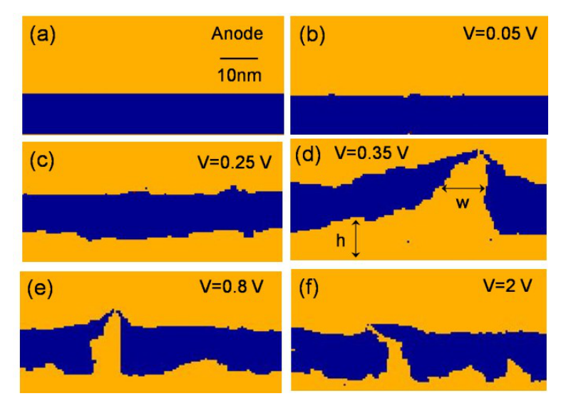
*Figure 2.7: Filament topographies at different voltage levels. (a) initial; (b) 0.05 V; (c) 0.25 V; (d) 0.35 V ('h' = isotropic deposition thickness, 'w' = average filament width); (e) 0.8 V; (f) 2 V (PDF p61)*

| Voltage | Behaviour | Topography |
|---|---|---|
| **well below $V_t$** | the serial chain oxidize → desorb (without being reduced back) → reduce at cathode (without re-oxidation) is nearly impossible | **no deposition at all**, Fig 2.7(b) |
| **≈ $V_t$** | isotropic deposition; anode–cathode gap essentially unchanged | **no gap shrinkage → no filament**, Fig 2.7(c) |
| **slightly above $V_t$** | adsorbed cations prefer diffusing to and reducing at the more stable step/hole sites → isotropic deposition | **large width 'w'**, Fig 2.7(d) |
| **further increased** | `adatom` formation becomes easy → faster, more localized growth | **width decreases markedly**, Fig 2.7(e)(f) |

**Experimental validation**: **lateral cells** in `Ag/Ag2S/W` and `Cu/H2O/Cu` (`Cu/H2O` closely resembles the simulated system because **H₂O supplies no cations and acts purely as a transport medium**) → wide filaments at low voltage, much narrower patterns at high voltage (Figure 2.9).

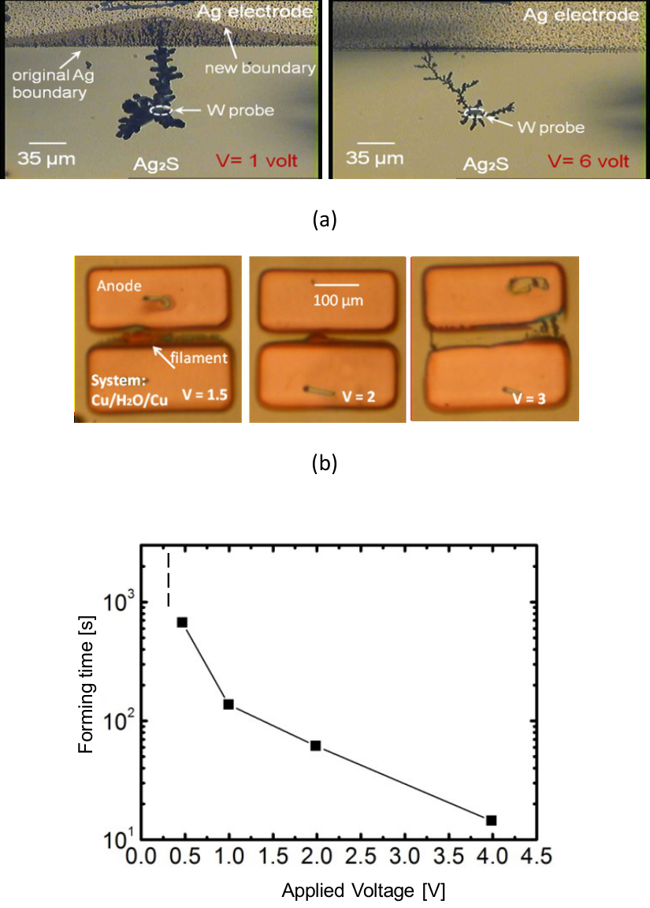
*Figure 2.9: (a) `Ag/Ag2S/W`, (b) `Cu/H2O/Cu` experimental filament topographies; (c) forming time vs applied voltage measured in `Ag/Ag2S/W` (PDF p62–63)*

#### (b) The three regimes of $t_{Form}$–V, explained via BV → Tafel

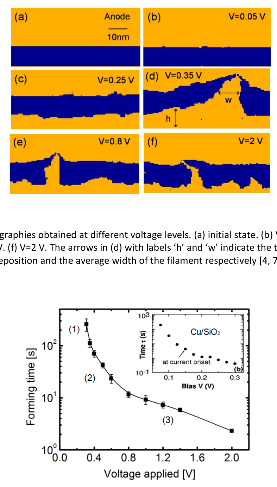
*Figure 2.8: Forming time vs applied voltage; inset shows `Cu/SiO2` experiment [17] (PDF p61)*

| Region | Dominant mechanism | Cation flux | # cations needed | $t_{Form}$ |
|---|---|---|---|---|
| **1** | serial oxidize/desorb/reduce chain barely completes | very low | very large (no gap shrinkage) | essentially non-conducting |
| **2** | `BV` **linear regime** | **linear** ∝ $\eta_s$ | reduced by topographic effect | decreases with V (both effects) |
| **3** | **`Tafel approximation`** | **exponential** ∝ $\exp(\alpha nq\eta_s/k_BT)$ | minor | **exponential** decrease |

Key intermediate relation: $t_{Form}\approx$ (# cations needed for the filament) / (average cation flux); $\eta_s=V-U$ (surface overpotential); applied voltage = anode $\eta_s$ + cathode $\eta_s$ + dielectric drop.

#### (c) ★ Three-way comparison of extracted α — the quantitative case for KMC

| Source | α |
|---|---|
| Theoretical typical value for liquid-electrolyte electrochemistry | **≈0.5** (the simulator **deliberately sets 0.5**) |
| Extracted from `Cu/SiO2/Pt` experiment [9] | **≈0.1** |
| **Extracted from the KMC simulation output** | **≈0.05** |

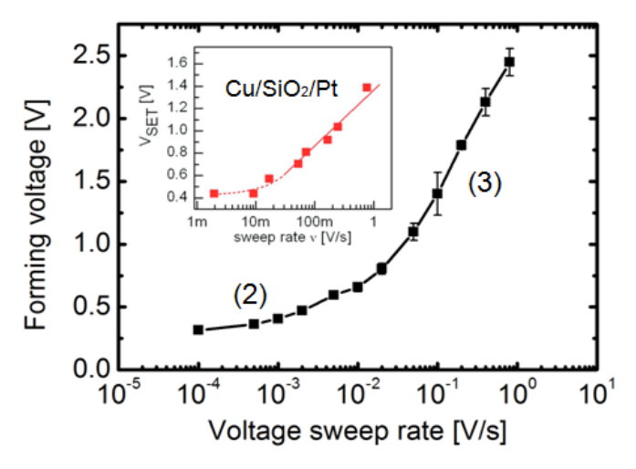
*Figure 2.10: Simulated $V_{Form}$ vs voltage sweep rate; inset `Cu/SiO2/Pt` experiment [9] (PDF p64)*

Three features of $V_{Form}$ vs sweep rate: as sweep rate → 0, $V_{Form}$ **approaches a constant** (a threshold $V_t$ exists); at slightly higher rates $V_{Form}$ rises slightly; at large rates $V_{Form}$ depends **logarithmically** on the sweep rate (Schindler's analytic result, eq 13–15: $V_{Form}=\frac{kT}{\alpha n q}\ln v+\frac{kT}{\alpha n q}\ln\frac{\alpha nqQ_{Form}}{kT\,i_0\,\pi r_f^2}$). **These significant discrepancies indicate the `Butler-Volmer` equation alone cannot accurately describe the whole system.**

#### (d) Scaling laws

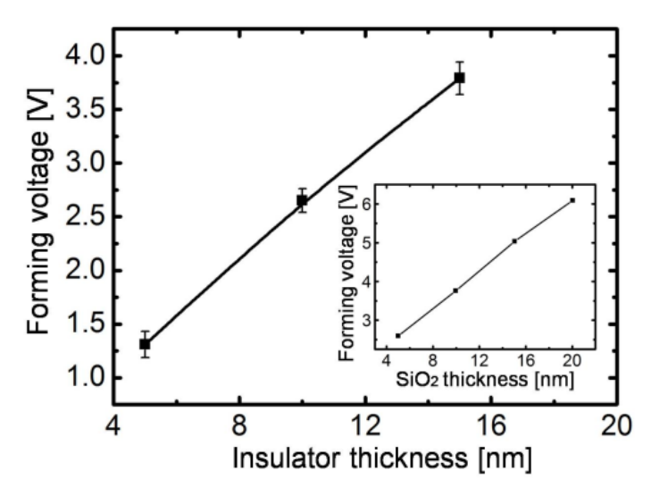
*Figure 2.11: $V_{Form}$ vs insulator thickness (1 V/s); inset `Cu/SiO2/Pt` experiment [9] (PDF p66)*

- **$V_{Form}$ depends linearly on insulator thickness** (1 V/s ramp), matching `Cu/SiO2/Pt` experiments → the system is **purely field-dependent**: effective drop = average field × effective initial-to-final distance; an ion hops roughly one lattice constant per event, so at constant field the rate change is identical; field ∝ 1/thickness → $V_{Form}$ ∝ thickness. **Corollary: once the device is thin enough, `forming` can be effectively eliminated.**

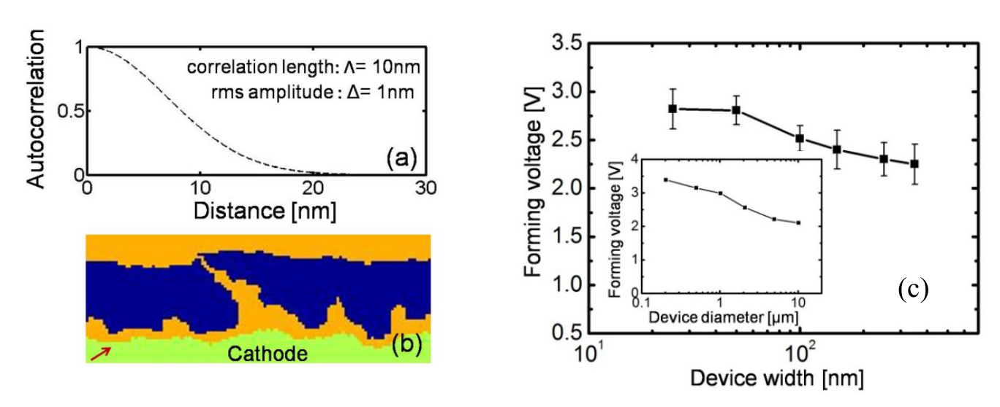
*Figure 2.12: (a) Gaussian autocorrelation; (b) simulated roughness pattern; (c) $V_{form}$ vs device width + `Cu/Ta2O5/Pt` experiment [10] (PDF p67)*

- **Area effect**: cathode roughness generated by a **Gaussian autocorrelation** (**correlation length 10 nm, rms 1 nm**; the author notes the correlation length is smaller than the real value due to simulation-time limits) → **a filament forms most readily where the effective electrode separation is shortest, since the effective field is strongest there**; $V_{form}$ **approaches a constant at small device sizes** and **decreases gradually as size increases**, consistent with `Cu/Ta2O5/Pt`.

#### (e) Four regions of the I-V and `filament overgrowth`

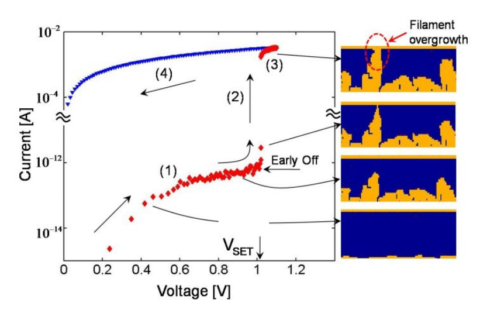
*Figure 2.13: Simulated I-V and filament shape. **Sweep rate 3 V/s, filament resistivity 5×10⁻⁸ Ω·m, $R_{ext}$ = 100 Ω** (PDF p68)*

| Region | Current type | Area dependence |
|---|---|---|
| **1** | **ionic** (immature filaments) | **∝ electrode area** |
| **2** | filament shorts both electrodes → **sharp turn-on** | **area-independent** |
| **3, 4** | **ohmic electronic** | **area-independent** |

After shorting, the filament's non-ideal conductivity leaves a large drop across it → **chemistry continues → the filament widens and its conductivity keeps increasing until steady state with the external test system**; **the voltage distribution across each filament layer must be updated every step**. Overgrowth is simplified by using a **flat anode** (justified because topography is mainly determined by the cathode [19]). **Thermal effects are ignored** — a good approximation when the filament resistance is large or a series protecting resistance limits current and hence heat dissipation.

#### (f) `SET` statistics and constant-current mode

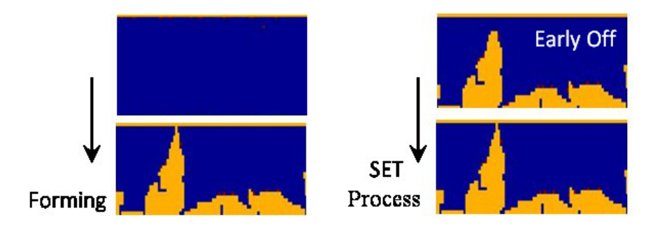
*Figure 2.14: Forming vs `SET` — `SET` only needs the top few atomic layers (PDF p69)*

**`SET` initial configuration = six top atomic layers removed** → $t_{SET}\ll t_{FORM}$.

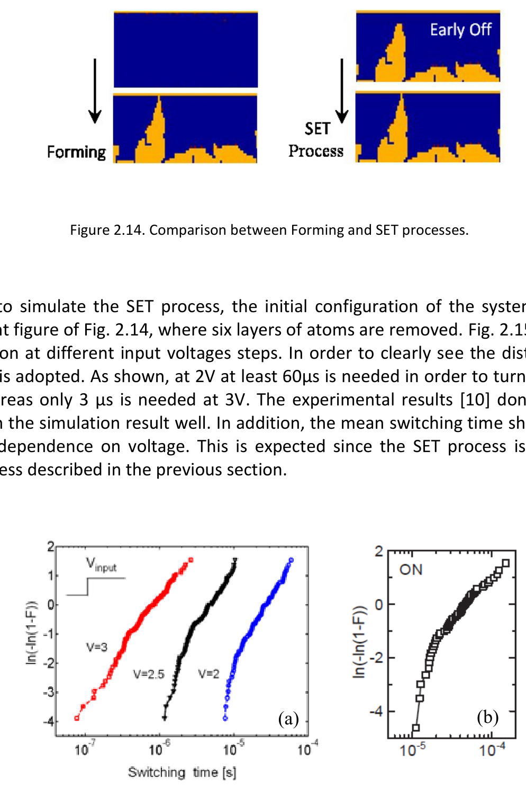
*Figure 2.15: (a) $t_{ON}$ `Weibull` distribution; (b) `Cu/Ta2O5` experiment [10] (PDF p69)*

- **At 2 V, ≥60 µs is required to turn on 99% of devices; at 3 V only 3 µs** (a `Weibull plot` is used to resolve the distribution tail); mean switching time depends **inverse-exponentially** on voltage; matches `Cu/Ta2O5`.

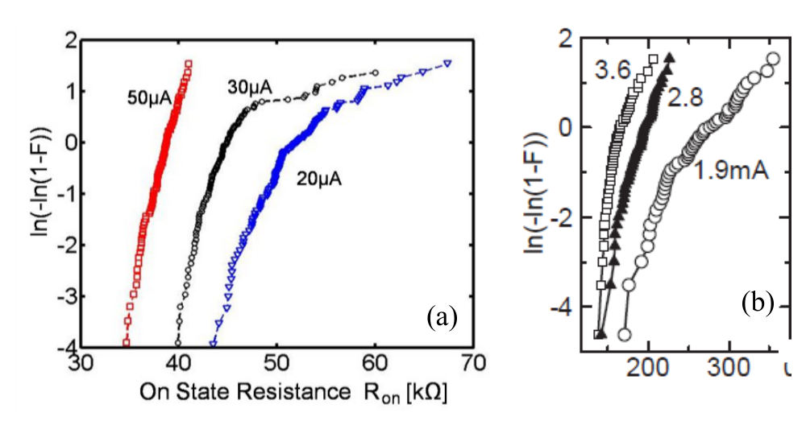
*Figure 2.16: (a) $R_{on}$ distribution under different current inputs; (b) `Cu/Ta2O5` experiment [10] (PDF p70)*

- **Constant-current mode**: at each step the total system resistance is computed and the voltage (= current × resistance) is updated **on every filament layer**. Result: **larger programming current → smaller $R_{on}$ with tighter spread** (overgrowth effect).

#### (g) `RESET`: rupture location set by the lateral field

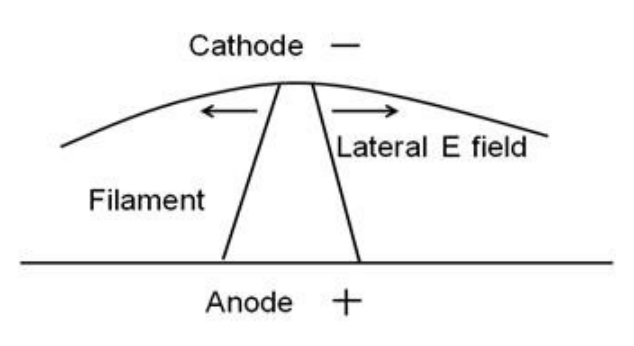
*Figure 2.17: Lateral field near the cathode region during `RESET` (PDF p71)*

| Lateral field | Physics | Simulation treatment | Rupture location |
|---|---|---|---|
| **small** | dissolved ions cannot diffuse out of the tip region laterally; they drift vertically and **accumulate on the cathode directly in front of the tip** | **accumulation at the tip allowed** | **mid-filament** or near the inert electrode (Fig 2.18c, white circle) |
| **large** | ions can also diffuse laterally | **accumulation at the tip disallowed** | **filament top / near the active electrode** (Fig 2.18a) |

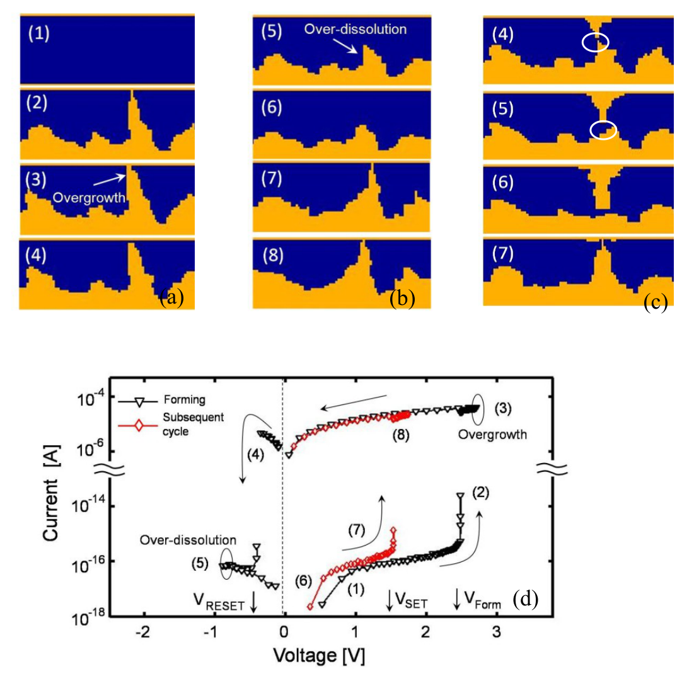
*Figure 2.18: Complete bipolar cycle (1)→(8). **Sweep rate 1 V/s, $R_{ext}$ = 30 kΩ, filament resistivity 5×10⁻⁶ Ω·m**; overgrowth and over-dissolution clearly visible; $V_{SET}\ll V_{Form}$ in subsequent cycles (PDF p72)*

- Region (1) ionic current → sharp turn-on at $V_{Form}$ → ohmic current → finite filament conductivity leaves a drop → **overgrowth** ((2)→(3), widening, decreasing resistance) → sweep back to zero → negative bias dissolves the filament → **rupture at $V_{RESET}$≈0.4 V** → **over-dissolution**.
- **In subsequent cycles $V_{SET}\ll V_{Form}$ because undissolved filament remains.**
- **During overgrowth/dissolution the per-layer voltage distribution is updated every step and serves as the new KMC boundary condition.**

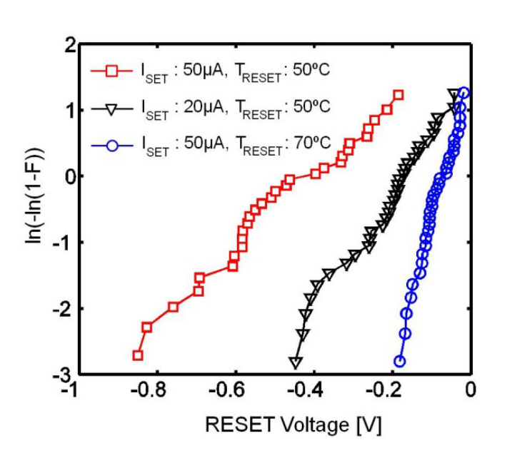
*Figure 2.19: $V_{RESET}$ distribution at different $I_{SET}$ and `RESET` temperature levels (PDF p73)*

- **Larger $I_{SET}$ → larger $V_{RESET}$** (more atoms must be dissolved); **higher T accelerates dissolution → much smaller $V_{RESET}$ with tighter distribution**.
- ⚠️ The chapter's single self-contradiction: §2.3.4 states "The current KMC simulator doesn't have a temperature dependence implemented", yet Fig 2.19 "includes a temperature effect". The consistent reading: **T is an externally supplied parameter entering eq(7)(8)(9) directly — an isothermal sweep, not self-consistent Joule-heating coupling**.

#### (h) Material-parameter sweeps

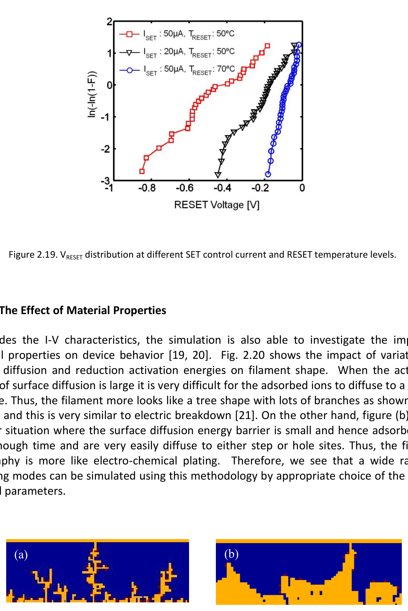
*Figure 2.20: (a) large $E_{surf}$, small $E_{adatom}$ → **dendritic, heavily branched** (resembling fractal dielectric breakdown [21]); (b) small $E_{surf}$, large $E_{adatom}$ → dense, **electroplating-like** (PDF p73)*

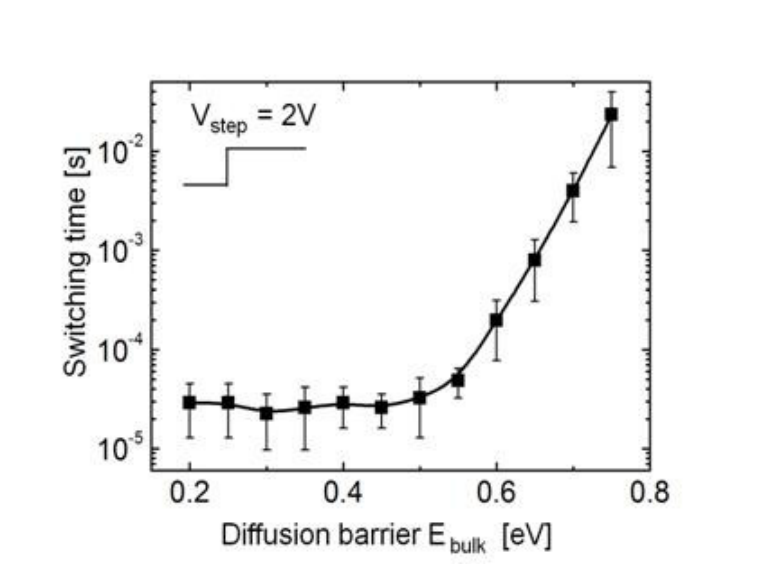
*Figure 2.21: Switching time vs solid-electrolyte diffusion barrier (PDF p74)*

| $E_{bulk}$ | Rate-limiting process | $t_{ON}$ |
|---|---|---|
| **large** | **bulk diffusion** | $t_{ON}\propto\exp(E_{bulk}/k_BT)$, falling rapidly as $E_{bulk}$↓ |
| **further reduced** | **`oxidation` + metal crystallization** | **saturates** |

→ **The most actionable conclusion for materials engineering**: the benefit of raising the ionic mobility of the dielectric is capped, the cap being set by the electrode-reaction $E_a$. **"A wide range of switching modes can be simulated using this methodology by appropriate choice of the system physical parameters."**

### 3.2 Chapter 3 `YSZ` experimental results

**Top-electrode comparison (Structure I, Table I / `./tables/table-i.png`)**:

| Top electrode | Mechanism | $V_{Form}$ | Yield | Endurance | Notes |
|---|---|---|---|---|---|
| **Au** | — | **largest**, very uniform | — | — | **BD field ≈5 MV/cm** (vs 4 MV/cm for epitaxial crystalline YSZ on Si, lower for polycrystalline); **stuck at LRS after forming** |
| **Ni** | — | — | — | — | **no switching at all** |
| **Ti** | **`VO`-type** | reduced, wider spread | **≈60%** | **>10⁴** | interfacial reaction: a thin Ti layer oxidizes → `VO` created in YSZ → dielectric strength weakened; spread from **uncontrolled spontaneous chemistry** |
| **Al** | ECM (metallic) | reduced, wider spread | **<10%** | **<10** | easy to oxidize, hard to precipitate → no stable filament; **large amounts of Al ions trapped in the film → stuck at LRS** |
| **Cu** | **ECM** | **much smaller** | **≈80%** | **≈100** | — |
| **Ag** | ECM | **smallest** | — | — | diffusivity ≫ Cu; **too diffusive → poor voltage control**; very small $V_{RESET}$ → vulnerable to noise/read disturbance; **easily stuck at LRS** |

**Ti/YSZ vs Cu/YSZ**:

| Metric | Ti/YSZ | Cu/YSZ |
|---|---|---|
| **Endurance** (ISPP, $R_{on}$=10 kΩ / $R_{off}$≈100 kΩ) | **almost all devices >10⁴ cycles** (limited only by measurement time) | **best device ≈180 cycles** |
| **$V_{SET}$/$V_{RESET}$ uniformity** | much smaller variation | **very large cycle-to-cycle variation** |
| **Off-state mechanism** | **`SCLC` + electron hopping** | — |
| **On-state mechanism** | **ohmic + electron hopping** | ohmic (metallic) |
| **Electron $E_a$ barrier** | **positively correlated with resistance state**; still ~**0.02 eV** even when $R_{on}$<1 kΩ | **no such barrier found** |
| **Area dependence** | $R_{on}$ independent → **localized filament conduction**; $R_{off}$ ∝ 1/area → **bulk conduction** | — |
| **$R_{off}$ retention** | **stable, 20 kΩ–1 MΩ** | very stable, **typically constant** |
| **$R_{on}$ retention** | stable near 10 kΩ; **very unstable near 1 kΩ** (measured **400 Ω → 3 kΩ in 10⁴ s**) | **very stable below 1 kΩ (opposite to Ti)**; **poor around 20 kΩ** (narrower filament → a small amount of lateral Cu diffusion significantly reduces the effective width) |
| **Noise** | **much lower**, with a **noise-recovery capability** | high, **worsening as resistance increases** (filament narrows) |

**Root cause for Cu/YSZ**: in ECM devices **metal crystallization is the key filament-forming process → the demand on interface quality is extremely stringent**. Supporting evidence [21]: `Pt/NiO/Pt` shows large $V_{SET}$ variation and <200 cycles endurance; adding a thin **IrO₂** layer markedly improves it, and TEM shows **IrO₂ enhances NiO crystallinity at the interface**. A second factor: **organic contamination on the inert-electrode side** [23] blocks crystallization and destabilizes the on-state. The author stresses this is not universal — `Cu/amorphous Ta2O5` reaches ~**10⁴ cycles** in the literature [24]; generally, **`VO`-type RRAM tends to beat ECM in endurance and uniformity**.

**Ti/YSZ $R_{on}$ degradation mechanism**: bulk YSZ is thermally and chemically stable → stable $R_{off}$; but **Y cations bond very strongly to O anions** → `VO` created during `SET` tends to recombine with O²⁻ into a stable phase → $R_{on}$ increases as recombination proceeds; **poor encapsulation accelerates this** (absorbing ambient oxygen/moisture).

### 3.3 Chapter 4 `MLP` and `ISPP` results

- **Cu/YSZ**: abrupt in both `SET` and `RESET`; conductance drops to a minimum that is **the only stable HRS state** → **RESET-side MLP impossible**.
- **Ti/YSZ**: abrupt `SET` but **very smooth `RESET`** (Fig 4.1b); **above a $V_{RESET}$ threshold, $R_{off}$ increases exponentially with applied voltage** (ISPP, **1 µs** pulses, Fig 4.2); **on/off window >10⁴ for fresh devices**.
- **4-level MLP demonstrated** (Fig 4.4): **$R_{on}$ ~8 kΩ plus three distinct high-resistance states up to ~2 MΩ**.
  - ⚠️ The device in Fig 4.4(b) programs successfully for the **first 3000 cycles**, then a **capacitive charging effect** appears → $R_{on}$ (red dots) falls below 1 kΩ → the first $R_{off}$ level (blue) rises and mixes with the second (black). Physical chain: lower $R_{on}$ → **more Joule heat at the same $V_{RESET}$** → weakens **Ti-O bonding at the Ti/YSZ interface** → **excess O²⁻ generated in a very short time** under the field → recombines with `VO` → large resistance increase; the excess heat also helps YSZ overcome the **LRS→HRS phase-transition barrier** → $R_{off}$ rises **abruptly rather than gradually** → programming error. **Conclusion: parasitic capacitance must be minimized for MLP.**
- **Physical criteria for smooth RESET (the chapter's central argument)**:
  1. **A semiconducting / hopping system beats a metallic one** — at a given resistance the filament **cross-section is much larger**, and at the same RESET current the **heat density is smaller**;
  2. **Feedback direction is decisive** — dissolution of more metallic species is **self-accelerating** and, because of its **positive temperature coefficient of resistance**, more sensitive to Joule heating → **weak spots form easily**; for hopping-like systems the same process is **negative feedback** → **weak spots are hard to form**;
  3. **`SEP` as a quantitative predictor**: **Y = −2.37 V, Zr = −1.53 V, Ni = −0.25 V, Cu = +0.34 V** (more positive = easier electron capture) → Y/Zr hard to reduce, Ni/Cu easy → **`CuxO`/`NiO` devices conduct metallically and reset abruptly**.
- **`ISPP` vs single pulse (Fig 4.6a)**: under single-pulse programming **both failure modes appear** — the black curve is a device **stuck at LRS** (extra electrical stress during `SET`), the blue curve one **stuck at HRS** (ineffective $V_{RESET}$); **under ISPP endurance exceeds 10⁴ cycles (red) with neither failure observed**.
- **Window vs endurance trade-off (Fig 4.6b)**: **beyond a window of 3000 some devices survive only 100 cycles; with a window of 10 almost all tested devices exceed 10⁴**.
- **$V_{SET}$–$V_{RESET}$ correlation (Fig 4.5)**: $V_{SET}$ **drops abruptly by ~1 V around 3000 cycles** and $V_{RESET}$ **falls accordingly at the same time** (capacitive charging: smaller $V_{SET}$ → less discharge current → less overgrowth → easier RESET); across a **10⁴-cycle** test the two are **nearly linearly correlated with slope ≈1**; around **5000 cycles** they gradually rise again.
- **Microscopic origin of the $V_{SET}$ drop**: in HRS, extra `VO` may be **thermally generated in the filament–electrode gap**; during `RESET` some tip `VO` **escape annihilation** → residual `VO` lower the local dielectric strength.
- **HRS degradation mechanism**: a large window demands a large $V_{RESET}$ to extract more O²⁻ from the Ti electrode and deliver it to `VO` sites; **this is harmless only while local O²⁻ is sufficient**; when **local O²⁻ deficiency** occurs randomly, delivery saturates and **a larger $V_{RESET}$ instead weakens the dielectric bonding and generates more `VO` (a SET-like process)** → HRS degrades.
- **The one drawback of ISPP: slower programming** → partially alleviated by **increasing the voltage increment between adjacent pulses** (0.3 V or 0.5 V instead of 0.1 V), trading endurance against speed.

### 3.4 Findings the author highlights

- **"there is no fundamental difference"** between metal-cation and `VO`-based RRAM — they are two descriptions of the same set of atomistic processes (repeated in 1.3.4, 4.2, 5.1.3).
- **"KMC cannot generate new physics"** — all physics must be defined before the simulation; **the challenge of atomistic simulation "is often not in developing the algorithm but rather in constructing a meaningful chemical reaction mechanism"** (citing Battaile [3]).
- **"the width of the filament is inversely proportional to the applied voltage"** (at the moment of shorting) — but **immediately reversed by overgrowth**: in the final equilibrium state, larger voltage/current yields a wider filament.
- **"when the device becomes thin enough, the forming process can be effectively eliminated."**
- **"switching speed is limited by oxidization and crystallization"** — the benefit of a more diffusive resistive layer is capped.

## 4. Contributions · Limitations · Future Work

### 4.1 Contributions (framed around the author's claims)

1. **A KMC simulator for ECM `RRAM` is established**, incorporating **most important physical and chemical processes** — `oxidation`, `reduction`, metal crystallization, `adsorption`, `desorption`, ionic transportation — with rates from `transition state theory`, **self-consistently coupled to the `Poisson equation`** (FDM, periodic BC) and with **self potential explicitly excluded**.
2. **Scaling and statistical laws are systematically produced**: the three-regime $t_{Form}$–V law, the logarithmic $V_{Form}$–sweep-rate law, $V_{Form}\propto$ thickness, the logarithmic $V_{Form}$–area law, the $t_{ON}$ `Weibull` distribution, the $R_{on}$–$I_{CC}$ distribution, and the $V_{RESET}$–$I_{SET}$/T relation — **validated by `Ag/Ag2S/W` and `Cu/H2O/Cu` lateral-cell experiments**.
3. **Prediction that the `RESET` rupture location depends on the lateral field** (small lateral field → rupture mid-filament or near the inert electrode; large → near the active electrode), plus demonstration of `filament overgrowth`/over-dissolution and $V_{SET}\ll V_{Form}$.
4. **(Experimental)** Systematic comparison of six top electrodes (Au/Cu/Ni/Al/Ti/Ag) on `YSZ`, establishing mechanism attribution and tracing the `Ti/YSZ` ≫ `Cu/YSZ` gap to interfacial microstructure, with supporting noise analysis.
5. **(Experimental)** A three-part explanation of **smooth RESET** (**hopping conduction + negative feedback + `SEP`**), on which a **4-level `MLP`** `Ti/YSZ` cell is realized; demonstration that **`ISPP` tailors optimum $V_{SET}$/$V_{RESET}$ per device per cycle**, markedly improving endurance/reliability and optimizing the window-vs-lifetime trade-off.

### 4.2 Limitations

**Author-acknowledged**:
- **No temperature dependence / no self-consistent Joule-heating coupling** (justified by "large filament resistance or a large series protecting resistance");
- **2D, out-of-plane field ignored** ("Ideally the simulation should be carried out in 3D");
- **Periodic BC → edge effects ignored**, valid only for large width/thickness aspect ratio;
- **Anode `oxidation` mechanism (c) contradicts the (d) mechanism supported by Willis's experiment**;
- **Chemical $E_a$ from experimental fitting**, not first principles;
- **`RESET` lateral field only a binary approximation**, cathode topography not fully modelled;
- **The 0.5 → 0.05 discrepancy in extracted α is left unexplained** ("Further detailed studies are needed");
- **Roughness correlation length 10 nm is smaller than the real value** (simulation-time limit);
- **Most processes are phenomenological**; `KMC` cannot generate new physics.

**(reviewer's note) Not stated by the author but affecting reproduction**:
- **No explicit lattice type or site spacing**: only "150 atoms per electrode layer, 10 nm insulator" is given. One must infer the grid pitch (if 150 atoms span ~40 nm laterally and 10 nm corresponds to ~30–40 rows, the pitch is ~0.25–0.33 nm, close to the Cu lattice constant — but this is my inference, not stated in the text).
- **No explicit form of the Poisson equation and no dielectric-constant values**: only FDM + periodic BC + self-potential exclusion. How space charge maps onto sites, and how $V_{self,i}$ is computed (analytic subtraction vs solving twice numerically), is unspecified.
- **Not stated whether $\nu_o$ = 10¹³ s⁻¹ is common to all ten processes** (it is only mentioned generically alongside eq (7)).
- **The ionic charge state is never given** (Cu⁺ vs Cu²⁺): the value of q in eq (9) directly scales the field-correction term. Figure 2.5 [14] shows the barrier depends on charge state (0.15–0.2 eV), yet which valence the chosen 0.15 eV corresponds to is unstated.
- **The "stop condition" is never defined**: VSSM step 1 requires choosing it, but the filament-formed criterion (bridging? current exceeding a threshold?) is not given.
- **Filament resistivity differs by 100× between Fig 2.13 and Fig 2.18** (5×10⁻⁸ vs 5×10⁻⁶ Ω·m): the latter is artificially inflated so that enough drop remains across the filament to keep driving chemistry — a modelling device, not a physical value. Using the true metallic value uniformly would markedly weaken overgrowth.
- **$R_{ext}$ differs by 300× between the two cases** (100 Ω vs 30 kΩ) and is bound to the "ignore thermal effects" premise — the two must be adopted as a matched pair.

### 4.3 Future Directions

**The four KMC-related gaps the author lists in 5.2**:
1. ⭐ **Temperature dependence / self-consistent Joule-heating coupling**;
2. ⭐ **3D simulation**;
3. ⭐ **Incorporating the O₂/H₂O-assisted chemical oxidation mechanism (d)** (author's suggested route: reduce the `oxidation` $E_a$);
4. ⭐ **Disentangling the impact of the various physical and chemical processes on the apparent α.**

**Experimental directions**: control and characterization of the `YSZ` interfacial microstructure (IrO₂-style interface engineering), encapsulation effects on retention, minimizing parasitic capacitance for `MLP`, and the still-missing explicit temperature dependence of tunneling current.

**Reproducibility / code and data availability**:
- ❌ **No simulator source code is provided**, and no code or data repository is mentioned (a 2012 dissertation, no supplementary code).
- ✅ However, Chapter 2 is backed by **four companion published papers** that supply further methodological detail; recommended reading order: **[7] Pan, Yin, Subramanian, IEEE EDL 32(7):949-951, 2011** (forming-focused, most detailed) → **[4] Pan, Yin, Subramanian, IMW 2011** → **[19] Pan & Subramanian, SISPAD 2010, pp.19–22** (`SET`-focused) → **[20] Pan & Subramanian, DRC 2010, p.255**.
- ✅ **Upstream methodology references** (needed to reproduce eq (9) and the FDM-KMC coupling): **[1] Voter**'s KMC review; **[2] Jansen** arXiv:cond-mat/0303028 (the four-step VSSM); **[5] Saedi** J. Electroanal. Chem. 588 (2006) 267-284 (**FD-KMC coupling — the closest complete methodology to this work**); **[16] Modak & Lusk** Solid State Ionics 176 (2005) 2181-2191 (**the concrete self-potential exclusion procedure**); **[18] Kaya** SISPAD 2001 (Gaussian autocorrelated roughness generation); **[15] Newman & Thomas-Alyea**, *Electrochemical Systems*, 3rd ed. (BV/Tafel/SEP).

---

## Assets index

Automatically extracted (numbering **strictly follows the paper**: Figure 2.N → `figure-N.png`):

- **Figures**: **21** (all of Chapter 2, Figures 2.1–2.21), in `./figures/figure-1.png` … `./figures/figure-21.png`
  - Extracted directly from embedded bitmaps: figure-1, 5, 6, 7, 8, 9, 10, 11, 12, 13, 14, 15, 16, 17, 18, 19, 20, 21
  - Vector graphics captured as full page regions at 3× resolution: figure-2, 3, 4
- **Tables**: **4** (from Chapters 1 and 3; Chapter 2 has no numbered tables — its parameter table appears as the Figure 2.2 caption), in `./tables/`
- **Equations (an addition beyond the standard skill output)**: **6** high-resolution crops (4×/8×) in `./code/`
  - Rationale: the source equations are assembled from **piecewise brackets and fraction bars drawn in the Symbol font**, which plain-text extraction scrambles. `equation-9.png` is an **8× zoom** used to verify the LaTeX reconstruction in `*.zh-full.md`.
- **manifest.json**: page numbers, captions, pixel dimensions and warnings for every asset

---
*Generated by paper-analyzer skill · English version*
