# 阻性开关用于存储应用的实验与仿真研究 / Experimental and Simulation Study of Resistive Switches for Memory Applications

> 📖 完整翻译版 · 领域：**固态电子器件 / RRAM 忆阻器 / 电化学金属化（ECM）+ Kinetic Monte Carlo 原子尺度仿真**
> 文档类型：**博士学位论文（PhD Dissertation）**，118 页，5 章
>
> **翻译范围说明（按用户指定）**：本文件对 **Abstract + Chapter 2（KMC，全文核心）+ Chapter 5.1.1（KMC 结论）** 做**逐段完整翻译**；
> Chapter 1 / 3 / 4 只做**结构化要点提炼**（含全部关键实验数据），不逐段翻译。三份 `.md` + `figures/` + `tables/` + `code/` 构成完整笔记包。
>
> **保留英文的术语（Step 2 用户确认）**：
> - 器件/机制：`RRAM`, `ECM`, `CBRAM`, `conductive filament (CF)`, `forming`, `SET`, `RESET`, `HRS`, `LRS`, `VForm`, `VSET`, `VRESET`, `Ron`, `Roff`
> - KMC/物理：`Kinetic Monte Carlo (KMC)`, `transition state theory (TST)`, `Variable Step Size Method (VSSM)`, `activation energy (Ea)`, `symmetry factor α`, `Poisson equation`, `Butler-Volmer (BV)`, `Tafel approximation`, `surface overpotential`, `current compliance (CC)`
> - 位点/过程：`adatom`, `step site`, `hole site`, `kink site`, `oxidation`, `reduction`, `adsorption`, `desorption`, `bulk diffusion`, `surface diffusion`, `filament overgrowth`
> - 材料体系：`Ag/Ag2S/W`, `Cu/H2O/Cu`, `Cu/SiO2/Pt`, `Cu/Ta2O5`, `YSZ`, `Ti/YSZ`, `Cu/YSZ`, `Al/YSZ`, `SCLC`
> - 其它：`MLP`, `ISPP`, `Weibull plot`, `DFT`, `MD`, `voltage-time dilemma`, `SEP (standard electrode potential)`, `RTN`, `1/f noise`

---

## 元信息 / Metadata

| 项 | 内容 |
|---|---|
| **作者 / Author** | Feng Pan |
| **机构 / Affiliation** | Electrical Engineering and Computer Sciences, University of California at Berkeley |
| **文档类型 / Type** | PhD Dissertation（Engineering – EECS），同时作为 Technical Report No. **UCB/EECS-2013-38** 发布 |
| **导师 / Chair** | Professor Vivek Subramanian |
| **委员会 / Committee** | Prof. Tsu-Jae King Liu, Prof. Ronald Gronsky, Prof. Sayeef Salahuddin |
| **年份 / Year** | Fall 2012（Technical Report 日期：May 1, 2013） |
| **链接 / Link** | http://www.eecs.berkeley.edu/Pubs/TechRpts/2013/EECS-2013-38.html |
| **PDF** | 118 页，`ref-paper/Experimental and Simulation Study of Resistive Switches for Memory Applications.pdf` |

### 全文结构总览（含 PDF 页码 ↔ 论文页码映射）

> PDF 页码 = 论文页码 + 8（前置页 i–iii + 空白页）。下表用于快速跳转原文。

| 章 | 标题 | PDF 页 | 论文页 | 字符量 | 占比 | 与本笔记相关性 |
|---|---|---|---|---|---|---|
| — | Abstract | 5 | — | 2,760 | 1% | ✅ 全译 |
| Ch 1 | Introduction to Nonvolatile Memory Devices | 9–50 | 1–42 | 90,097 | 39% | ⚠️ 背景综述（FLASH/RRAM），仅提炼 |
| **Ch 2** | **Kinetic Monte Carlo Simulation on Electrochemical Metallization RRAM** | **51–76** | **43–68** | **53,398** | **23%** | ✅✅ **核心，全文逐段译** |
| Ch 3 | Yttria Stabilized Zirconia Based RRAM | 77–102 | 69–94 | 49,760 | 21% | ⚠️ YSZ 实验，仅提炼 |
| Ch 4 | Multi-level Programming and Impact of Programming Methodology on Device Reliability | 103–112 | 95–104 | 21,243 | 9% | ⚠️ MLP/ISPP，仅提炼 |
| Ch 5 | Conclusions and Future Work | 113–118 | 105–110 | 14,034 | 6% | ✅ 5.1.1（KMC 结论）全译 |

### Chapter 2 内部结构（KMC 建模主线）

```
Chapter 2: KMC Simulation on ECM RRAM                        PDF p51–76 / 论文 p43–68
│
├── 2.1 Introduction to Kinetic Monte Carlo Method           p51–54 / 43–46   ← KMC 方法论
│     ├── MD vs KMC：时间尺度问题（MD 限 1 µs，步长 1e-15 s）
│     ├── memoryless 假设 → 一阶过程 → 指数衰减统计
│     ├── eq(1) CDF p_stay(t) = exp(−Γ_i t)
│     ├── eq(2) PDF p_i(t) = Γ_i exp(−Γ_i t)
│     ├── eq(3) Γ_tot = Σ Γ_i        （独立粒子系综）
│     ├── eq(4) CDF p_tot(t) = Γ_tot exp(−Γ_tot t)
│     ├── eq(5) τ = ∫₀^∞ t·p_tot(t)dt = 1/Γ_tot
│     ├── VSSM 算法 4 步（eq(6) Δt = −ln(r)/Γ_tot）
│     ├── eq(7)(8) TST 正/逆向速率 + symmetry factor α ≈ 0.5
│     └── KMC 的局限（Battaile）：不能生成新物理
│
├── 2.2 Establishment of a KMC simulator for ECM RRAM        p55–60 / 47–52   ← ★ 建模核心
│     ├── 2.2.1 Basic Chemical and Physical Processes and Assumptions
│     │     ├── 器件范围界定：只做「绝缘层仅作离子输运介质」型 ECM
│     │     ├── ★ 10 个过程 + Ea 数值表（Figure 2.2 caption，唯一完整参数表）
│     │     ├── Ea 的结构依赖性（adatom / step / hole 位点，Figure 2.3）
│     │     ├── 假设 1：oxidation 机制取 (c) 场助离子注入（Willis 实验实际支持 (d)）
│     │     ├── 假设 2：结晶过程简化 —— 吸附离子始终带电，只有吸附离子可表面扩散
│     │     ├── 假设 3：忽略中性原子扩散；Ea_bulk = 0.15 eV（DFT 给 0.15–0.2 eV）
│     │     └── 假设 4：Ea_oxidation > Ea_reduction（对应 Cu/Ag 大正 SEP）
│     └── 2.2.2 Simulation Procedures
│           ├── ★ 几何：2D，每层电极 150 原子，绝缘层厚 10 nm
│           ├── ★ 边界：Poisson 求解用周期性边界；2D → 忽略面外电场
│           ├── ★ Poisson 用有限差分法（FDM）
│           ├── ★ Figure 2.6 流程图：解 Poisson → 排除 self potential → 更新 Ea → 算速率
│           │    → 更新 t → 选事件 → 更新构型 → 回到解 Poisson
│           └── ★★ eq(9) 电场修正 + self-potential 排除的完整速率公式
│
├── 2.3 Simulation Results and Discussion                    p60–74 / 52–66
│     ├── 2.3.1 Filament Formation Study                     p60–65 / 52–57
│     │     ├── Figure 2.7 形貌 vs 电压（6 档：初始/0.05/0.25/0.35/0.8/2 V）
│     │     ├── Figure 2.8 t_form–V 三个 regime；Figure 2.9 Ag/Ag2S/W + Cu/H2O/Cu 实验验证
│     │     ├── eq(10)(11)(12) BV 方程 → Tafel 近似，解释三段曲线
│     │     ├── 「为什么不能只用 BV」的两条论证（缺输运耦合 / 电荷离散）
│     │     └── Figure 2.10 + eq(13)(14)(15) VForm–扫描率对数律；α 提取值 0.05 vs 设定 0.5
│     ├── 2.3.2 Forming Voltage vs Device Size               p65–67 / 57–59
│     │     ├── Figure 2.11 VForm 线性依赖绝缘层厚度（1 V/s 扫描）
│     │     └── Figure 2.12 Gaussian 自相关表面粗糙度（相关长度 10 nm, rms 1 nm）+ 面积效应
│     ├── 2.3.3 I-V & SET Switching Properties               p67–70 / 59–62
│     │     ├── ★ 电流提取法：计数单位时间内到达阴极的金属离子数 → I = Q/t
│     │     ├── Figure 2.13 I-V 四区域（区域1 面积相关的离子电流；2–4 面积无关的欧姆电流）
│     │     │    参数：扫描率 3 V/s，CF 电阻率 5×10⁻⁸ Ω·m，R_ext = 100 Ω
│     │     ├── Figure 2.14 Forming vs SET 差异 → 初始构型「移除顶部 6 层原子」
│     │     ├── Figure 2.15 t_ON Weibull 分布：2 V 下 99% 需 ≥60 µs；3 V 下仅需 3 µs
│     │     └── Figure 2.16 恒流模式：每步算总电阻 → 更新每层电压；I_CC 越大 Ron 越小越集中
│     ├── 2.3.4 RESET Stage Characteristics                  p70–73 / 62–65
│     │     ├── Figure 2.17 阴极附近横向电场示意（决定断裂位置）
│     │     ├── ★ 横向电场的二值近似（小 → 允许尖端累积；大 → 不允许累积）
│     │     ├── Figure 2.18 完整双极循环 (1)→(8)，含 overgrowth / over-dissolution
│     │     │    参数：扫描率 1 V/s，R_ext = 30 kΩ，CF 电阻率 5×10⁻⁶ Ω·m，VRESET ≈ 0.4 V
│     │     └── Figure 2.19 VRESET vs I_SET 与温度 T（本节引入了温度依赖）
│     └── 2.3.5 The Effect of Material Properties            p73–74 / 65–66
│           ├── Figure 2.20 E_surf 大 → 树枝状（类电击穿分形）；E_surf 小 → 类电镀致密
│           └── Figure 2.21 E_bulk 大 → t_ON 指数依赖；E_bulk 小 → 被 oxidation/结晶限速而饱和
│
├── 2.4 Summary                                              p74 / 66
└── 2.5 References                                           p75–76 / 67–68   [21] 条
```

---

## 摘要 / Abstract

近年来，阻性随机存取存储器（resistive random access memory, `RRAM`）作为下一代存储应用最有希望的候选者之一，已获得显著关注。这归因于它相对于 Flash 技术在**高密度、低功耗以及快速读写速度**方面的预期优势。这类器件的主要工作机制是由**金属阳离子**或**氧空位**形成 `conductive filament`（导电细丝）所诱导的电阻变化。

在本工作的**第一部分**，我们构建了一个 `Kinetic Monte Carlo`（`KMC`）仿真器，用于研究电化学金属化（electrochemical metallization, `ECM`）`RRAM` 中的细丝形成过程。该仿真器考虑了绝大多数重要的物理与化学过程，例如 `oxidation`、`reduction`、金属结晶（metal crystallization）、`adsorption`、`desorption` 以及离子输运（ionic transportation）。我们研究了 `forming` 电压、`forming` 时间与开关速度的特性。此外，我们还给出了关于细丝过度生长（filament overgrowth）以及 on-state 电阻分布的研究。进一步地，我们研究了在不同器件工作条件下对器件特性有强烈影响的**细丝形貌（filament topography）**。该仿真器还预测：取决于横向电场的强度，`conductive filament` 在 `RESET` 过程中可以在**不同位置**发生断裂。仿真结果由在 `Ag/Ag2S/W` 和 `Cu/H2O/Cu` 体系上开展的实验加以验证。

在本工作的**第二部分**，我们系统研究了基于非晶晶化氧化钇稳定氧化锆（amorphous Yttria stabilized Zirconia, `YSZ`）的 `RRAM` 存储器件。我们考察了 Au、Cu、Ni、Al、Ti 等不同顶电极的影响，并详细研究了 `Ti/YSZ` 与 `Cu/YSZ` 的特性和机理。研究发现 `Ti/YSZ` 在 endurance、retention 和可靠性方面都**远优于** `Cu/YSZ`，我们探究了驱动这一行为的底层物理。此外还发现，`Ti/YSZ` 在 `RESET` 阶段具有**非常平滑的转变**，且 off state 电阻随 erase 电压的增大呈**指数增长**。基于这些特性，我们实现了一个展现出良好 endurance 的多级编程（multi-level programming, `MLP`）单元。我们研究了使 `Ti/YSZ` 得以实现 `MLP` 的底层物理。最后我们表明，增量步进脉冲编程（incremental step pulse programming, `ISPP`）技术能够显著提升器件的 endurance 与可靠性；此外，它还能优化电阻编程窗口（resistance programming window）与器件寿命之间的折中。

> **摘要的两段式结构 = 全文两大部分**：第一部分（Ch 2）是 **KMC 仿真**，第二部分（Ch 3+4）是 **YSZ 实验**。这两部分在原文里**没有直接的模型–实验对应关系** —— Ch 2 的 KMC 验证用的是 `Ag/Ag2S/W` 和 `Cu/H2O/Cu` 横向器件，而 Ch 3/4 的 YSZ 实验是独立的纵向器件研究。

---

## Chapter 1（要点提炼，未逐段翻译）/ Introduction to Nonvolatile Memory Devices

> 📍 PDF p9–50 / 论文 p1–42。**本章为纯背景综述，不含原创工作**，占全文 39% 篇幅。以下提炼 Chapter 2 建模所直接依赖的概念。

### 1.1–1.2 存储背景与 FLASH 的 scaling 局限（p9–23）

- Flash 的 floating gate 机制：隧穿注入/抽出电荷改变阈值电压。NAND 高密度、NOR 支持随机读（对比见 `./tables/table-1-2.png`）。
- Scaling 极限：浮栅电荷数随尺寸缩小而减少 → retention 与 program 窗口恶化；隧穿氧化层无法继续减薄。
- **这是全文的动机起点**：需要一种不依赖电荷存储、而依赖**局部导电通路**的非易失机制。

### 1.3 RRAM 分类 —— Chapter 2 建模对象的定位（p24–39）

**两大类的判据不是材料，而是「谁更易扩散 / 谁主导导电通路」**：

| 类型 | 载流子 | LRS 通路本质 | 典型体系 |
|---|---|---|---|
| `ECM`（金属阳离子型，= `CBRAM`） | 金属阳离子比 O²⁻ 更易扩散，或更易析出 | **金属性** conductive filament | `Cu/SiO2/Pt`, `Cu/Ta2O5/Pt`, `Pt/NiO/Pt`, `Ag/Ag2Se/Pt` |
| `VO`（氧空位型） | O²⁻ 比金属阳离子更易扩散 | VO 构成的 **trap** → 电子 hopping / percolation | `Ti/HfO2/TiN`, `Pt/TiO2/Pt` |

**ECM 再按阳离子来源分三组**（这一分类决定了 KMC 要不要模拟「电解质自带离子」）：

1. 阳离子**仅来自电极**：`Cu/SiO2/Pt`、`Cu/Ta2O5/Pt` —— SiO₂ 只作**离子输运介质**
2. 阳离子**仅来自阻变层**：`Pt/NiO/Pt` —— Ni 来自 NiO 层自身
3. **两者皆可**：`Ag/Ag2Se/Pt`、`Ag/Ag2S/Pt` —— Ag₂Se 本身是含大量 Ag⁺ 的**电解质**

> ⭐ **Chapter 2 的 KMC 只针对第 1 类**（绝缘层仅作输运介质）。作者论证：两类器件的物理过程几乎相同，故结论可迁移。

**ECM 的 I-V 机制（Cu/SiO2/Pt，Figure 1.15）**：
- `SET`：正电压加在 Cu 电极 → Cu 氧化成 Cu⁺/Cu²⁺ → 电场驱动穿过 SiO₂ → 在 Pt 阴极积累并**结晶** → 细丝桥接两电极 → HRS→LRS。过程中施加 `current compliance (CC)` 以避免过大电流产生 Joule 热损伤细丝。
- `RESET`：反压 → 细丝氧化溶解 → Cu 离子迁回 Cu 电极析出 → 通路断开 → LRS→HRS。
- **双极性（bipolar）**：VSET 正、VRESET 负 → 二者裕度大 → 可靠性好。
- **经验规律：`IRESET ≈ ISET`**，对绝大多数双极性器件成立，与化学成分和开关机制无关（Cu/SiO2/Pt 中约 250 nA）。

**RESET 的热正反馈机制（Russo，Figure 1.17，Pt/NiO/Pt）**：介质热导率差 → 细丝中段温度更高 → 溶解速率更大 → 细丝变细、电阻升高 → 改变电压/电流分布 → **正反馈** → 最终断裂，`RESET` 呈现突变。
> ⚠️ 这条正反馈链在 Chapter 2 的 KMC 里**被显式忽略**（无温度依赖），只在 Figure 2.19 的 VRESET–温度扫描中以参数形式引入。

**通用规律：`VSET < VForm`** —— 后续循环只有部分细丝断裂，故重新导通所需电压小于初次 forming。

### 1.3.3.3 电压分布：bulk transport limited vs crystallization limited（p32–33, Figure 1.20）

这是 Chapter 2 里「大部分压降落在哪」这一建模选择的前提：

| regime | 压降主要位置 | 代表体系 | 厚度 scaling 行为 |
|---|---|---|---|
| **bulk transport limited** | 介质层内部 | `Cu/SiO2/Pt` | 厚度显著增大（µm 级）时几乎无法开关 |
| **crystallization limited** | 电极/介质界面（电荷转移处） | `Ag/Ag2S/Pt` | 介质极厚（mm 级以上）仍能直接观察到金属化 |

### 1.3.4 VO 型 RRAM 的两种导电机制（p33–39）

- **VO 作 n 型掺杂**（中等带隙：`TiO2`, `Ta2O5`）：VO↑ → 电子浓度↑ → Fermi 能级与导带间距↓ → TiO₂₋ₓ 区域成为 **virtual electrode** → 隧穿势垒变薄 → HRS→LRS。
- **VO 作 trap**（宽带隙：`HfO2`, `ZrO2`）：**Ion-Transport-Recombination 模型** —— LRS 是 VO 链的 percolation + 电子 hopping；电极充当**氧库（oxygen reservoir）**，SET 时吸附 O²⁻、RESET 时释放 O²⁻ 与 VO 复合。Ti 和 TiN 都是良好的 O²⁻ 储库。
- **1.3.4 节的核心论点（贯穿全文）**：`ECM` 与 `VO` 型在**原子过程层面没有本质区别**，只是对同一组物理化学过程的两种描述方式 → 统一理论存在的可能性。这一点在 Chapter 4 的 MLP 物理解释中被直接调用。

### 1.4 性能与 scaling（p40–46）

- RRAM 性能汇总见 `./tables/table-1-3.png`（Table 1.3, RRAM performance）。
- `MLP` 的两条路线（Chapter 4 的问题起点）：
  1. **SET 阶段调 CC** → 受**电容放电效应（capacitive discharge）** 困扰，Ron 波动大；1T1R 可消除但大幅降低阵列密度；二极管型 selector 仍有此问题。另有 **history dependent Ron instability**（Figure 1.31）：CC 从 100 µA→200 µA 时 Ron 2 kΩ→500 Ω 符合预期，但 CC 调回 100 µA 后，随循环进行 Ron 会**自发趋向 500 Ω** → 严重编程错误。
  2. **RESET 阶段调电压** → 无电容放电问题，电压控制、易实现，但**要求 RESET 段 I-V 足够平滑**，使 Roff 随电压渐进上升 → 这正是 Chapter 4 选择 `Ti/YSZ` 的原因。
- Roff 的 scaling 取决于残余细丝形貌：若残余细丝（metal rich region / virtual electrode）在整个氧化层中均匀分布 → Roff 随面积缩小而增大；若存在单一主导细丝 → Roff 与器件尺寸无关。

### 1.5 This Work（p46）

论文明确的两部分划分：第一部分 = ECM 型 RRAM 的 KMC 仿真研究（Ch 2）；第二部分 = ECM 与 VO 型 RRAM 的实验工作，材料为 `YSZ`（Ch 3），外加改善均匀性/可靠性/endurance 的编程方法学（Ch 4）。

---

## Chapter 2: 电化学金属化 RRAM 的 Kinetic Monte Carlo 仿真 / Kinetic Monte Carlo Simulation on Electrochemical Metallization RRAM

> 📍 PDF p51–76 / 论文 p43–68 · **本章为全文核心，逐段完整翻译**
> 配套图表：`./figures/figure-1.png` ~ `./figures/figure-21.png`（Figure 2.1 ~ 2.21）
> 配套公式图（4×/8× 高清裁剪，用于核对下文 LaTeX 重构）：`./code/equation-1-5.png`、`equation-6-vssm.png`、`equation-7-8.png`、`equation-9.png`（**8×**）、`equation-10-12.png`、`equation-13-15.png`

`RRAM` 的本质特征在于其**随机性（randomness）**。对于基于阴离子的电化学金属化（electrochemical metallization, `ECM`）`RRAM`，器件工作涉及化学反应与物理扩散，二者在原子尺度上都是随机的。而对于氧空位（`VO`）型 `RRAM`，还额外包含随机 trap 的产生。所有这些都导致 `conductive filament` 的随机生成与湮灭，并直接影响 `RRAM` 的特性。在各种仿真工具中，`Kinetic Monte Carlo`（`KMC`）可以是一种有效的手段：它既能有效捕捉 `RRAM` 器件的随机本质，同时又不需要耗费过多的计算能力与时间。

本章研究 `ECM` `RRAM` 的基本物理与化学过程。首先简要介绍 `KMC` 仿真技术；接着建立一个 `KMC` 仿真器，用于模拟典型 `ECM` `RRAM` 中金属细丝的形成过程，并讨论 `KMC` 中所涉及的全部化学与物理过程；随后研究 `forming` 电压、`forming` 时间以及所谓的 **"`voltage-time dilemma`（电压–时间困境）"** 的特性。此外，我们还研究了在不同器件工作条件下对器件特性有强烈影响的**细丝形貌（filament topographies）**；进一步给出了关于细丝过度生长（filament overgrowth）与 on-state 电阻的研究。最后，仿真结果由实验加以验证。

### 2.1 Kinetic Monte Carlo 方法简介 / Introduction to Kinetic Monte Carlo Method

要理解一个电子材料体系的微观动力学，通常有两大技术：其一是分子动力学（molecular dynamics, `MD`），其二是 `Kinetic Monte Carlo`（`KMC`）。`MD` 仿真是对经典运动方程做**数值化的、逐步的**求解 [1]。因此，需要在每一个时间步上计算作用在每个粒子上的力。这些力一般由系统的势能获得，而原子间势必须事先选定。一旦势函数与系统的初始条件确定，整个系统就会随时间自然演化。

然而，`MD` 的一个问题是**时间尺度限制**。为了捕捉原子运动的细节，时间步长必须足够短（10⁻¹⁵ s）以描述原子的振动。因此，其可仿真时间被限制在 **1 µs** [1]。另一方面，如果我们感兴趣的系统时间演化远长于此，`MD` 就变得不可行了。而 `KMC` 能够成功克服这一时间尺度限制。`KMC` 与 `MD` 的主要区别之一在于：`KMC` 并不关注小时间步内的原子振动，而**只关注那些真正能把系统迁移到新状态的关键过程**。例如考虑一个原子扩散问题：原子可以在位置 A 停留相当长的时间，然后才跳跃到新位置 B。在这段时间间隔内，原子只是待在位置 A 并围绕它做热振动，**没有任何有意思的事情发生**。因此，如果用 `MD` 来仿真这个过程，大量时间会被浪费在仅仅描述原子绕 A 点的振动上。而采用 `KMC`，我们可以忽略这段无聊的部分，只关注真正的跃迁过程，即原子从位置 A 跳到位置 B。这样，`KMC` 就允许我们仿真时间尺度长得多的物理过程。

此外，所考虑的绝大多数系统都是**无记忆的（memoryless）**。这意味着一旦粒子进入状态 i，它并不记得自己来自哪个状态。对于满足下述条件的物理系统，这一规则成立：粒子从状态 m 跃迁到状态 n 所花的时间，远短于它停留在状态 n 的时间。因此，在每一个很短的时间增量内，它找到逃逸路径的概率与上一个时间增量内的概率相同。这就产生了一个具有**指数衰减统计**的一阶过程 [1]。粒子在时刻 t 仍停留在同一状态的概率为 [1]：

$$p_{stay,i}(t) = \exp\left(-\Gamma_i t\right) \tag{1}$$

其中 $\Gamma_i$ 是第 i 个粒子的跃迁速率（transition rate）。式 (1) 是累积分布函数（CDF）。由上式可以容易地得到概率密度分布函数（PDF），即 CDF 对时间的导数：

$$p_i(t) = \Gamma_i \exp\left(-\Gamma_i t\right) \tag{2}$$

真实的物理系统往往是大量粒子构成的系综。在多数情况下，可以假设它们彼此独立。根据概率论，若各粒子的跃迁速率为 $\Gamma_1, \Gamma_2, \Gamma_3 \dots \Gamma_n$ 且相互独立，则**下一个事件发生的概率同样服从指数分布，其跃迁速率等于所有粒子各自跃迁速率之和** [1]：

$$\Gamma_{tot} = \sum_i \Gamma_i \tag{3}$$

类似地，下一个事件发生时刻的 CDF 服从指数分布，可描述为：

$$p_{tot}(t) = \Gamma_{tot}\exp\left(-\Gamma_{tot} t\right) \tag{4}$$

平均跃迁时间为 [1]：

$$\tau = \int_0^{\infty} t\, p_{tot}(t)\, dt = \frac{1}{\Gamma_{tot}} \tag{5}$$

实现 `KMC` 的一种常用算法是所谓的**可变步长法（Variable Step Size Methods, `VSSM`）** [2]。它简单而高效。一般流程如下 [2]：

> #### 可变步长法（Variable Step Size Method）
>
> **1. 初始化（Initialize）**
> - 生成一个初始构型（initial configuration）
> - 把时间 t 设为初始值
> - 选定何时停止推进仿真的条件
>
> **2. 更新系统时间（Update the system time）**
> - 生成一个在此期间不发生任何跃迁的时间间隔 Δt：
>   $$\Delta t = -\frac{\ln r}{\Gamma_{tot}} \tag{6}$$
>   其中 r 是在单位区间上均匀分布的随机数。
> - 更新系统时间 t = t + Δt
>
> **3. 更新系统构型（Update system configuration）**
> - 以 $\Gamma_i/\Gamma_{tot}$ 的概率选择一个跃迁，并更新系统构型
>
> **4. 继续（Continuation）**
> - 若停止条件已满足，则停止；否则回到步骤 2

由上述描述可见，一次 `KMC` 仿真需要关于系统内**所有化学与物理过程的跃迁速率**的定量信息。这些速率是成功实现 `KMC` 仿真的关键。

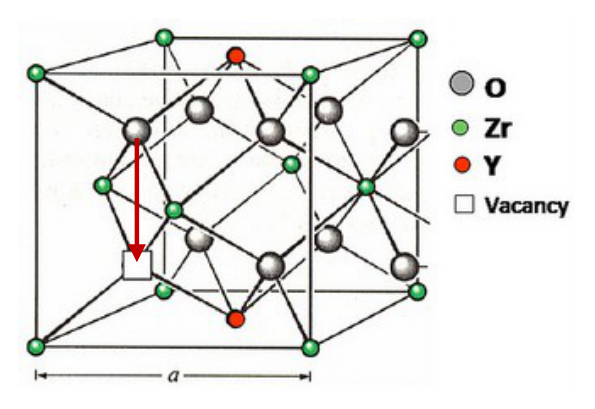
*Figure 2.1: 状态 S1 与 S2 之间跃迁的能量图（原文：The energy diagram for a transition between states S1 and S2）*

跃迁速率常常由**过渡态理论（transition state theory, `TST`）** 获得；在该理论中，一个反应被视为相邻两个局部能量极小值之间的跃迁 [3]。如 Figure 2.1 [4] 所示，实线表示**无外电场**时的状态图，而虚线表示系统两端**存在外电场**时的状态图。我们先考虑无电场的情况。处于状态 S1 的粒子可以被热激发，克服 activation energy 势垒 $E_A$ 而到达状态 S2，这被视为**正向跃迁（forward transition）**。类似地，若粒子位于状态 S2，它也有机会到达状态 S1；但此时逆向 activation energy 势垒 $E_B$ 显然**大于** $E_A$。$E_A$ 与 $E_B$ 之差就是状态 S1 与 S2 之间的能量差。这种情况下，相比正向跃迁，逆向跃迁是不被青睐的。

若假定 Boltzmann 统计支配这些化学与物理过程，则正向跃迁速率可写为 [5, 6]：

$$\Gamma_f = \nu_o \exp\left(-\frac{E_A}{k_B T}\right) \tag{7}$$

其中 $\Gamma_f$ 是正向跃迁速率，$\nu_o$ 是**频率因子（frequency factor）**，可以粗略地假定为原子振动频率，约等于 **10¹³ s⁻¹**。$k_B$ 是 Boltzmann 常数，T 是绝对温度。类似地，逆向跃迁速率可表示为：

$$\Gamma_r = \nu_o \exp\left(-\frac{E_B}{k_B T}\right) \tag{8}$$

如虚线所示，**存在电场时所有的 activation energy 值都必须被修正**。电场既可以来自离子空间电荷分布，也可以来自外部电压源。正向和逆向跃迁的 $E_a$ 必须分别被修正 $\alpha q\Delta V$ 和 $(1-\alpha)q\Delta V$，其中 $\Delta V$ 是两个状态之间的电势变化。注意 α 是 **`symmetry factor`（对称因子）**，它描述势垒平台相对于两个终态的位置，**典型值为 0.5**。因此，只要存在电场，activation energy 与跃迁速率就必须被修正。

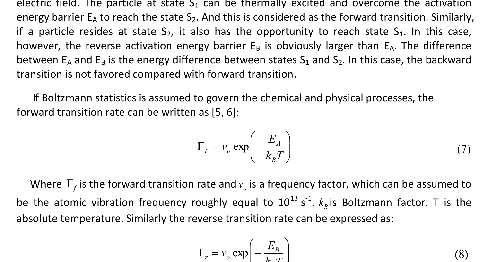
*式 (7)(8) 原文 4× 裁剪（`./code/equation-7-8.png`, PDF p54），用于核对上方 LaTeX 重构*

上述描述简要过了一遍 `KMC` 的基本原理。尽管 `KMC` 实现起来很直接，但它存在 Battaile [3] 指出的若干**局限**。作者指出：

1. 即使用最精密的量子力学方法，也**很难准确获得化学与物理的速率参数**。因此任何机制都必然至多是近似的。
2. **几乎不可能事先知道所有的反应**（哪怕只是重要的那些）。因此，任何反应机制都是真实化学的一个受限且简化的版本。

换句话说，**`KMC` 不能生成新的物理，所有物理都必须在仿真之前定义好**。因此作者指出，原子尺度系统仿真的挑战往往**不在于开发算法，而在于构建一个有意义的化学反应机制**。

> 🔑 **这一条局限是全章的方法论基调**：后文 2.2.1 中所有 $E_a$ 数值都不是第一性原理算出来的，而是**由实验拟合**得到的（见 p58 段末："Typically, those activation energies are modeled by experimental fitting."）。

### 2.2 为 ECM RRAM 建立一个 KMC 仿真器 / Establishment of a KMC simulator for ECM RRAM

#### 2.2.1 基本化学与物理过程及假设 / Basic Chemical and Physical Processes and Assumptions

如前一章所讨论，一个典型的 `ECM` `RRAM` 由一层**电化学活性金属**作为阳极、一层**绝缘层**、以及一层**惰性金属**作为阴极构成。绝缘层既可以直接充当**电解质（electrolyte）**——即它本身含有高浓度的阳极型金属离子，因而能对细丝形成过程有贡献（例如 `Ag/Ag2S/Pt` [7] 和 `Ag/Ag2Se/Au` [8] 体系）——也可以仅仅充当被氧化的阳极离子从阳极迁移到阴极的**输运层（transportation layer）**（例如 `Cu/SiO2/Pt` [9] 和 `Cu/Ta2O5/Pt` [10] 体系）。

**本章讨论的仿真器聚焦于上述第二类 `ECM` `RRAM`**，即绝缘层只作为被氧化阳极离子的输运介质。这样一来，复杂的电解质结构就可以被忽略。不过正如将要展示的，由于两类器件的物理过程几乎完全相同，仿真结果对两类器件都适用。

`KMC` 仿真所包含的各种物理与化学过程如 Figure 2.2 所示。阳极与阴极两处的 `oxidation`/`reduction` 反应都被包含在内；此外还包含**离子表面扩散（ion surface diffusion）、`desorption` 与 `adsorption`** 过程。最后，假设电解质是**各向同性**且**电子电导为零**的，这意味着体相离子扩散的 $E_a$ 在各个方向上相同，且没有电子电流穿过电解质。

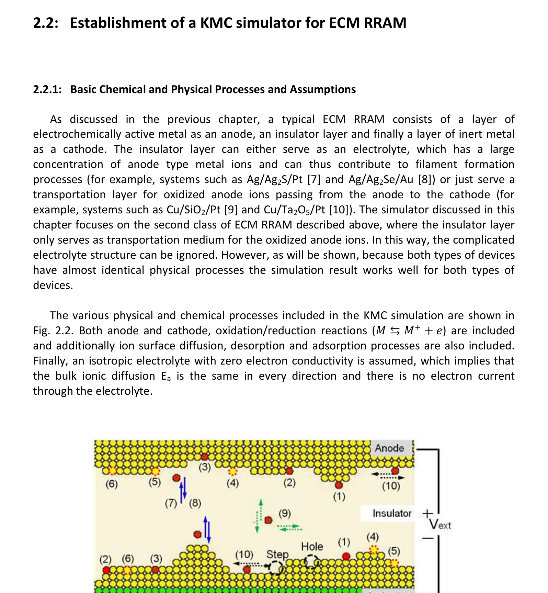
*Figure 2.2: `KMC` 仿真所包含的过程。`oxidation` 发生于 (1) `adatom` 位点（0.65 eV）、(2) `step site`（0.7 eV）、(3) `hole site`（0.75 eV）；`reduction` 发生于 (4) `adatom` 位点（0.35 eV）、(5) `step site`（0.3 eV）、(6) `hole site`（0.25 eV）；(7) `adsorption`（0.15 eV）；(8) `desorption`（0.3 eV）；(9) `bulk diffusion`（0.15 eV）；(10) `surface diffusion`（0.2 eV）。
（原文：Processes included in the KMC simulation. Oxidation at (1) adatom site (0.65 ev), (2) step site (0.7 ev), (3) hole site (0.75ev). Reduction at (4) adatom site (0.35 ev), (5) step site (0.3 ev), (6) hole site (0.25 ev). (7) adsorption (0.15 ev). (8) desorption (0.3 ev). (9) bulk diffusion (0.15 ev). (10) surface diffusion (0.2 ev).）*

> #### ⭐ 表 A：Figure 2.2 完整 activation energy 参数表（本仿真器唯一的完整参数清单）
>
> | # | 过程 | 位点 | $E_a$ (eV) | 发生位置 |
> |---|---|---|---|---|
> | (1) | `oxidation` | `adatom` site | **0.65** | 阳极表面 |
> | (2) | `oxidation` | `step site` | **0.70** | 阳极表面 |
> | (3) | `oxidation` | `hole site` | **0.75** | 阳极表面 |
> | (4) | `reduction` | `adatom` site | **0.35** | 阴极表面 |
> | (5) | `reduction` | `step site` | **0.30** | 阴极表面 |
> | (6) | `reduction` | `hole site` | **0.25** | 阴极表面 |
> | (7) | `adsorption` | — | **0.15** | 阴极表面 |
> | (8) | `desorption` | — | **0.30** | 阳极表面 |
> | (9) | `bulk diffusion` | — | **0.15** | 绝缘层体内 |
> | (10) | `surface diffusion` | — | **0.20** | 电极表面 |
>
> **由该表可读出的三条设计意图**（正文 p56、p58 明确说明）：
> 1. **`reduction` 的 $E_a$ 随位点配位数升高而降低**：adatom 0.35 → step 0.30 → hole 0.25。即离子**更倾向于在 step 或 hole 位点被还原**，因为那里更稳定 → 这是产生「低压下各向同性致密沉积」的微观根源。
> 2. **`oxidation` 的 $E_a$ 随位点配位数升高而升高**：adatom 0.65 → step 0.70 → hole 0.75，趋势与 `reduction` **相反**。
> 3. **`oxidation` 的 $E_a$（0.65–0.75）系统性大于 `reduction` 的 $E_a$（0.25–0.35）**：这代表 Cu、Ag 这类具有**大的正 standard electrode potential (SEP)** 的金属 —— 它们更容易捕获电子而析出，但更难被氧化。

如 Figure 2.2 所示，当一个阳离子被 `adsorption` 到阴极表面后，它可以被还原形成一个 `adatom`；它也可以通过 `surface diffusion` 到达 `step site` 或 `hole site`。各种过程的 activation energy（$E_a$）是**结构依赖的（structure dependent）** [5]。如 Figure 2.3 所示，例如在 `adatom` 位点被还原的离子，其 $E_a$ 大于在 `step site` 或 `hole site` 被还原时的值。因此，**离子更容易在 step 或 hole 位点被还原**。

在继续之前，重要的是陈述本仿真器所做的假设。事实上，**`KMC` 中绝大多数化学与物理过程都是唯象的（phenomenological）**，这意味着这些过程是对真实系统的近似。这样做有几个原因：

- 第一，多数化学过程极其复杂，可能涉及多重反应与电荷转移过程，把计算资源花在这种细节过程上是不切实际的。
- 第二，如上所述，即使用最先进的第一性原理仿真器，仍有许多基本过程人们尚未理解，而对另一些过程也只能给出非常粗略的定性描述。

尽管存在这些局限，仍然**有可能捕捉问题的本质，并对整个细丝形成过程做出令人满意的仿真**。在接下来的几段中，将描述一些基本的假设与近似。

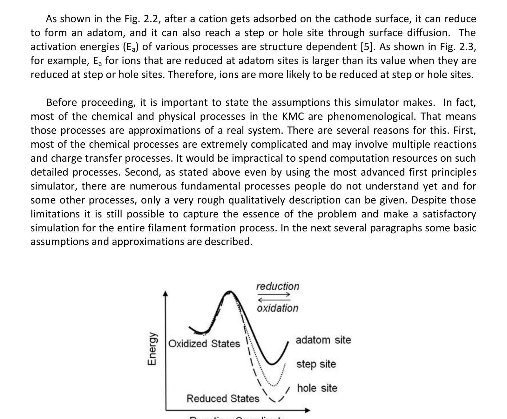
*Figure 2.3: activation energy 的结构依赖性（原文：Structural dependency of activation energy）*

**【假设 1：阳极 oxidation 机制的选取】** 首先要考虑的是金属（如 Cu）在金属–介质界面（如 `Cu/SiO2` 界面）处的 `oxidation` 过程。这个看起来相对简单的问题**至今仍没有被很好理解**。B.G. Willis [11] 做了一个出色的实验，试图澄清铜在 SiO₂ 内部的输运机制。他总结出四种可能的机制，如 Figure 2.4 所示：

- **(a)** 从电极向介质的**热扩散（thermal diffusion）**
- **(b)** 铜通过**还原 SiO₂** 而被氧化，随后离子在电场下输运
- **(c)** 铜原子在电场下失去电子变成离子，随后这些离子**在电场帮助下被注入**介质
- **(d)** 通过环境气体（如 H₂O 和 O₂）或通过介质**放气（out-gassing）** 在界面发生铜的**"化学氧化"**，随后离子在电偏压下输运

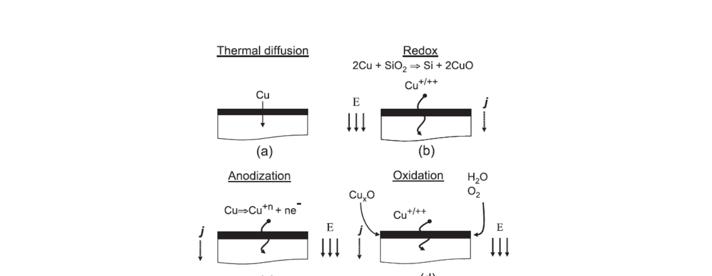
*Figure 2.4: 铜注入 SiO₂ 的四种可能途径 [11]（原文：Four possible ways of copper injection into SiO2 [11]）*

他的结论是：与早先的结果相反，**他没有发现铜直接从电极扩散的证据，但发现了来自"已被氧化的铜电极"的铜扩散的清晰信号**。这意味着**只有过程 (c) 和 (d) 是可能的**。通过进一步研究，Willis 声称：在温度低于 **450–500 °C** 且电场 **< 1 MV/cm** 的条件下，铜输运中**只有机制 (d) 是活跃的**。换句话说，该化学反应必须由 O₂ 或 H₂O 辅助，而它们来自周围环境或来自介质的放气。

> ⚠️ **本 `KMC` 仿真中采用过程 (c)**，以降低系统的复杂性。不过，通过为 `oxidation` 指派一个**更小的 $E_a$** 来使氧化过程更容易发生，就有可能把 O₂ 和 H₂O 的作用考虑进来。

**【假设 2：结晶过程的简化】** 此外，对**结晶（crystallization）** 过程做了近似。事实上，真实的结晶过程远比本 `KMC` 仿真器所用的模型复杂。典型地，当一个离子被 `adsorption` 到表面后，它可能有几种选择：

1. 它可以**完成电荷转移过程**而变成一个 `adatom`；该 `adatom` 可以进一步扩散到 `kink site` 或 `step site`。
2. 在第二种情形中，离子被吸附后可能**只完成部分电荷转移**而变成一个 **adion**；该 adion 随后扩散到 `kink site` 或 `step site`，在那里获得剩余电荷，最终变成中性原子并入晶体。

在当前的 `KMC` 仿真器中，通过**假设所有被吸附到电极上的离子仍然带电**来简化问题，并且**只允许被吸附的离子在表面上扩散**。这一做法一方面简化了问题；另一方面，它并没有失去结晶过程的普适性，因为它仍然保证了 **`kink site` 和 `step site` 相对于 `adatom` 位点是稳定位点**。

**【假设 3：化学反应 $E_a$ 的来源】** 最后必须指出，与化学反应相关的各种 $E_a$ 值是**难以获得的**。正如 Bronshtein [12] 指出的，确定这些值的理论困难在于几个因素：

- 第一，反应物通常与金属电极**强耦合**；
- 第二，反应路径**关键地依赖于界面结构**；
- 第三，反应速率依赖于溶剂（此处为固体电解质）的**动力学**。

上述所有效应都使得电荷转移过程对理论建模构成挑战。**通常，这些 activation energy 是通过实验拟合来建模的。**

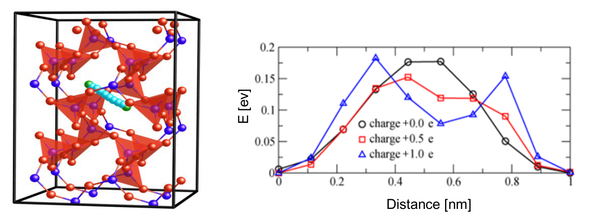
*Figure 2.5: (a) Cu 穿过 a-cristobalite 相 SiO₂ 扩散的仿真晶胞结构；(b) 携带不同电荷的 Cu 元素的扩散能垒 [14]（原文：(a) Simulated cell structure for Cu diffusion through a-cristobalite phase SiO2 (b) Diffusion energy barriers for Cu element carrying different charges [14].）*

与单个化学反应不同，**体相扩散（bulk diffusion）过程通常可以被很好地描述**，因为其中不涉及电荷转移过程。尽管如此，由于密度泛函理论（`DFT`）的固有局限 [13]，仿真得到的势垒高度通常**低于真实值**。M. Zelený [14] 做了一个 ab initio 仿真来确定铜穿过 a-cristobalite 相 SiO₂ 的扩散势垒，仿真结构与结果如 Figure 2.5 所示。**仿真得到的扩散势垒在 0.15 eV 到 0.2 eV 之间**，取决于 Cu 元素所携带的电荷。

> ⭐ **本仿真器的三条体相扩散设定**（p58 段末，建模时直接可用）：
> 1. **忽略中性原子的扩散** —— 因为在存在外电场时，它们的扩散速率远低于离子的速率。
> 2. **离子扩散势垒设为 0.15 eV** —— 这既可以模拟一个具有小扩散势垒的绝缘层，也可以代表器件经过若干循环工作后形成的**快速离子通道（fast ion paths）**，即势垒被降低的情形 [7]。
> 3. **`oxidation` 的 $E_a$ 取比 `reduction` 更大的值** —— 这代表 Cu、Ag 这类具有大正 `SEP` [15] 的金属：它们更容易捕获电子而析出，但更难被氧化。

#### 2.2.2 仿真流程 / Simulation Procedures

理想情况下仿真应该在 **3D** 中进行。遗憾的是，这会消耗过多的计算资源和时间。因此这里**只考虑 2D**。在仿真中，如 Figure 2.2 所示，**每一层电极由 150 个原子组成，绝缘层厚度为 10 nm**。

在求解 `Poisson equation` 时施加**周期性边界条件（periodic boundary condition）**，因此**边缘效应被忽略**。当器件的**宽厚比（width over thickness aspect ratio）较大**时，这是一个很好的近似。此外，由于仿真在 2D 中进行，**面外电场（out-of-plane electric field）被忽略**。`Poisson equation` 用**有限差分法（finite difference method, FDM）** 求解。

> #### ⭐ 表 B：仿真器几何与数值设置（p58–59 汇总）
>
> | 项 | 取值 | 说明 |
> |---|---|---|
> | 维度 | **2D** | 3D 计算量过大；忽略面外电场 |
> | 每层电极原子数 | **150** | — |
> | 绝缘层厚度 | **10 nm** | — |
> | 边界条件 | **周期性**（求解 Poisson 时） | 忽略边缘效应，要求宽厚比大 |
> | Poisson 求解方法 | **有限差分（FDM）** | 每一步 KMC 事件后重新求解 |
> | 频率因子 $\nu_o$ | **10¹³ s⁻¹** | 近似为原子振动频率 |
> | `symmetry factor` α | **0.5** | 描述势垒平台位置 |
> | self potential | **显式排除** [16] | 离子自身产生的电势不帮助降低它自己的 $E_a$ |
> | 电解质电子电导 | **0** | 无电子电流穿过电解质 |
> | 电解质离子扩散 | **各向同性** | 体相 $E_a$ 各方向相同 |

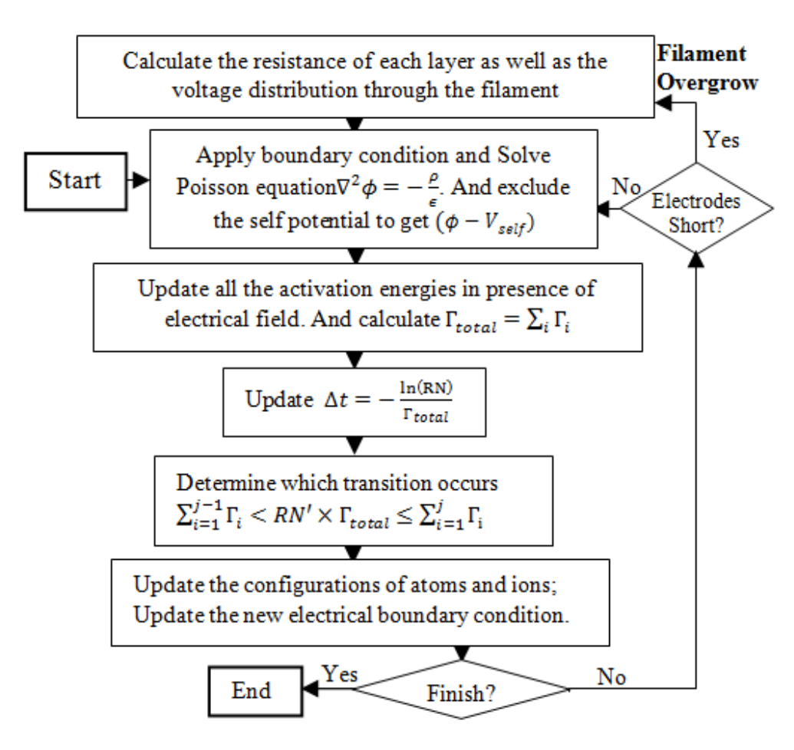
*Figure 2.6: `KMC` 仿真流程图。RN 与 RN' 是均匀分布于 [0, 1] 的随机数（原文：The flowchart of the KMC simulation process. RN and RN' are random numbers uniformly distributed between [0 1]）*

仿真流程图见 Figure 2.6。**从初始构型开始，先求解 `Poisson equation`；之后排除 self potential** [16]。self potential 是离子自身产生的电势，**该电势并不帮助降低它自己的 $E_a$**。在获得电势信息后，就可以更新存在电场时的 activation energy，并基于下式计算**各个体的与总的**跃迁速率：

$$\sum_i \Gamma_i = \sum_i \nu_o \exp\left(-\frac{qE_{a,i}}{k_B T}\right)\exp\left(\frac{q\left(V_{initial,i} - V_{final,i}\right)}{2k_B T}\right)\exp\left(-\frac{qV_{self,i}}{2k_B T}\right) \tag{9}$$

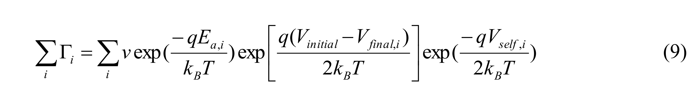
*★ 式 (9) 原文 8× 高清裁剪（`./code/equation-9.png`, PDF p60）—— **这是整个仿真器最核心的公式**，务必与上图逐符号核对*

> #### ⭐⭐ 式 (9) 的结构与三个因子逐项解读（建模时最重要的一个公式）
>
> **首先注意等式两侧都有求和号 $\sum_i$** —— 这与正文"both **individual and total** transition rates can be calculated"直接对应：
> - **左侧 $\sum_i\Gamma_i$ 就是式 (3) 的 $\Gamma_{tot}$**，它是式 (6) 中 $\Delta t=-\ln r/\Gamma_{tot}$ 所需的量；
> - **去掉右侧求和号后的被加项就是单个事件的速率 $\Gamma_i$**，它是 VSSM 步骤 3 中选择事件所需概率 $\Gamma_i/\Gamma_{tot}$ 的分子。
>
> **即式 (9) 一次给出了「个体速率」与「总速率」两个量，这正是 VSSM 一步所需的全部信息。**
>
> | 因子 | 表达式 | 物理含义 | 对应前文哪条假设 |
> |---|---|---|---|
> | ① 热激活项 | $\nu_o\exp\!\left(-\dfrac{qE_{a,i}}{k_BT}\right)$ | 无场时的 `TST` 速率，即式 (7) | $E_{a,i}$ 取自**表 A** 的 10 个过程值；$\nu_o=10^{13}$ s⁻¹ |
> | ② 电场修正项 | $\exp\!\left(\dfrac{q(V_{initial,i}-V_{final,i})}{2k_BT}\right)$ | 势垒被电场降低 → 速率提升。分母中的 **2 来自 $\alpha=0.5$**（即 $2k_BT$ 等价于 $k_BT/\alpha$） | 2.1 节末："正/逆向 $E_a$ 分别修正 $\alpha q\Delta V$ 与 $(1-\alpha)q\Delta V$" |
> | ③ self potential 排除项 | $\exp\!\left(-\dfrac{qV_{self,i}}{2k_BT}\right)$ | 减去离子自身电荷对 $V_{initial,i}$ 的虚假贡献 —— 该贡献**不会**真正降低它自己的势垒 [16] | 2.2.2 节："After that the self potential is excluded" |
>
> **符号说明**：$q$ 为元电荷；$E_{a,i}$ 为第 i 个过程的 activation energy（原文以 eV 给出，故乘 $q$ 换算为能量）；$V_{initial,i}$、$V_{final,i}$ 为该过程初态与末态格点的静电势（由 Poisson 求解得到）；$V_{self,i}$ 为第 i 个离子自身产生的电势；分母中统一出现 $2k_BT$ 是 $\alpha=0.5$ 的直接结果。**求和下标 i 遍历当前构型下所有允许的事件**（每个可跃迁粒子 × 每个可跃迁方向）。
>
> **②③ 两项同号/异号的作用**：若不排除 self potential，因子 ② 中的 $(V_{initial}-V_{final})$ 会被离子自身电势抬高，从而**虚假地加速**该离子自己的跃迁；因子 ③ 恰好抵消这一部分。
>
> ⚠️ **(reviewer's note)** 原文 PDF 中式 (9) 由 Symbol 字体的分段括号与分数线图像拼合而成，纯文本抽取会丢失结构。上式是按**字符坐标逐项重构**的，核对依据：
> - **两个求和号**：Symbol 字体码点 `U+F0E5`（大型显示样式 ∑，字号 18.2）在**整个 Chapter 2 中只出现 2 次，都在本页式 (9)**，分别位于 x=160.3（左侧）与 x=196.3（右侧），且各自的下标 i 位于 y=99.3（**在 ∑ 的竖直中心之下 → 下限位置**）；而式 (3) 的求和号用的是另一个码点 `U+F053`（行内 Σ，字号 12.1），全章仅出现 1 次 —— 二者不会混淆。
> - **三条分数线**（矢量绘图，y=91.1）：x∈[239.2,272.0] 对应 $qE_{a,i}/k_BT$；x∈[300.9,378.3] 对应 $q(V_{initial,i}-V_{final,i})/2k_BT$；x∈[407.2,447.3] 对应 $qV_{self,i}/2k_BT$。
> - 已用 8× 裁剪图 `./code/equation-9.png` 交叉核对。**在你自己实现前，建议再对照该 PNG 确认一次符号。**

接下来，根据式 (6) 更新系统时间 t；然后通过生成**第二个随机数**来选择一个具体的跃迁。一旦选定某个过程，就更新所有原子与离子的构型。随后**必须重新求解 `Poisson equation`**，整个仿真过程如此继续。

> #### ⭐ 表 C：KMC 主循环伪代码（由 Figure 2.6 流程图 + 式 (6)(9) 整理）
>
> ```
> 初始化：电极各 150 原子/层，绝缘层 10 nm，t = 0，构型 = pristine
>
> while 未达停止条件:
>     1. 求解 Poisson equation（FDM，周期性边界）
>          → 得到每个格点电势 V(i,j)
>     2. 排除 self potential：V_corrected = V − V_self   [ref 16]
>     3. 枚举当前构型下所有可能的跃迁事件 i
>          对每个事件按 式(9) 计算 Γ_i：
>            Γ_i = ν₀·exp(−qE_{a,i}/k_BT)
>                  ·exp(+q(V_{initial,i} − V_{final,i})/2k_BT)
>                  ·exp(−qV_{self,i}/2k_BT)
>          E_{a,i} 由「过程类型 × 位点类型」查表 A 决定
>          （式(9) 右侧去掉 Σ 后的被加项 = 单个事件的 Γ_i）
>     4. Γ_tot = Σ Γ_i   ← 即式(9) 的左侧                  式(3)
>     5. Δt = −ln(RN) / Γ_tot ;  t ← t + Δt               式(6)
>     6. 以概率 Γ_i/Γ_tot 选中事件 i（用第二个随机数 RN'）  VSSM 步骤 3
>     7. 执行事件 i：更新所有原子/离子构型
>     8. 若处于 overgrowth/RESET 阶段：更新细丝每一层的电压分布，
>        作为下一步 KMC 的新边界条件
>     → 回到 1
>
> 电流提取：I = (单位时间内到达阴极的金属离子数 × q) / 时间间隔
> ```

### 2.3 仿真结果与讨论 / Simulation Results and Discussion

#### 2.3.1 细丝形成研究 / Filament Formation Study

尽管 `forming` 过程在器件工作中只执行一次，但**细丝形成过程的仿真对于理解存储单元的基本物理至关重要**。事实上，后续的 `SET` 过程几乎可以被视为与 `forming` 过程相同。`SET` 与 `forming` 过程之间唯一的区别是**有效阻变层厚度**（如前一章所述）。因此，从 `forming` 过程仿真中得出的所有结论都可以直接应用于 `SET` 过程。

此外，某些仿真结果，例如**电压–时间关系**和**细丝形貌**，可以直接与实验结果对比，以验证仿真器的正确性。

本节首先用 `KMC` 仿真器预测 `forming` 时间与外加电压之间的关系及其对应的细丝形貌。**`forming` 时间的定义是：从 pristine 状态形成一条金属细丝所需的时间**。换言之，它是器件工作第一个循环中把存储单元从 `HRS` 带到 `LRS` 所需的时间。

Figure 2.7 展示了在不同电压水平下获得的细丝形貌。Figure 2.8 展示了形成这些细丝所需的时间，其插图给出了文献报道的 `Cu/SiO2` 器件实验结果 [17]。

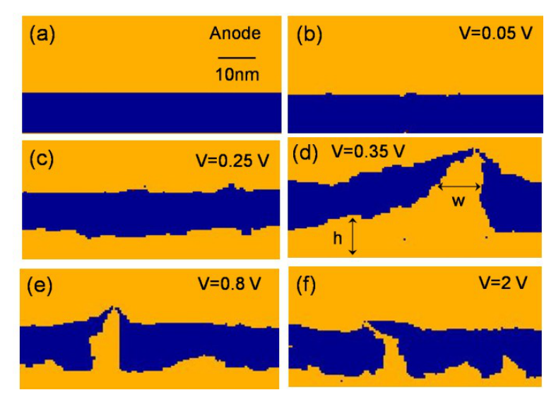
*Figure 2.7: 在不同电压水平下获得的细丝形貌。(a) 初始状态；(b) V=0.05 V；(c) V=0.25 V；(d) V=0.35 V；(e) V=0.8 V；(f) V=2 V。(d) 中带 'h' 和 'w' 标签的箭头分别表示各向同性沉积的厚度与细丝的平均宽度 [4, 7]（原文：Filament topographies obtained at different voltage levels. (a) initial state. (b) V=0.05 V. (c) V=0.25 V. (d) V=0.35 V. (e) V=0.8 V. (f) V=2 V. The arrows in (d) with labels 'h' and 'w' indicate the thickness of isotropic deposition and the average width of the filament respectively [4, 7].）*

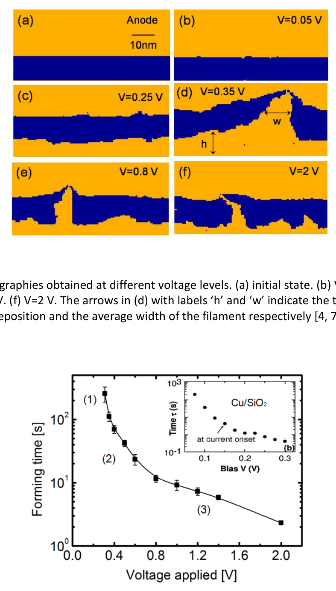
*Figure 2.8: `forming` 时间与外加电压之间的关系 [4, 7]；插图为 `Cu/SiO2` 上的实验结果 [17]（原文：The relationship between forming time and applied voltage [4, 7]. The inset shows the experimental results on Cu/SiO2 [17].）*

如 Figure 2.8 所示的仿真结果所表明的，I-V 特性中存在一个**阈值电压（Vt）**：

- **对于远低于 Vt 的输入电压**，几乎不可能在阴极上得到任何沉积，如 Figure 2.7 (b) 所示。这是因为当电压极小时，阳极原子要**先被氧化、再从阳极脱附（且不被还原回去）、最后在阴极被还原（且不被重新氧化）**是非常困难的。
- **当电压在 Vt 附近时**，观察到**各向同性沉积（isotropic deposition）**（Figure 2.7 (c)），且阳极与阴极之间的距离基本保持不变。因此在这一阶段仍然不可能形成细丝。
- **当电压略高于 Vt 时**，细丝最终形成。在这一偏压条件下，细丝的宽度 'w' 很大，如 Figure 2.7 (d) 所示。
- **当电压进一步升高时**，细丝宽度**显著减小**，如 Figure 2.7 (e) 和 (f) 所示。

这些结果可以如下解释：当电压较小时，阴极侧被吸附的阳离子倾向于**扩散到更稳定的 `step site` 和 `hole site` 并在那里被还原**，而不是在 `adatom` 位点被还原，因此沉积是**各向同性**的；这样，阳极与阴极之间就没有有效的间隙收缩。而较大的电压使 **`adatom` 的形成更容易**，因此细丝生长更快（Figure 2.8），且其宽度减小。

为证实这些观察，我们在用 `Cu/H2O` 和 `Ag/Ag2S` 构建的**横向器件（lateral cells）** 上进行了实验 [4, 7]。事实上，`Cu/H2O` 与我们的仿真系统非常相似，因为 **H₂O 不提供任何阳离子，只作为阳离子的输运介质**。Figure 2.9 显示实验与仿真预测相符：电压小时得到很宽的细丝；电压大时则出现窄得多的图案。

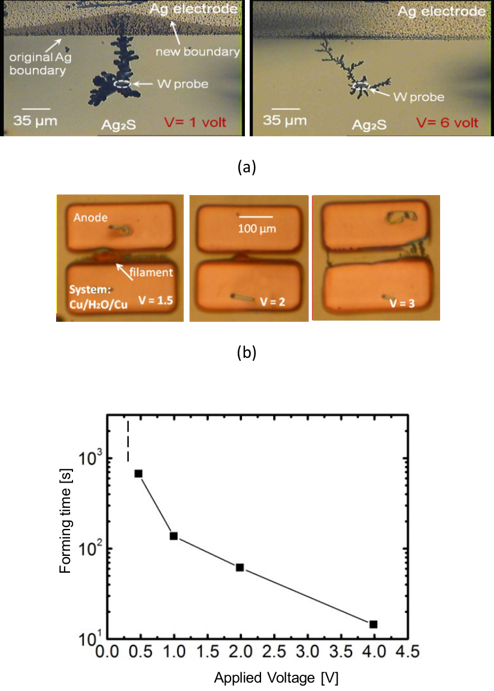
*Figure 2.9: 不同电压水平下的细丝形貌，(a) `Ag/Ag2S/W`、(b) `Cu/H2O/Cu`；(c) 在 `Ag/Ag2S/W` 体系中获得的 `forming` 时间 vs 外加电压的实验结果 [4]（原文：Filament topographies at different Voltages levels for (a) Ag/Ag2S/W and (b) Cu/H2O/Cu. (c) The experimental results of forming time vs applied voltage obtained in Ag/Ag2S/W system [4].）*

Figure 2.8 表明，`forming` 时间 $t_{Form}$ 总体上随电压升高而减小。此外我们在图中观察到**三个区域（three regimes）**。这条曲线的形状是前述各种化学与物理过程**竞争**的结果，并取决于各个 activation energy —— 而它们本身是**材料依赖**的性质。不过，其总体趋势可以借助 `Butler-Volmer` 方程（`BV`）[15] 粗略解释：

$$i = i_0\left[\exp\left(\frac{\alpha nq\eta_s}{k_B T}\right) - \exp\left(-\frac{(1-\alpha)nq\eta_s}{k_B T}\right)\right] \tag{10}$$

$$\eta_s = V - U \tag{11}$$

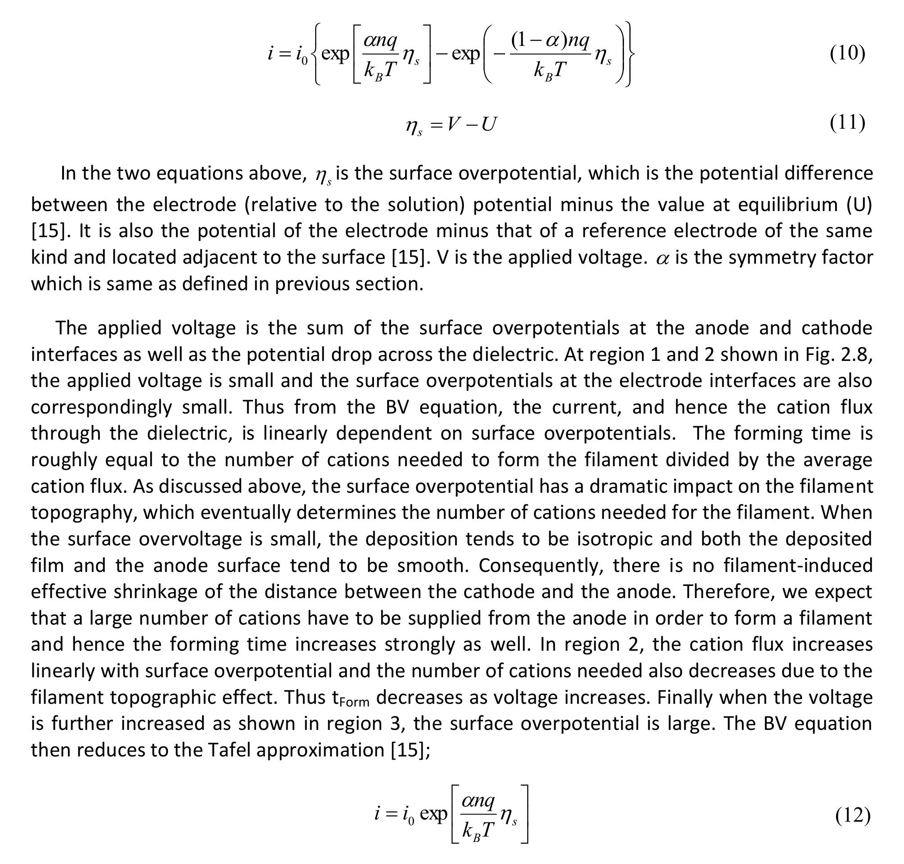
*式 (10)(11)(12) 原文 4× 裁剪（`./code/equation-10-12.png`, PDF p63）*

> ⚠️ **(reviewer's note)** 式 (10) 在原文中是**竖排大括号 + 分段括号图像**的排版（Symbol 字体码点 0xEC/0xED/0xEE 与 0xFC/0xFD/0xFE 拼出外层方括号，0xE9/0xEA/0xEB 与 0xF9/0xFA/0xFB 拼出 `exp` 后的括号），纯文本抽取会严重错位。上式是**按字符 x/y 坐标逐符号重构**的，核对依据：两条分数线（矢量绘图）分别位于 y=250.0、x∈[256.2,276.6] 与 x∈[338.2,383.3]；第一条上方为 α(0x61, x=255.2)、n(x=263.7)、q(x=269.7)、η(0x68, x=276.4)，下方为 k(x=257.2)、B(x=263.3)、T(x=267.7)；第二条上方为 (1−α)nq，下方为 $k_BT$。**式 (10)(11) 在本章中仅用于定性解释趋势，不是仿真器的实际计算路径** —— 仿真器用的是式 (9)。请以 `./code/equation-10-12.png` 为准做最终核对。

在上述两式中，$\eta_s$ 是 **surface overpotential（表面过电位）**，即电极（相对于溶液）电势减去平衡时的值 (U) [15]；它也是电极电势减去位于表面附近的同类参考电极的电势 [15]。V 是外加电压，$\alpha$ 是 `symmetry factor`，与前一节定义相同。

**外加电压等于阳极与阴极界面处 surface overpotential 之和，加上跨越介质的电势降落。** 在 Figure 2.8 所示的**区域 1 和区域 2**，外加电压小，电极界面处的 surface overpotential 也相应地小。因此由 `BV` 方程，电流（以及穿过介质的阳离子通量）**线性依赖于 surface overpotential**。`forming` 时间粗略等于**形成细丝所需的阳离子数除以平均阳离子通量**。如上所讨论，surface overpotential 对细丝形貌有剧烈影响，而形貌最终决定了形成细丝所需的阳离子数。当 surface overpotential 小时，沉积趋于各向同性，沉积膜与阳极表面都趋于平滑；因此**不存在细丝诱导的阴极–阳极间距离的有效收缩**，我们预期必须从阳极供应**大量**阳离子才能形成细丝，故 `forming` 时间也强烈增加。在**区域 2**，阳离子通量随 surface overpotential 线性增加，同时由于细丝形貌效应所需阳离子数也在减少，因此 $t_{Form}$ 随电压升高而减小。最后，当电压进一步升高（**区域 3**），surface overpotential 很大，`BV` 方程退化为 **`Tafel approximation`** [15]：

$$i = i_0 \exp\left(\frac{\alpha n q \eta_s}{k_B T}\right) \tag{12}$$

此时阳离子通量**指数依赖**于 surface overpotential。此外，在大的 surface overpotential 下，被吸附的阳离子可以容易地在 `adatom` 位点结晶，因此**形成细丝所需的阳离子数只起次要作用**。所以，我们预期在区域 3 中 $t_{Form}$ 与外加电压之间呈指数关系。

> #### ⭐ 表 D：$t_{Form}$–V 三段曲线的机制归属（Figure 2.8）
>
> | 区域 | 电压范围 | 主导机制 | 阳离子通量 | 所需阳离子数 | 形貌特征 | $t_{Form}$ 行为 |
> |---|---|---|---|---|---|---|
> | **1** | $V \lesssim V_t$ | 氧化/脱附/还原三步串联难以完成 | 极低 | 极大（无间隙收缩） | **各向同性沉积**，无细丝（Fig 2.7c） | 几乎不导通 |
> | **2** | 略高于 $V_t$ | `BV` 线性区 | **线性** ∝ $\eta_s$ | 因形貌效应而减小 | 宽细丝（'w' 大，Fig 2.7d） | 随 V 升高而下降（双重作用） |
> | **3** | 大电压 | **`Tafel approximation`** | **指数** ∝ $\exp(\alpha nq\eta_s/k_BT)$ | 次要（`adatom` 易结晶） | 窄细丝（Fig 2.7e,f） | **指数**下降 |

通过上述讨论，看起来 `BV` 方程单独就能描述整个过程，那么这似乎意味着**没有必要实现 `KMC` 仿真**。事实上，`BV` 方程本身**不能完全描述整个系统**，原因如下 [7]：

1. **`BV` 方程只处理电极与介质界面之间的电荷转移**，不包含沉积金属表面上以及介质层内部的离子输运过程。因此，必须把其他输运方程（例如描述阳离子如何穿过介质层和金属表面的 **drift-diffusion 方程**）与 `BV` 方程耦合。整个问题是**时间与位置的函数**。
2. 在这样一个纳米器件中，**电荷分布是离散的**。因此像连续变化的电荷浓度函数这类物理量变得含糊不清。而使用 `KMC`，这种含糊性可以被轻松解决。

接下来，探索 `forming` 电压与**电压扫描率**之间的关系。仿真结果见 Figure 2.10 [7]。该图上有几个特征：

- 第一，无论扫描率多小，都应存在如前所述的**阈值电压 Vt**。这可以从图中看出：随着电压扫描率不断减小，$V_{Form}$ 趋近一个常数。
- 第二，当电压扫描率略微增加时，可以看到 `forming` 电压也略微增加。
- 第三，当电压扫描率很大时，$V_{Form}$ **对数依赖**于电压扫描率。

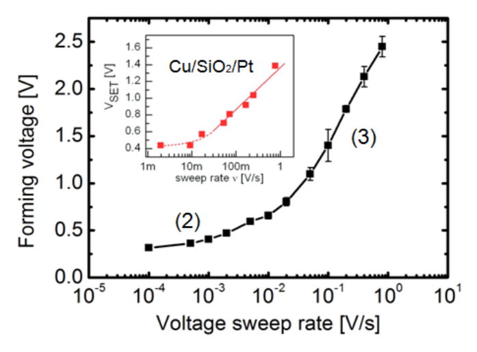
*Figure 2.10: 仿真的 $V_{Form}$ vs 电压扫描率 [4, 7]；插图为 `Cu/SiO2/Pt` 体系的实验结果 [9]（原文：Simulated VForm vs voltage sweep rate [4 ,7]. The inset shows the experimental results on Cu/SiO2/Pt system [9]）*

值得注意的是，C. Schindler [9] 给出了一个描述 $V_{Form}$ 与电压扫描率之间对数关系的数学模型。Schindler **假设外加电压近似等于 surface overpotential**，即假设阳极处的 `oxidation` 和介质层内部的离子输运**都不是限速过程**。`forming` 阶段所需的总电荷 $Q_{Form}$ 可进一步表示为：

$$Q_{FORM} = \int_0^{V_{Form}} \frac{I_f}{v}dV = \int_0^{V_{Form}} \frac{i\,\pi r_f^2}{v} dV \tag{13}$$

其中 $I_f$ 是流过器件的总电流，i 是电流密度，v 是电压扫描率且等于

$$v = \frac{dV}{dt} \tag{14}$$

此外，当外加电压较大时假定 `Tafel approximation` 成立。把式 (12) 与式 (13) 联立，可得到下述关系：

$$V_{Form} = \frac{kT}{\alpha n q}\ln v + \frac{kT}{\alpha n q}\ln\frac{\alpha n q Q_{Form}}{kT\, i_0\, \pi r_f^2} \tag{15}$$

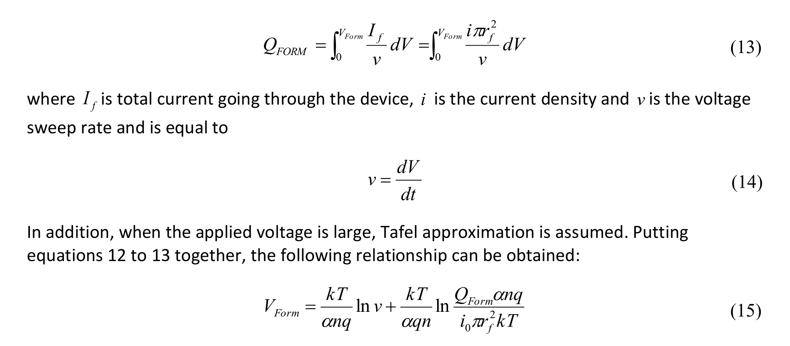
*式 (13)(14)(15) 原文 4× 裁剪（`./code/equation-13-15.png`, PDF p65）*

该式给出了 `forming` 电压与电压扫描率之间的对数关系。基于 `Cu/SiO2/Pt` 的实验结果，**提取出的 $\alpha$ 约为 0.1** [9]，这**显著小于**具有液体电解质的电化学系统的 $\alpha \approx 0.5$。此外，从 `KMC` 仿真结果看，**即使 $\alpha$ 被有意设为 0.5，从仿真结果提取出的 $\alpha$ 也只有约 0.05**。这些显著差异表明 **`Butler-Volmer` 方程单独不能准确描述整个系统**。此外，在 Schindler 的方法中，假定**全部电压都降落在发生结晶过程的阴极/SiO₂ 界面上**；这个假设也值得商榷，因为**介质内部的离子输运过程和阳极侧的 `oxidation` 过程也可能是限速因素**。需要进一步的详细研究来找出各种物理化学过程对 $\alpha$ 的影响。

> #### ⭐ 表 E：$\alpha$ 提取值的三方对比（p65，这是全章最有说服力的「KMC 必要性」证据）
>
> | 来源 | $\alpha$ | 备注 |
> |---|---|---|
> | 液体电解质电化学系统的理论典型值 | **≈ 0.5** | 仿真器**有意设定**为 0.5 |
> | `Cu/SiO2/Pt` 实验提取 [9] | **≈ 0.1** | 显著偏离 0.5 |
> | **KMC 仿真结果提取** | **≈ 0.05** | 尽管输入 $\alpha=0.5$ |
>
> **推论**：宏观 `BV`/Tafel 公式把整个系统压缩成单一 $\alpha$，而真实系统中**限速步骤会随电压漂移**（区域 1→2→3 依次是「氧化+脱附串联」→「界面电荷转移」→「体相输运/结晶」），因此拟合出的表观 $\alpha$ 远小于任何单一过程的微观 $\alpha$。这正是「连续介质电化学公式无法替代原子尺度 KMC」的定量证据。

#### 2.3.2 Forming 电压与器件尺寸的关系 / Relationship Between Forming Voltage and Device Size

本节研究 $V_{Form}$ 与器件尺寸之间的关系。研究器件尺寸对 $V_{Form}$ 影响的主要目的是研究 `RRAM` 器件的 **scaling 特性**。Scaling 既包括阻变层厚度的减小，也包括器件面积的减小。从仿真可以表明，**当器件足够薄时，`forming` 过程可以被有效消除**，这是一个非常理想的特性。此外，它还可以通过与实验结果对比来验证仿真器。

首先仿真具有不同介质厚度的器件，如 Figure 2.11 所示。在此仿真中，电压上升速率为 **1 V/s**。可以看到，**$V_{Form}$ 线性依赖于绝缘层厚度**。插图给出了在 `Cu/SiO2/Pt` 体系中所做实验的结果 [9]，实验结果与仿真吻合良好。这表明该系统是**纯电场依赖**的：只要电场恒定，具有不同介质厚度的系统就会有相同的行为。

这种线性关系的原因可解释如下：如 Figure 2.1 所示，初态与末态之间的**有效电压降落**是**两态之间平均电场**与**两态之间有效距离**的乘积。通常，对于给定系统在各种偏压条件下，初态与末态之间的有效距离是相同的。以离子体相扩散为例，金属离子每次大致**只跳过一个晶格常数的距离**，除非电场强到使离子一次穿过多个位点。因此在多数情况下，**只要电场保持恒定，跨越初末态的总电压降落（从而跃迁速率的变化）就是相同的**。由于电场与膜厚成反比，**`forming` 电压因此线性依赖于膜厚**。

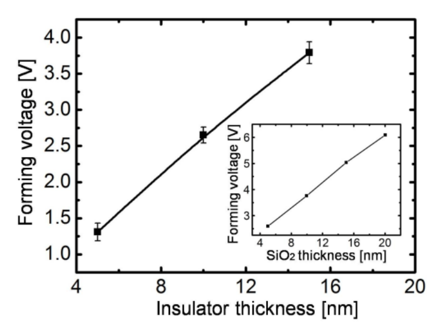
*Figure 2.11: 仿真的 $V_{Form}$ vs 绝缘层厚度。扫描率为 1 V/s。插图为 `Cu/SiO2/Pt` 体系的实验结果 [9]（原文：Simulated VForm vs. insulator layer thickness. The sweep rate is 1V/s. Inset shows experimental result for Cu/SiO2/Pt system [9].）*

接下来研究 $V_{Form}$ 与**器件面积**的关系。此外，仿真中还包含了**阴极表面粗糙度效应**，这是基于**自相关函数法（autocorrelation function method）** [18] 实现的。如 Figure 2.12 (a) 所示，仿真中使用 **Gaussian 自相关**来生成表面粗糙度轮廓：**相关长度为 10 nm，均方根（rms）值设为 1 nm**。仿真得到的表面粗糙度图案如 Figure 2.12 (b) 中绿色区域所示。

如预期，**在两电极之间有效距离最短的位置更容易形成细丝**，因为这些位置的**有效电场最强**。仿真结果与实验结果（Figure 2.12 (c)）[10] 都表明：**$V_{form}$ 在器件尺寸小时趋近一个常数，并随尺寸增大而逐渐减小**。

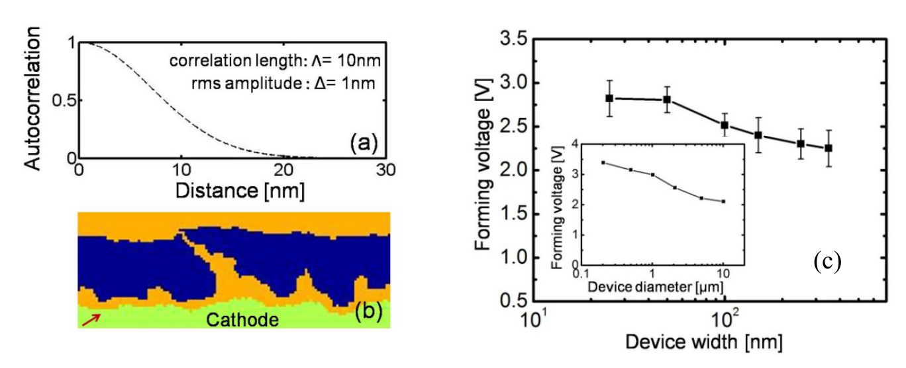
*Figure 2.12: (a) 用于表面粗糙度仿真的 Gaussian 自相关。由于仿真时间限制，相关长度为 10 nm，小于真实值。(b) 仿真图案，箭头表示阴极表面粗糙度。(c) 仿真的 `forming` 电压 vs 器件宽度，以及 `Cu/Ta2O5/Pt` 体系的实验结果 [10]（插图）（原文：(a) The Gaussian autocorrelation used for surface roughness simulation. Due to simulation time limitation, the correlation length is 10nm, which is smaller than the real value. (b) Simulated pattern. The arrow shows the cathode surface roughness. (c) Simulated forming voltage vs. device width and experimental result [10] for Cu/Ta2O5/Pt system (inset).）*

#### 2.3.3 I-V 特性与 SET 开关特性 / I-V Characteristics and SET Switching Properties

在细丝形貌、电压–时间关系和器件尺寸研究之后，本节主要关注 **I-V 特性与 `SET` 开关统计**。如本章开头所讨论，由于 `RRAM` 的随机本质，`KMC` 可以成为一种有效手段，在不消耗过多计算资源的情况下捕捉 `RRAM` 器件的随机特征。本节展示了 `KMC` 的优点：如将要展示的，**它自然地产生描述器件动态行为的统计分布**；此外，通过**计数到达电极一侧的电荷**，可以提取 I-V 关系 —— 而 I-V 行为是 `RRAM` 器件最重要的特性之一，因此也可以由 `KMC` 获得。

本节首先研究 `ECM` `RRAM` 的 I-V 特性，并重点关注**细丝过度生长（filament overgrowth）** 现象。接着研究外加电压与 `SET` 时间之间的关系。最后，得到 `SET` 的 `current compliance (CC)` 对细丝电阻分布的影响。

> ⭐ **电流信息的获取方式（建模关键）**：通过**计数在给定时间间隔内到达阴极表面的金属离子数**来得到电流信息；**电流等于总电荷除以时间间隔**。

这里还仿真了细丝过度生长效应。为了简化细丝过度生长问题，**采用平坦的阳极表面**。如 Figure 2.7 所示这是一个不错的近似，因为它表明**细丝形貌主要由阴极决定** [19]。Figure 2.13 展示了仿真的 I-V 结果。可以看到曲线上有几个不同的区域。额外的仿真结果表明：**区域 1 的电流与电极面积成正比，而区域 2、3、4 的电流与面积无关**。这是符合预期的，因为区域 1 中形成的未成熟细丝数量与电极面积成正比，因而离子电流也与之成正比；而区域 2–4 由**局部细丝导电**主导，因此与面积无关。

**当细丝短接两个电极时，电流在区域 2 出现急剧开启**。一旦形成短路，欧姆电子电流就开始流动。由于细丝的电导率并非理想，其上仍有很大的电压降落，因此**化学过程继续进行** —— 细丝变得更宽，其电导率持续增加，直到与外部测试系统达成稳态。在 `KMC` 仿真中，**细丝每一层上的电压分布在每一步都必须被更新**。

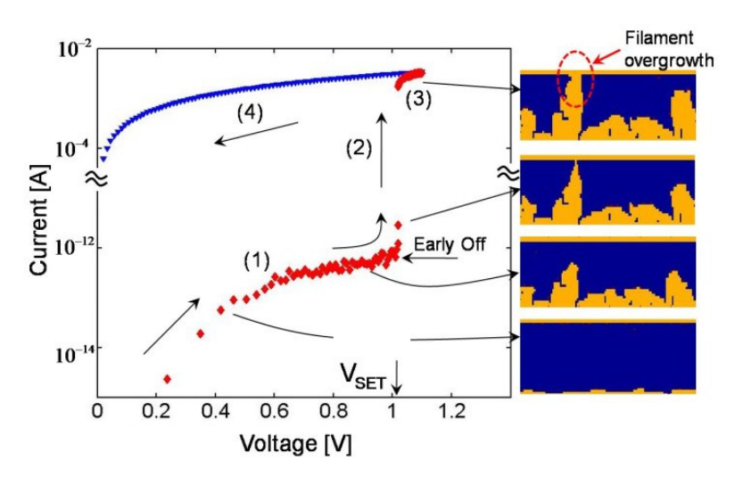
*Figure 2.13: `KMC` 仿真的 I-V 及相关细丝形状。电压扫描率为 3 V/s。区域 (1) 是离子电流，而 (3) 和 (4) 是欧姆电流。金属细丝的电阻率设为 5×10⁻⁸ Ω·m。外部系统电阻取 $R_{ext}$=100 Ω（原文：The KMC simulated I-V and related filament shape. The voltage sweep rate is 3V/s. Region (1) is ionic current while (3) and (4) are ohmic current. The resistivity of metal filament is set to 5×10⁻⁸Ωm. The external system resistance is taken as Rext=100Ω.）*

除了 `forming` 阶段，`SET` 过程也可以被仿真。`forming` 与 `SET` 过程的区别如 Figure 2.14 所示：**在 `forming` 阶段，整条细丝从阴极侧形成**；然而在实际的 `SET`/`RESET` 开关工作中，**只需要细丝顶部的几层原子就能开启/关断器件**。因此 `RRAM` 的 on-state 开关时间（$t_{SET}$）**远小于** $t_{FORM}$ —— 后者是形成一整条细丝所需的时间，而不是形成"上一个 `SET`/`RESET` 循环遗留的残余细丝的最后几层"所需的时间。

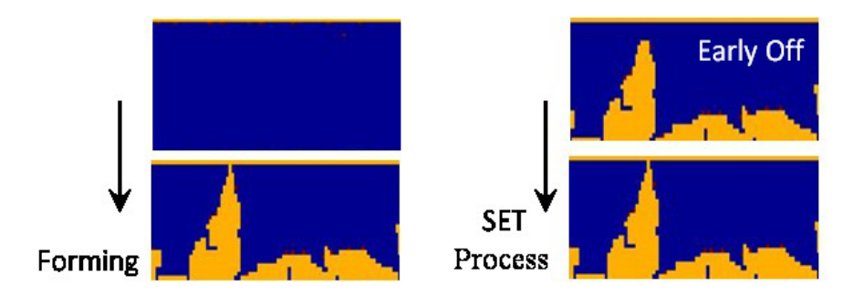
*Figure 2.14: `forming` 与 `SET` 过程的对比（原文：Comparison between Forming and SET processes.）*

为了仿真 `SET` 过程，**系统的初始构型选择为 Figure 2.14 右图所示，即移除六层原子**。Figure 2.15 (a) 展示了在不同输入电压步长下的 $t_{SET}$ 分布。为了清晰看到分布的尾部，采用了 **`Weibull plot`**。如图所示，**在 2 V 下至少需要 60 µs 才能开启 99% 的器件，而在 3 V 下只需要 3 µs**。在 `Cu/Ta2O5` 上所做的实验结果 [10] 与仿真结果吻合良好。此外，**平均开关时间对电压呈反指数依赖**。这是符合预期的，因为 `SET` 过程与前一节描述的 `forming` 过程相似。

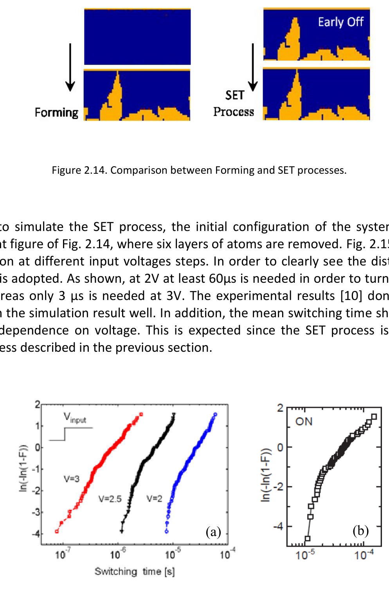
*Figure 2.15: (a) 不同输入条件下仿真的开关时间 $t_{ON}$ 分布；(b) `Cu/Ta2O5` 体系的实验结果 [10]（原文：(a) Simulated switching time tON distribution under different input conditions (b) experimental results in Cu/Ta2O5 system [10].）*

在真实的电路应用中，电压模式和电流模式都是可用的。`KMC` 仿真器也能够仿真器件在**电流工作模式**下的行为。在此仿真中，采用与电压模式相同的构型（Figure 2.14）。**在每一个时间步，计算整个系统的电阻，并把等于电流与电阻乘积的电压在细丝的每一层上更新**。Figure 2.16 (a) 展示了仿真结果。可以看到，由于**细丝过度生长效应**，细丝的 on-state 电阻（$R_{on}$）随控制电流变化。一般而言，**大的编程电流导致更小的 $R_{on}$ 和更小的分散性**。

> ⚠️ 需要注意的是，**在细丝过度生长效应的仿真中忽略了热效应**。当实际细丝电阻较大、或器件串联了一个保护电阻从而使流过器件的电流量有限、不产生大量热耗散时，这是一个很好的近似。

最后，图 (b) 给出了在 `Cu/Ta2O5` 体系获得的实验结果。

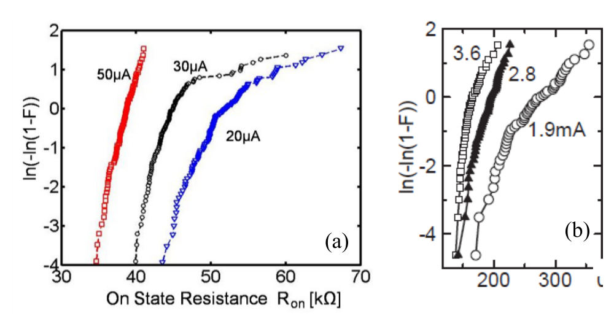
*Figure 2.16: (a) 不同电流输入条件下仿真的 on-state 电阻分布；(b) `Cu/Ta2O5` 体系的实验结果 [10]（原文：(a) Simulated on-state resistance distribution under different current input conditions (b) the experimental results for the Cu/Ta2O5 system [10]）*

> #### ⭐ 表 F：Chapter 2 各仿真场景的参数设定汇总（建模时逐项对照）
>
> | 仿真场景 | 对应图 | 扫描率 | $R_{ext}$ | 细丝电阻率 | 初始构型 | 温度依赖 | 其它 |
> |---|---|---|---|---|---|---|---|
> | `forming` 形貌 vs 电压 | Fig 2.7, 2.9 | 恒压 | — | — | pristine | ✗ | 6 档电压 0.05–2 V |
> | $t_{Form}$–V | Fig 2.8 | 恒压 | — | — | pristine | ✗ | — |
> | $V_{Form}$ vs 扫描率 | Fig 2.10 | 变化 | — | — | pristine | ✗ | $\alpha$ 设为 0.5 |
> | $V_{Form}$ vs 厚度 | Fig 2.11 | **1 V/s** | — | — | pristine | ✗ | 厚度扫描 |
> | $V_{Form}$ vs 面积 + 粗糙度 | Fig 2.12 | — | — | — | pristine | ✗ | Gaussian 自相关，相关长度 **10 nm**，rms **1 nm** |
> | I-V + overgrowth | Fig 2.13 | **3 V/s** | **100 Ω** | **5×10⁻⁸ Ω·m** | pristine | ✗ | 平坦阳极 |
> | $t_{SET}$ Weibull 分布 | Fig 2.15 | 恒压 | — | — | **移除顶部 6 层原子** | ✗ | `Weibull plot` |
> | $R_{on}$ vs $I_{CC}$（恒流模式） | Fig 2.16 | 恒流 | — | — | **移除顶部 6 层原子** | ✗ | 每步算总电阻并更新每层电压 |
> | 完整双极循环 | Fig 2.18 | **1 V/s** | **30 kΩ** | **5×10⁻⁶ Ω·m** | pristine → (1)→(8) | ✗ | 平坦阳极；$V_{RESET}$≈0.4 V |
> | $V_{RESET}$ vs $I_{SET}$ 与 T | Fig 2.19 | 恒流 | — | — | — | **✓ 引入温度 T** | 唯一的温度依赖仿真 |
> | 形貌 vs $E_{surf}$/$E_{adatom}$ | Fig 2.20 | — | — | — | pristine | ✗ | 材料参数扫描 |
> | $t_{ON}$ vs $E_{bulk}$ | Fig 2.21 | — | — | — | pristine | ✗ | 材料参数扫描 |
>
> ⚠️ 注意 Fig 2.13（overgrowth）与 Fig 2.18（RESET）用了**相差 100 倍**的细丝电阻率：5×10⁻⁸ vs 5×10⁻⁶ Ω·m。前者接近真实金属（Cu 约 1.7×10⁻⁸），后者是**为了让细丝上有足够压降以驱动化学过程继续**而人为放大的建模选择。

#### 2.3.4 RESET 阶段特性 / RESET Stage Characteristics

在 `RESET` 阶段，一个负电压被施加到活性金属电极上。因此，`SET` 过程中的**阳极变成了阴极，阴极变成了阳极**。由于电压极性反转，在 `SET` 过程中建立的金属细丝开始**溶解**并漂移回阴极（即活性金属电极）。这个过程持续进行直到细丝断裂。**一旦细丝断裂，就会出现从低阻态（`LRS`）到高阻态（`HRS`）的急剧电阻转变。**

在 `RESET` 过程中有几个重要因素需要考虑：

- **第一个是 Joule 加热效应** [20]，因为温度可以加速化学与物理过程。
- **第二个是阴极侧形貌**，它决定了靠近阴极侧的细丝尖端处的**横向电场分布**，如 Figure 2.17 所示。如将看到的，**这个横向电场决定了细丝最终在哪里断裂**。

> ⚠️ **当前的 `KMC` 仿真器没有实现温度依赖**。如前所述，这适用于「实际细丝电阻较大」或「串联了一个大的保护电阻」从而流过器件的电流有限、不产生大量热耗散的情形。

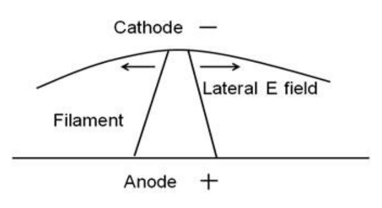
*Figure 2.17: `RESET` 阶段阴极区域附近横向电场的示意图（原文：Illustration of side electric field near the cathode region in the RESET stage.）*

其次，在细丝过度生长和 `RESET` 阶段**完整地考虑阴极形貌非常耗时和耗算力**。为了模拟横向电场效应，做了如下近似：

> ⭐ **横向电场的二值近似（建模时的关键简化）**
>
> | 横向电场 | 物理图像 | 仿真中的处理方式 |
> |---|---|---|
> | **小** | 溶解的金属离子难以从细丝尖端区域扩散出去；它们更倾向于沿**垂直方向**漂移，并**直接累积在正对细丝尖端的阴极上** | **假设金属离子可以在细丝尖端累积** |
> | **大** | 除了向前扩散，金属离子还可以**横向扩散** | **假设金属离子难以在细丝尖端前方累积** |

Figure 2.18 展示了仿真的 I-V 特性及相关细丝形貌。**电压扫描率固定为 1 V/s，外部电阻设为 30 kΩ，细丝电阻率为 5×10⁻⁶ Ω·m**。仿真从条件 (1) 开始，到条件 (8) 结束。如前所述，为简化问题采用了平坦阳极。

- **区域 (1) 的电流是离子电流**。在 $V=V_{Form}$ 处出现急剧开启，之后流动欧姆电流。
- 由于细丝具有有限电导率，其上仍有一些电压降落，因此**细丝过度生长开始** —— 细丝变得更宽（从 (2) 到 (3)），电阻持续减小，直到电压扫回零。
- 另一方面，当电压扫向负值时细丝开始溶解。**在 $V_{RESET}$ 约 0.4 V 处细丝断裂后，过度溶解（over-dissolution）过程开始。**
- **对于剩余的循环，由于存在未溶解的细丝，后续循环中的 `SET` 电压（$V_{SET}$）远小于 $V_{Form}$。**

值得注意的是，Figure 2.18 (a) 显示**细丝在顶部断裂**，那里阴极侧没有金属离子累积 —— 这是**横向电场大**的情形。另一方面，Figure 2.18 (c) 展示了另一种情形，即**允许金属离子在阴极侧累积和析出**；在这种情况下，细丝可能**在中间断裂**，如 Figure 2.18 (c) 中白色圆圈所示。

**在过度生长与溶解过程中，细丝每一层的电压分布必须在每一步更新，并作为 `KMC` 中新的边界条件。**

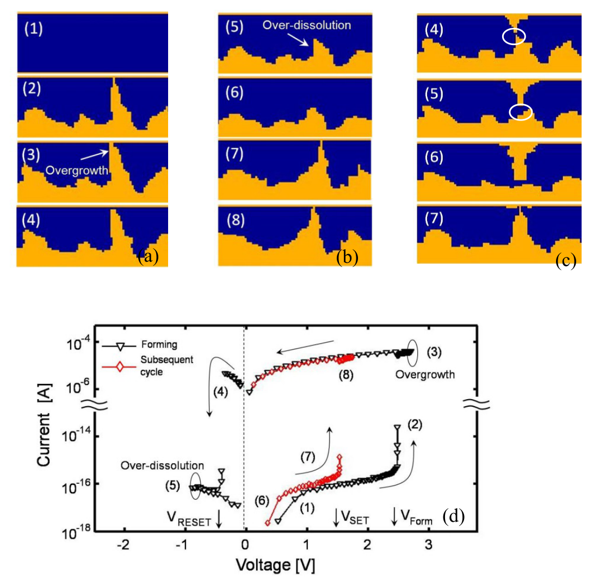
*Figure 2.18: `KMC` 仿真的 I-V 特性及相关细丝形貌（第一种情形）。电压扫描率为 1 V/s。仿真从 (1) 开始到 (8) 结束。所有关键物理参数都在图中标出。可以清楚看到过度生长与过度溶解，且后续循环中的 $V_{SET}$ 远小于 $V_{Form}$。外部电阻设为 30 kΩ，细丝电阻率为 5×10⁻⁶ Ω·m（原文：KMC Simulated I-V characteristics and related filament topographies (for the first scenario). The voltage sweep rate is 1V/s. Simulation starts from (1) and ends at (8). All the critical physical parameters are indicated in the figures. Overgrowth and over-dissolution are clearly seen And VSET in the subsequent cycle is much less than VForm. The external resistance is set to 30kΩ. Filament resistivity is 5×10⁻⁶Ωm）*

接下来，Figure 2.19 展示了 $V_{RESET}$ 与 $I_{SET}$ 之间的关系。**在此仿真中还包含了温度效应**。可以看到，一般而言，**在更大 $I_{SET}$ 下形成的细丝也具有更大的 $V_{RESET}$**，因为在 `RESET` 过程中必须溶解更多的原子。**通过改变温度 (T)，$V_{RESET}$ 显著变化：更高的 T 加速溶解过程，导致小得多的 $V_{RESET}$ 和更小的分布分散性。**

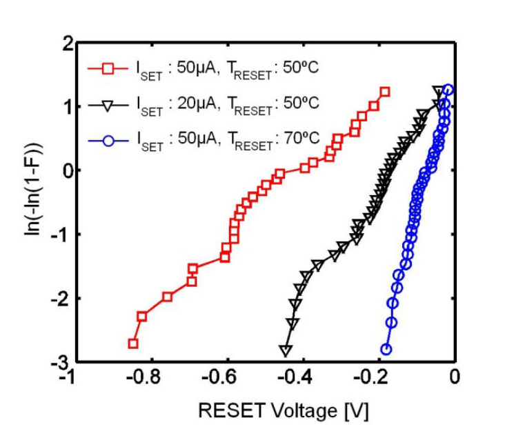
*Figure 2.19: 在不同 `SET` 控制电流与 `RESET` 温度水平下的 $V_{RESET}$ 分布（原文：VRESET distribution at different SET control current and RESET temperature levels.）*

> ⚠️ **(reviewer's note)** 这里出现了全章唯一的自相矛盾之处：2.3.4 开头明确说 **"The current KMC simulator doesn't have a temperature dependence implemented"**，但 Figure 2.19 的仿真又"包含了温度效应"。合理的解读是：温度**不是**在 KMC 主循环中通过自洽 Joule 热方程求解的，而是作为**外部给定参数**直接进入式 (7)(8)(9) 的 $T$ —— 即做了「等温扫描」而非「自热耦合」。这与 Figure 2.16 处"忽略热效应"的声明一致。**若你要复现 Figure 2.19，把 T 做成可配参数即可，不必实现热传导求解器。**

#### 2.3.5 材料性质的影响 / The Effect of Material Properties

除了 I-V 特性，仿真还能够研究**材料性质对器件行为的影响** [19, 20]。Figure 2.20 展示了 `surface diffusion` 与 `reduction` 的 activation energy 变化对细丝形状的影响：

- **当 `surface diffusion` 的 activation energy 大时**，被吸附的离子很难扩散到 `hole site` 或 `step site`。因此细丝**更像树形，带有大量分支**，如 Figure 2.20 (a) 所示，这与**电击穿（electric breakdown）** [21] 非常相似。
- **另一方面，Figure 2.20 (b) 展示了 `surface diffusion` 能垒小的情形**：被吸附的离子有足够时间并且很容易扩散到 `step site` 或 `hole site`，因此细丝形貌**更像电化学电镀（electro-chemical plating）**。

因此我们看到，**通过适当选择系统物理参数，可以用这一方法仿真出宽泛的开关模式**。

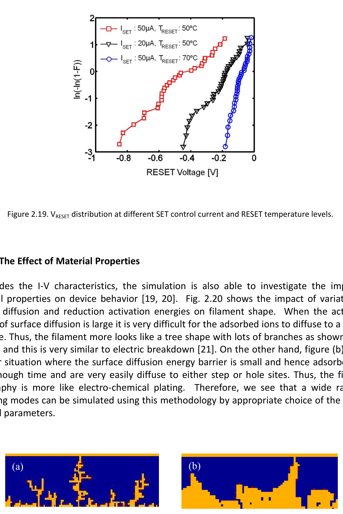
*Figure 2.20: 在不同条件下形成的仿真细丝形状。(a) 当 activation energy $E_{surf}$ 大而 $E_{adatom}$ 小时；(b) 当 $E_{surf}$ 小而 $E_{adatom}$ 大时（原文：Simulated Filament shape formed under different conditions. (a) when the activation energy Esurf is large while Eadatom is small (b) when Esurf is small and Eadatom is large.）*

最后，研究**体相扩散能垒（$E_{bulk}$）** 的影响。Figure 2.21 展示了 $E_{bulk}$ 对器件开关特性的影响：

- **当体相扩散能垒大时**，开关时间**指数依赖**于 $E_{Bulk}$。在此条件下，**体相扩散是整个系统的限速过程**，因此开关时间 $t_{ON}$ 随绝缘层迁移势垒减小（更小的 $E_{bulk}$）而减小。
- **然而当 $E_{Bulk}$ 进一步减小时**，`oxidation` 与金属结晶变成限速过程，**开关时间饱和**，如图所示。

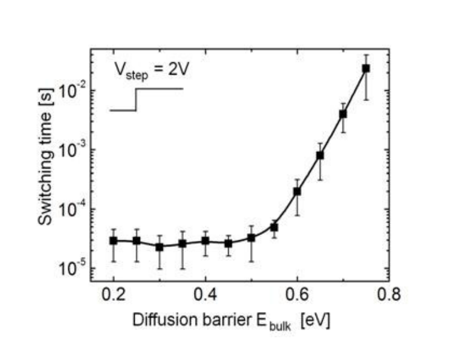
*Figure 2.21: 仿真的开关时间 vs 固体电解质的扩散势垒（原文：Simulated switching time versus diffusion barrier of the solid electrolyte.）*

> #### ⭐ 表 G：限速步骤的迁移（Figure 2.21 的物理内核 —— 材料设计的直接指导）
>
> | $E_{bulk}$ 范围 | 限速过程 | $t_{ON}$ 行为 | 材料设计含义 |
> |---|---|---|---|
> | **大** | **体相扩散** | $t_{ON}\propto\exp(E_{bulk}/k_BT)$，随 $E_{bulk}$↓ 而快速下降 | 降低介质迁移势垒 → 提速有效 |
> | **进一步减小** | **`oxidation` + 金属结晶** | **饱和**，不再改善 | 单靠提高介质离子电导**无法**无限提速 |
>
> **这是本章对材料工程最有价值的一条结论**：介质离子迁移率的收益有**上限**，上限由电极反应的 $E_a$ 决定（表 A 中 `oxidation` 0.65–0.75 eV / `reduction` 0.25–0.35 eV）。

### 2.4 小结 / Summary

本章建立了一个 `Kinetic Monte Carlo` 仿真器来研究电化学金属化 `RRAM`。**该仿真器更聚焦于 `forming` 与 `SET` 过程**。研究了 `forming` 电压、`forming` 时间、电压扫描率与细丝形貌之间的各种关系。研究发现，**在不考虑细丝过度生长效应的情况下，大外加电压下形成的细丝平均宽度远小于小电压条件下形成的细丝宽度**。在 `Ag/Ag2S` 和 `Cu/H2O` 体系上的实验验证了仿真结果。此外还仿真了 `RESET` 过程，发现**它依赖于靠近阴极的横向电场的存在，且细丝可以在不同位置断裂**。最后，还研究了 `surface diffusion` 与化学 `reduction` 能垒的变化对细丝形状的影响。

### 2.5 参考文献 / References

> 按 skill 规范，References 列表整段保留英文原文，不翻译。**加粗标注**的是与 KMC 建模直接相关、值得优先追读的条目。

**[1]** A. F. Voter, "Introduction to the Kinetic Monte Carlo Method," to be published in *Radiation Effects in Solids*, K. E. Sickafus and E.A. Kotomin, eds., Springer, 2005. — **KMC 方法论权威综述，eq(1)–(5) 与 memoryless 假设的来源**
**[2]** A. P. J. Jansen, "An introduction to Monte Carlo simulations of surface Reactions," arXiv:cond-mat/0303028v1 — **VSSM 算法四步流程的来源**
**[3]** C.C. Battaile, "Kinetic Monte Carlo simulation of chemical vapor deposition," *Annual Review of Materials Research*, 2002, 32: 297-319 — **KMC 局限性的论述来源（TST 图示 Fig 2.1 引自 [4]）**
**[4]** F. Pan, S. Yin, V. Subramanian, "A Comprehensive Simulation Study on Metal Conducting Filament Formation in Resistive Switching Memories," *3rd IEEE International Memory Workshop (IMW)*, 2011 — **作者本人的前作，Fig 2.7/2.8/2.9/2.10 的数据来源**
**[5]** A. Saedi, "A study on mutual interaction between atomistic and macroscopic phenomena during electrochemical processes using coupled finite difference-kinetic Monte Carlo model: Application to potential step test in simple copper sulfate bath," *Journal of Electroanalytical Chemistry* 588 (2006) 267-284 — **★ FDM+KMC 耦合、Ea 结构依赖性的方法来源，与你要做的事最接近**
**[6]** R. Pornprasertsuk, T. Holme, Friedrich B. Prinz, "Kinetic Monte Carlo simulations of solid oxide fuel cell," *Journal of the Electrochemical Society*, 156 (12) B1406-B1416 (2009) — **eq(7)(8) 形式的来源；同一作者也是 Ch 3 中 YSZ 离子电导 KMC 研究 [Ch3 ref 4] 的作者**
**[7]** F. Pan, S. Yin, V. Subramanian, "A Detailed Study of the Forming Stage of an Electrochemical Resistive Switching Memory by KMC Simulation," *IEEE Electron Device Letters*, vol.32, no.7, pp.949-951, July 2011 — **★ forming 阶段专题前作，Ea_bulk=0.15 eV 的依据、"BV 不足以描述系统"两条论证的来源**
**[8]** J. Jang, F. Pan, K. Braam, and V. Subramanian, "Resistance Switching Characteristics of Solid Electrolyte Chalcogenide Ag2Se Nanoparticles for Flexible Nonvolatile Memory Applications," *Advanced Materials*, Volume 24, Issue 26, pages 3573–3576, July 10, 2012
**[9]** C. Schindler, G. Staikov and R. Waser, "Electrode kinetics of Cu-SiO2-based resistive switching cells: overcoming the voltage-time dilemma of electrochemical metallization memories," *Applied Physics Letters*, 94, 072109, 2009 — **★ eq(13)–(15) 与 α≈0.1 实验值的来源；"voltage-time dilemma" 概念出处**
**[10]** T. Sakamoto, N. Banno, N. Iguchi, H. Kawaura, H. Sunamura, S. Fujieda, K. Terabe, T. Hasegawa, and M. Aono, "A Ta2O5 solid-electrolyte switch with improved reliability," *Symp. on VLSI Tech.*, Dig. Tech. Papers, pp. 38-39, 2007 — **Cu/Ta2O5 实验对照数据来源（Fig 2.12c, 2.15b, 2.16b）**
**[11]** B.G. Willis, D.V. Lang, "Oxidation mechanism of ionic transport of copper in SiO2 dielectrics," *Thin Solid Films*, 467, pages: 284-293, 2004 — **★ Fig 2.4 四种 Cu 注入机制及 (d) 机制的判据（T<450–500 °C, E<1 MV/cm）**
**[12]** Michael D. Bronshtein, Renat R. Nazmutdinov and Wolfgang Schmickler, "An approach to optimised calculations of the potential energy surfaces for the case of electron transfer reactions at a metal/solution interface," *Chemical Physics Letters* 399 (2004) 307–314 — **化学反应 Ea 难以理论确定的三条原因来源**
**[13]** Aron J. Cohen, Paula Mori-Sánchez, Weitao Yang, "Insights into Current Limitations of Density Functional Theory," *Science* 321, 792, 2008 — **DFT 低估势垒的论述来源**
**[14]** Martin Zelený, J. Hegedus, A. Foster, R. M. Nieminen, D. A. Drabold and S. R. Elliott, "A model for a non-volatile memory material: Ab initio study of Cu diffusion in SiO2," *Material Research Society Spring Meeting* 2011 — **★ Fig 2.5，Ea_bulk = 0.15–0.2 eV 的 ab initio 依据**
**[15]** John Newman and Karen E. Thomas-Alyea, *Electrochemical Systems*, third edition, Wiley-Interscience, 2004 — **★ Butler-Volmer eq(10)、Tafel eq(12)、surface overpotential、SEP 的教科书来源**
**[16]** Abhijit U. Modak, Mark T. Lusk, "Kinetic Monte Carlo simulation of a solid-oxide fuel cell: I. Open-circuit voltage and double layer structure," *Solid State Ionics* 176 (2005) 2181-2191 — **★ eq(9) 第三项 self potential 排除的方法来源**
**[17]** Y. Bernard, P. Gonon, and V. Jousseaume, "Resistance switching of Cu/SiO2 memory cells studied under voltage and current-driven modes," *Applied Physics Letters*, vol. 96, no. 19, pp. 193502-1–193502-3, May 2010 — **Fig 2.8 插图的 Cu/SiO2 实验数据**
**[18]** S. Kaya, A.R. Brown, A. Asenov, D. Magot, T. Linton, "Analysis of Statistical Fluctuations due to Line Edge Roughness in Sub-0.1μm MOSFETs," *Simulation of Semiconductor Processes and Devices (SISPAD)*, 2001 — **★ Gaussian 自相关表面粗糙度生成方法来源（Fig 2.12a）**
**[19]** F. Pan and V. Subramanian, "A kinetic Monte Carlo study on the dynamic switching properties of electrochemical metallization RRAMs during the SET process," *Proc. Int. Conf. Simulation of Semiconductor Processes and Devices (SISPAD)*, 2010, pp. 19–22 — **★ SET 过程专题前作；"细丝形貌主要由阴极决定"的依据**
**[20]** F. Pan, V. Subramanian, "Kinetic Monte Carlo simulation of resistive switching and filament growth in electrochemical RRAMS," *Device Research Conference*, 2010, page 255 — **★ 细丝生长专题前作**
**[21]** L. Niemeyer, L. Pietronero and H.J. Wiesmann, "Fractal dimension of dielectric breakdown," *Physical Review Letters* 52, 1984, pp.1033–1037 — **Fig 2.20(a) 树枝状细丝类比电击穿分形的来源**

---

## Chapter 3（要点提炼，未逐段翻译）/ Yttria Stabilized Zirconia Based RRAM

> 📍 PDF p77–102 / 论文 p69–94。**本章为纯实验工作**，与 Chapter 2 的 KMC 模型无直接耦合。以下提炼全部关键数据。

### 3.1 YSZ 材料基础（p77–79）

- 纯 ZrO₂ 的相变：>2370 °C 立方相 → 1170–2370 °C 四方相 → <1170 °C 单斜相。**相变导致冷却时开裂**。掺入 Y₂O₃ 可在室温稳定立方相。
- Kroger-Vink 记号：$2Y_2O_3 \xrightarrow{ZrO_2} 4Y_{Zr}^{3'} + V_O^{\bullet\bullet} + 6O_O^x$（式 1）—— **两个 Y³⁺ 替代两个 Zr⁴⁺，为维持电中性必须移除一个 O²⁻**，即产生 $V_O$。O²⁻ 通过这些空位跳跃 → YSZ 在高温有**很高的氧离子电导率**。
- Pornprasertsuk 等的 KMC 研究（Figure 3.2）：**Y₂O₃ 浓度约 8 mol% 时电导率达峰**，之后下降。原因是 O²⁻ 迁移势垒在 Y₂O₃ < 6–8 mol% 时近似恒定，之后稳定上升 —— 浓度高时 O²⁻ 更可能穿过 Y–Y 和 Y–Zr 边而非 Zr–Zr 间隙，而 Y³⁺ 离子半径大于 Zr⁴⁺。
- 应用：固体氧化物燃料电池（SOFC）、氧传感器。开路电压服从 Nernst 方程：$V_{Open}=\frac{k_BT}{4q}\ln\frac{p_{O_2}^{meas}}{p_{O_2}^{REF}}$（式 2）。
> ⚠️ 本论文实验用的是**非晶（amorphous）YSZ**，与上述晶体 YSZ 的离子导电机制不同 —— 非晶 YSZ 用于 RRAM 时主导机制是 `VO` trap + 电子 hopping。

### 3.2 实验流程（p80–82）

| 项 | Structure I（筛选用） | Structure II（正式研究） |
|---|---|---|
| 衬底 | Au/Cr/SiO₂/Si | 4 inch N 型 Si + 100 nm 热氧化层 |
| YSZ | **30 nm, 8 mol%**，e-beam 蒸发，**0.5 nm/s**，9e-6 torr | **3–30 nm** 可变，e-beam，1e-5 torr |
| 底电极 | Au | **3 nm Cr（粘附层）+ 80 nm Au**，基压 3×10⁻⁶ torr |
| 隔离层 | — | **100 nm Si₃N₄**，PECVD：350 °C，0.9 torr，200 sccm NH₃ / 40 sccm SiH₄ / 200 sccm Ar，25 W，**17 nm/min** |
| 表面处理 | YSZ 经 **UVO 10 min** | Si₃N₄ 光刻开窗，干法刻蚀 90 sccm SF₆+O₂，200 W，**125 nm/min** |
| 顶电极 | Ti, Al, Au, Cu, Ag, Ni（热蒸发或 e-beam，<1e-5 torr，shadow mask） | **140 nm Ti 或 Cu** |
| 器件面积 | 100×200 µm² | **64×64 µm² 到 4×4 µm²**（由 Si₃N₄ 开窗定义） |
| 其它 | — | 光刻：HMDS + 1.1 µm I-line PR @4100 RPM，90 °C 软烘 1 min，Karl Suss MA6 曝光，OPD 4262 显影，120 °C 后烘 30 min；去胶 PRS-3000 @80 °C 20 min；顶电极 200×200 µm²；10% BOE 去除残余 Ti/YSZ（Cu 用 ion milling） |
| 清洗 | — | piranha（H₂O₂ + 热 H₂SO₄，120 °C）10 min → DI 冲洗 → SRD 10 min |

### 3.3 不同顶电极的影响与开关机制（p83–85）

| 顶电极 | 机制 | $V_{Form}$ | Yield | Endurance | 备注 |
|---|---|---|---|---|---|
| **Au** | — | **最大**，分布很均匀 | — | — | **BD 电场 ≈5 MV/cm**（对比：Si 上外延单晶 YSZ 为 4 MV/cm，多晶 YSZ 更低）；**forming 后卡在 LRS**，无开关 |
| **Ni** | — | — | — | — | **无开关行为**，forming 后卡在 LRS |
| **Ti** | **`VO` 型** | 降低，分布变大 | **≈60%** | **>10⁴** | 界面化学反应：薄层 Ti 被氧化 → YSZ 内产生 `VO` → 介质强度被削弱；变化来自**不可控的自发化学反应** |
| **Al** | ECM（金属性） | 降低，分布变大 | **<10%** | **<10** | 同上机制，但 Al 极易氧化、极难析出 → 难形成稳定细丝 |
| **Cu** | **ECM** | **小得多** | **≈80%** | **≈100** | Cu 容易扩散进 YSZ |
| **Ag** | ECM | **最小** | — | — | Ag 扩散率远大于 Cu → $V_{Form}$ 最小；但**过于可扩散 → 缺乏电压控制**；$V_{RESET}$ 极小（Figure 3.6b 红箭头）→ 易受噪声与 read disturbance 影响；**易卡在 LRS** |

（数据表图片：`./tables/table-i.png`，Table I Device Performance Comparison）

**Al/YSZ 为何 yield 与 endurance 都极差**（p85 的完整论证链）：
1. Al/YSZ 在 LRS 呈**完美欧姆导电**（Figure 3.7a）→ 金属性细丝的证据；而 Ti/YSZ 的 $R_{on}$ 呈**电压依赖**行为 → `VO` 型电子 hopping 导电的证据。
2. 变温测量（Figure 3.7b）：**LRS 下 Cu/YSZ 与 Al/YSZ 的电导随温度升高而下降**（金属性），**与 Ti/YSZ 相反** → 确认 Al/YSZ 是金属型导电。
3. 文献 [14]：spin-on 或 PECVD 制备的 SiO₂ 中，**Al 离子的扩散势垒远小于 Cu 离子** → Al 更可扩散；而 Al/SiO₂ 界面之所以比 Cu/SiO₂ 稳定，只能归因于界面形成的**氧化铝需要更多能量才能解离并释放 Al 离子**（相比从 Cu₂O 释放 Cu 离子）。
4. 结论：虽然需要更大的 $V_{FORM}$ 才能把 Al 离子从 Al₂O₃ 中释放，但一旦释放，Al 离子就容易穿过 YSZ 形成金属型细丝；然而**由于 Al 更易被氧化、更难析出，稳定细丝难以形成** → yield 与 endurance 都差；且**大量 Al 离子被困在 YSZ 膜内 → 器件易卡在 LRS**。
5. 关于 Al₂O₃ 与 TiO₂ 生成能的既有解释 [13] 被作者否定：二者**每摩尔氧的平均生成能差异并不显著**，无法解释 Ti/YSZ 与 Al/YSZ 之间的巨大差异。

### 3.4 Ti/YSZ 与 Cu/YSZ 详细对比（p85–101）

**3.4.1 I-V 特性（p85–91）**
- Ti/YSZ 的 forming I-V 在 30 °C、50 °C、70 °C 下测量（Figure 3.8a），两种极性下都服从 **Poole-Frenkel 发射**。
- **OFF 态主导机制：`SCLC`（空间电荷限制电流）+ 电子 hopping**；**ON 态：欧姆 + 电子 hopping**。
- 变温 I-V 表明：**Ti/YSZ 的电子 activation energy 势垒与单元的电阻态正相关**。
- 证据支持 Schottky 热发射与空间电荷导电机制，但**电子隧穿模型无法完全排除** —— 虽然一阶近似下直接隧穿与 F-N 隧穿都与温度无关 [16]，详细理论分析揭示它们确实依赖温度 [20]；据作者所知，**描述隧穿电流温度依赖性的显式数学形式仍然缺乏**。

**3.4.2 Endurance、Retention 与 Uniformity（p91–94）**

| 指标 | Ti/YSZ | Cu/YSZ |
|---|---|---|
| **Endurance**（ISPP，目标 $R_{on}$=10 kΩ，$R_{off}$≈100 kΩ） | **几乎所有器件 >10⁴ cycles**（仅受测量时间限制） | **最好的器件也只有 ≈180 cycles** |
| **$V_{SET}$/$V_{RESET}$ uniformity** | 变化小得多（Figure 3.16b） | **cycle-to-cycle 变化非常大**（Figure 3.16a） |
| **Retention（$R_{off}$）** | **稳定，20 kΩ 到 1 MΩ**（分别在不同器件上测试） | 非常稳定，且**通常为常数** |
| **Retention（$R_{on}$）** | ≈10 kΩ 时稳定，**≈1 kΩ 时非常不稳定**；实测 $R_{on}$ 从 **400 Ω 逐渐升到 3 kΩ / 10⁴ s** | **<1 kΩ 时很稳定（与 Ti/YSZ 相反）**；**≈20 kΩ 时 retention 变得很差** |
| **面积依赖** | $R_{on}$ 与面积无关 → **on 态是局域细丝导电**；$R_{off}$ 与面积成反比 → **off 态是体导电** | — |
| **Noise** | **低得多**，且有**噪声恢复能力** | 高，且随电阻增大而恶化 |

**Cu/YSZ 为何 endurance 与 uniformity 差**（p93 的物理解释）：
- Cu/YSZ 是 ECM 型，**金属结晶是形成 conductive filament 的关键过程，因此对界面质量要求极为苛刻**。一个"坏"界面（例如阻变层与电极之间晶向差异显著、或电极表面不洁净）可能对器件性能有有害影响。
- 支撑证据 [21]：`Pt/NiO/Pt` 表现出大的 $V_{SET}$ 变化（Figure 3.17a）且 endurance <200 cycles，与 Cu/YSZ/Au 非常相似；当在 NiO 两侧加入很薄的导电氧化物 **IrO₂** 后性能显著改善（Figure 3.17b），$V_{SET}$ 变化急剧减小。TEM 显示 **IrO₂ 层增强了 NiO 在 NiO-IrO₂ 界面处的结晶度** → 性能改善归因于界面晶体结构的改变。
- 另一因素：**惰性电极侧的有机污染物** [23] 会显著负面影响 endurance，因为污染物会阻碍惰性电极上的结晶过程，使 on 态不稳定。
- 但作者强调**不应据此认为所有 ECM 体系都性能差**：文献 [24] 表明 `Cu/amorphous Ta2O5` 可获得约 **10⁴ cycles** 的 endurance → 只要工艺控制足够好，优秀的 ECM 器件是可能的。不过一般而言，**`VO` 型 RRAM 在 endurance 与 uniformity 上倾向于优于 ECM 型**。

**Retention 差异的物理解释**：
- **Ti/YSZ**：体相 YSZ 热学与化学稳定 → $R_{off}$ 稳定。但 on 态时，由于**钇阳离子倾向于与氧阴离子有极强键合**，`SET` 过程形成的 `VO` 倾向于与 O²⁻ 复合形成化学稳定相 → $R_{on}$ 更可能随复合过程进行而增大。这一退化过程可能因**器件封装不良**而加速（便于从环境吸收氧气或水汽）。
- **Cu/YSZ**：$R_{on}$ 可通过 `SET` 时施加不同 CC 调节。$R_{off}$ 非常稳定，但 $R_{on}$ 的稳定性取决于电阻水平 —— 归因于**细丝宽度**：$R_{on}$ 小时 Cu 细丝宽度大 → retention 稳定；$R_{on}$ 增大时细丝宽度相应变窄 → **少量 Cu 原子的横向扩散就会使有效细丝宽度显著减小**，从而使器件电阻上升 → retention 变差。

**3.4.3 噪声分析（p94–101）**
- RRAM 由于细丝导电本质，**易受周围原子、离子与 trap 的随机运动或涨落影响**；常观察到 `RTN`（random telegraph noise）与 `1/f noise`（flicker noise）[25]。这些噪声会提高读取错误率，应最大限度抑制。
- 噪声一般用随机过程描述；多数噪声是**平稳过程**（联合概率分布不随时间与位置改变）。自相关函数：$c(\tau)=\lim_{T\to\infty}\int_{-T/2}^{T/2}x(t)x(t+\tau)dt$（式 10），并由其得到功率谱密度。
- **同等电阻水平下，Ti/YSZ 的噪声远低于 Cu/YSZ**。解释：Cu 细丝的电导率远大于 `VO` 细丝 → 给定电阻态下金属细丝宽度**远窄于** `VO` 细丝 → Cu/YSZ 更容易受细丝边缘 Cu 原子运动的影响。**噪声随电阻增大而恶化**，因为细丝变窄。

---

## Chapter 4（要点提炼，未逐段翻译）/ Multi-level Programming and Impact of Programming Methodology on Device Reliability

> 📍 PDF p103–112 / 论文 p95–104。

### 4.1 MLP 的两条路线（p103）

| 路线 | 原理 | 优点 | 致命问题 |
|---|---|---|---|
| **`SET` 阶段调 CC** | 控制流过器件的最大电流得到不同电阻水平（Ti/YSZ 与 Cu/YSZ 都能实现，见 Fig 3.9） | — | ① **电容充放电效应** → $R_{on}$ 波动大；1T1R 可消除但**显著降低阵列密度**；二极管型 selector **仍有此问题**。② **history dependent $R_{on}$ instability** |
| **`RESET` 阶段调电压** | 需 RESET 段 I-V **足够平滑**，使 $R_{off}$ 随电压渐进上升 | **无电容充电效应**；电压控制；易于电路实现 | 要求材料本身具备平滑 RESET 特性 → **Cu/YSZ 不具备，Ti/YSZ 具备** |

已展示 MLP 能力的材料：`WOx` [1]、`HfO2` [2]、`Ta2O5` [3]、`TiO2` [4]。
**MLP 物理尚不清楚** [5]：有研究者从纯电子角度提出"只有中等带隙、且 `VO` 作电子施主的介质才有 MLP 能力"，但该理论无法解释全部实验现象 —— 例如 `CuxO` [6] 和 `NiO` [7] 满足上述所有判据，**却在 RESET 阶段仍表现出非常尖锐的转变**。

### 4.2 Ti/YSZ 在 RESET 阶段的 MLP（p104–107）

- **Cu/YSZ**：`SET` 与 `RESET` 都是**尖锐转变**；其电导通常降到一个最小值，**那是 Cu/YSZ 在 HRS 的唯一稳定态** → **RESET 阶段 MLP 不可能**。
- **Ti/YSZ**：`SET` 尖锐，但 **`RESET` 非常平滑**（Figure 4.1b 箭头处 I-V 曲线很平），电导逐渐下降。
- **Figure 4.2（ISPP，脉冲宽度 1 µs）关键定量结果**：
  - 超过某个 $V_{RESET}$ 阈值后，**Ti/YSZ 的 $R_{off}$ 随外加电压指数增长**；
  - 而 **Cu/YSZ 出现陡峭转变，之后电阻保持常数**；
  - **新器件的 on/off 窗口可超过 10⁴** → 适合 MLP。
- **Figure 4.4：实现了四级 MLP** —— 低阻态 ~8 kΩ，**三个不同的高阻态最高达 ~2 MΩ**。（器件一、器件二）
  - ⚠️ **Figure 4.4(b) 的器件在成功编程前 3000 cycles 后出现电容充电效应**：$R_{on}$（红点）显著降到 1 kΩ 以下 → 第一级 $R_{off}$（蓝点）升高并与第二级（黑点）混叠。
  - 物理链：$R_{on}$ 显著降低 → **相同 $V_{RESET}$ 水平下产生更多 Joule 热** → 过量热**削弱 Ti/YSZ 界面处的 Ti-O 键** → 电场下**极短时间内产生过量 O²⁻** → 这些 O²⁻ 与 `VO` 复合 → 电阻显著增大；过量热还帮助 YSZ 介质克服 LRS→HRS 的**相变势垒** → 总效果是 $R_{off}$ **急剧上升而非渐进上升** → 编程错误。
  - **结论：为 MLP 目的必须最小化电容充电效应。**

**为何 Ti/YSZ 能平滑 RESET 而 Cu/YSZ 不能**（p105–106 的物理，本章核心论点）：

> 尽管 RRAM 通常被分为金属阳离子型与 `VO` 型，**二者之间没有本质区别** —— 它们是描述金属氧化物单元内同一组物理化学过程的两种不同方式。`SET` 阶段是**局部金属元素浓度升高** + **金属阳离子还原**过程，从而形成**富金属区（metal rich region，或亚氧化物 suboxide）**；`RESET` 阶段是**局部金属元素浓度降低** + **金属物种/阳离子氧化**过程，从而局部形成更绝缘的氧化物。`SET` 阶段形成的富金属区**取决于具体化学成分而可具有金属性或半导体性特征**，其电导率各不相同。

1. **半导体相（或电子 hopping 系统）优于金属相**，因为：
   - 给定电阻水平下，**细丝横截面积大得多**；
   - 相同 RESET 电流水平下，**细丝内部热密度更小**。
   - 这两个因素都帮助实现电导的**渐进变化**。
2. **反馈方向的差异（决定性）**：
   - 更金属性物种的细丝溶解过程是**自加速过程（self acceleration）**，且由于其**正温度电阻系数**而对 Joule 加热更敏感 → **细丝内易形成弱点（weak spots）**；
   - 而对更半导体性或 hopping 型系统，相应过程是**负反馈** → **难以形成这类弱点** → 有助于实现更渐进的 RESET。
3. **用 `SEP`（standard electrode potential）定量描述金属阳离子捕获电子的能力** [9, 10]：

   | 元素 | SEP (V) | 含义 |
   |---|---|---|
   | **Y** | **−2.37** | 最难捕获电子 |
   | **Zr** | **−1.53** | 很难捕获电子 |
   | **Ni** | **−0.25** | 容易捕获电子 |
   | **Cu** | **+0.34** | 最容易捕获电子 |

   **数值越正 → 材料越容易捕获电子形成还原态金属**。因此 Y 和 Zr 都难以捕获电子，而 Ni、Cu 容易 → **大多数基于 `CuxO` 和 `NiO` 的器件表现出金属导电特征，并在 RESET 阶段有尖锐转变**。这正好解释了上面第 1、2 条。

4. **Figure 4.3 的直接证据**：Cu/YSZ 细丝的电导率远大于 Ti/YSZ —— 实验支持：**即使 $R_{on}$ 小于 1 kΩ，Ti/YSZ 类器件仍有约 0.02 eV 的 activation energy 势垒；Cu/YSZ 中找不到这样的势垒**。因此给定 $R_{on}$ 下，Cu/YSZ 的有效金属性细丝面积**远窄于** Ti/YSZ；且 Cu/YSZ 细丝对 Joule 加热更敏感 → 电流流过时能**快速形成弱点** → 最终**细丝尖端上极小的变化就能切断整条通路** → 尖锐转变。

### 4.3 编程方法学对器件可靠性的影响（p99–102）

**传统单脉冲编程的根本缺陷**：让 $R_{off}/R_{on}$ 比值在每个循环任意散布。$V_{SET}$/$V_{RESET}$ 幅度太小 → 开关过程失效；太大 → 器件快速击穿、寿命严重缩短。

**理想 vs 现实**：理想 RRAM 器件的 $V_{SET}$ 与 $V_{RESET}$ 应不随循环变化 —— `SET` 时新产生的所有 `VO` 空间位置应与上一循环相同；`RESET` 时 `SET` 产生的所有 `VO` 都应与从阴极或介质本身释放的氧离子复合。**但由于 RRAM 的随机本质，偶尔会出现意外的大变化**：HRS 下细丝与电极之间的间隙中可能热产生额外 `VO`；`RESET` 时细丝尖端的一些 `VO` 可能逃脱湮灭。**这些残余 `VO` 会降低氧化物的局部介质强度，导致 $V_{SET}$ 突然下降**（Figure 4.5a）。

**Figure 4.5 的定量结果**（ISPP，目标 $R_{on}$=8 kΩ，$R_{off}$=80 kΩ）：
- $V_{SET}$ 在 **约 3000 cycles 处突降 ~1 V**；有意思的是，**$V_{RESET}$ 同时相应降低**。原因是**电容充电效应** [12]（来自器件本身与外部测量电路）：用更小的 $V_{SET}$ 开启器件时，流过器件的**电容放电电流更小 → 细丝过度生长更少 → RESET 操作更容易 → 需要更小的 $V_{RESET}$**。
- **Figure 4.5(b)：$10^4$ cycles 的 endurance 测试中，$V_{SET}$ 与 $V_{RESET}$ 近乎线性相关，观测到的斜率 ≈1。**
- **约 5000 cycles 处，$V_{SET}$ 与 $V_{RESET}$ 又逐渐上升**。此时若不适当地调整外加电压，要么施加过多电应力导致器件退化，要么电压太小使开关失效 —— **这正是传统单脉冲技术的关键缺陷**。由于不可避免的器件间差异，**几乎不可能为大存储阵列中的所有器件找到 $V_{SET}$ 与 $V_{RESET}$ 的最优脉冲幅度**；即使对单个器件，最优幅度也依赖于工作历史、是时间的函数。

**ISPP（增量步进脉冲编程）如何解决**：
- $V_{SET}$ 与 $V_{RESET}$ 脉冲**按步长递增/递减，每两个脉冲之间穿插验证读取（interspersed verification reads）**；目标 $R_{on}$/$R_{off}$ 预先定义。若达到目标电阻且验证稳定，则记录编程电压与电阻；否则脉冲持续递增/递减。**当在预定电压上限内仍未达到所需电阻水平时判定器件失效。**
- **Figure 4.6(a) 对比结果**：单脉冲方案下**两类失效都被观察到** —— 黑曲线器件**卡在 LRS**（可能因 `SET` 期间施加了额外电应力）；蓝曲线器件**卡在 HRS**（因 $V_{RESET}$ 无效）。**而采用 ISPP，器件 endurance 可超过 10⁴ cycles（红线），且整个过程中两类失效都未出现。** 该改善与既有研究结果 [13] 一致。
- **Figure 4.6(b) 电阻窗口 vs endurance 的折中**：一般而言，$R_{on}$–$R_{off}$ 之间更大的电阻窗口会**劣化 endurance**。**窗口超过 3000 时，某些器件只能承受 100 cycles；而采用窗口 10 时，几乎所有被测器件 endurance 都超过 10⁴（受测量时间限制）。**
- **退化主要在 HRS**（$R_{off}$ 随循环下降）；$R_{on}$ 设为 10 kΩ，相当大且容易达到。$R_{off}$ 退化机制：为获得大窗口所需的大 $R_{off}$，必须施加大的 $V_{RESET}$ 以从 Ti 电极抽出更多 O²⁻ 并输送到 `VO` 位点。**只有当局部有足够 O²⁻ 时该过程才不损伤器件**；但由于 RRAM 的随机性，**偶尔会发生局部 O²⁻ 不足**，此时输送到 `VO` 的 O²⁻ 量饱和，更大的 $V_{RESET}$ 不再增加 O²⁻ 流量；**更糟的是，这种情况下大的 $V_{RESET}$ 实际会削弱介质键合并产生更多 `VO`（类似 `SET` 阶段的过程）** → HRS 逐渐退化。
- **ISPP 的唯一缺点：编程更耗时**。可部分缓解 —— **增大相邻脉冲间的电压差**（例如每步增加 0.3 V 或 0.5 V 而非 0.1 V），从而在 endurance 与编程速度之间获得良好折中。

### 4.4 小结（p102）

基于 Ti/YSZ 演示了一个可靠的 MLP 单元，具有大的电阻编程窗口与良好 endurance；用 ISPP 成功实现**四个编程等级**。与 Cu/YSZ 相比，**Ti/YSZ 的 MLP 能力源于：钇与锆都难以析出，且 Ti/YSZ 中的细丝表现出 hopping 型导电机制，因此细丝中不易形成弱点**。此外，为降低 MLP 错误率必须最小化电容充电效应。单脉冲方案与 ISPP 对比表明，**ISPP 能为每个器件、每个操作循环定制最优的 $V_{SET}$ 与 $V_{RESET}$**，显著提升 endurance 与可靠性，并优化电阻编程窗口与器件寿命之间的折中。

---

## Chapter 5: 结论与未来工作 / Conclusions and Future Work

> 📍 PDF p113–118 / 论文 p105–110。**5.1.1（KMC 结论）逐段完整翻译**；5.1.2–5.1.4 与 5.2 为要点提炼。

### 5.1.1 针对 ECM 型 RRAM 的 KMC 仿真 / KMC Simulation for ECM based RRAM ✅ 全译

本工作首先对基于 `ECM` 的 `RRAM` 进行了全面的 `KMC` 仿真研究。在仿真器内部，考虑了 `oxidation`、`reduction` 以及表面/体相扩散等物理与化学过程。**跃迁速率基于 `transition state theory` 仿真**。主要仿真结论列举如下 [1-4]：

**● 细丝形貌研究（Filament topography study）**：仿真结果表明，**在细丝短接两个电极的那一刻，细丝的宽度与外加电压成反比** —— 高电压偏置下形成的细丝宽度远窄于低电压偏置下形成的细丝宽度。这个**反直觉的结果**是由于：在金属化过程中，被吸附的金属离子试图通过 `surface diffusion` 扩散到更稳定的 `step site` 和 `hole site`，这使得细丝表面更平滑、宽度更宽。然而此后不久，**细丝过度生长效应（filament overgrowth）发生**，细丝在极短的时间跨度内长得宽得多。**在最终平衡态下，施加更大电压/电流的器件形成的细丝更宽。**

> ⚠️ **这条结论有一个极易误读的转折，务必分清两个时刻**：
> - **短接瞬间**（Figure 2.7 所测）：高压 → 细丝**更窄**
> - **最终平衡态**（Figure 2.13 / 2.16 / 2.18 的 overgrowth 之后）：高压/大电流 → 细丝**更宽**、$R_{on}$ **更小**、分散性更小
>
> 2.4 小结中"without filament overgrowth effect"这一限定词正是为此而加。**建模时若只做 forming 而不做 overgrowth，会得到与实验（大 CC → 小 Ron）相反的结论。**

**● 电压与时间关系**：通过对电压与时间关系的仿真发现，由于各种物理与化学过程的**组合作用**，**总是存在一个阈值电压，低于它器件无法开启**。此外，**当电压足够大时，观察到开关时间对电压的反指数依赖**，这使得 `RRAM` 的快速开关成为可能。此外还发现，**所需的 `forming`/`SET` 电压依赖于电压扫描率：当电压扫描率大时，观察到更大的 `forming`/`SET` 电压需求**。上述所有仿真结果都由实验证实。

**● I-V 特性与统计分布**：仿真器仿真了 I-V 特性，并演示了基于 `ECM` 的 `RRAM` 器件的**局部导电机制（local conduction mechanism）**。此外还获得了 on state 电阻、器件开关时间的分布以及 `SET` 与 `RESET` 电压之间的关系。主要结论是：
1. 第一，**更大的外加电压/电流导致导电性更强的细丝，且统计分布更集中**。
2. 第二，**$V_{RESET}$ 与 $V_{SET}$ 成正比例关联** —— 更大的 $V_{SET}$ 通常需要更大的 $V_{RESET}$ 才能关断器件。这是因为如果在 `SET` 阶段形成了更强的细丝，就需要更大的 `RESET` 电压来打断它，因为**必须氧化并迁走更多的原子**。
3. 第三，发现**取决于横向电场，细丝可以在不同位置断裂**：当横向场小时，细丝倾向于**在阻变层中间或靠近惰性电极表面处断裂**；另一方面，当存在大的横向电场时，细丝通常在**靠近活性电极表面处断裂**。

**● 器件尺寸与材料性质的影响**：仿真器还仿真了器件尺寸与材料性质对器件性能的影响。发现：
- **`forming`/`SET` 电压线性依赖于器件厚度**；
- **当器件面积增大时，`forming`/`SET` 电压逐渐减小**；
- 尽管**采用更可扩散的阻变层有可能提高器件开关速度，但最终开关速度受限于金属阳离子的 `oxidation` 与结晶**；
- 最后表明，**取决于不同 activation energy 的取值，可以获得具有各种形貌的细丝**。

### 5.1.2 基于 YSZ 的 RRAM（要点提炼）

本工作第二部分对基于非晶 `YSZ` 的 `RRAM` 进行了实验研究，考察了不同顶电极器件的性能，并对 `Ti/YSZ` 与 `Cu/YSZ` 体系进行了噪声测量。重要观察：

- **机制归属**：`Cu/YSZ`、`Al/YSZ`、`Ag/YSZ` 表现出 `ECM` 型 `RRAM` 特性；`Ti/YSZ` 表现出 `VO` 型 `RRAM` 特征；**`Ni/YSZ` 与 `Au/YSZ` 完全没有开关能力**。由于 **Ag 的大扩散率**，`Ag/YSZ` 具有**最小的 `forming`/`SET` 电压**。
- **Ti/YSZ 的导电机制**：I-V 特性表明 **off 态由 `SCLC` 与电子 hopping 机制主导，on 态具有欧姆 + 电子 hopping 特征**。变温 I-V 测量发现，对 `Ti/YSZ` 器件，**电子 activation energy 势垒与单元的电阻态正相关**。
- **可靠性差异及其根源**：`Ti/YSZ` 的 endurance 与可靠性远优于 `Cu/YSZ`；且 `Cu/YSZ` 的 `SET`/`RESET` 电压变化大得多。**两者都可归因于 `YSZ` 与 Au 惰性电极之间界面的质量差与不可控微观结构** —— 该界面之所以影响器件，是因为它**关键地影响 `Cu/YSZ` 器件的金属化过程**；但对 `VO` 型单元则影响不大。
- **$R_{on}$/$R_{off}$ 的可调性与稳定性**：`Ti/YSZ` 与 `Cu/YSZ` 的 $R_{on}$ 都可通过在 `SET` 操作中施加不同 CC 来改变。还发现 **`Ti/YSZ` 的 $R_{off}$ 在 `RESET` 操作中逐渐下降，而 `Cu/YSZ` 的 $R_{off}$ 急剧降到一个常数**。实验表明 **`Ti/YSZ` 在 off 态更稳定**，这可能是因为 `Ti/YSZ` off 态的**体导电本质**，而 on 态观察到的是**局域导电**。此外，尽管 `Cu/YSZ` 的 $R_{off}$ 很稳定，其 $R_{on}$ 的稳定性却取决于电阻水平：**$R_{on}$ 小于 1 kΩ 时通常有非常稳定的 retention；而当 $R_{on}$ 达到约 20 kΩ 时 retention 变得短得多**。这是因为单元电阻小时 Cu 细丝宽度大得多 → 导电桥更稳固；而 $R_{on}$ 增大时细丝变窄 → **少量 Cu 原子的横向扩散就会显著改变单元电阻**，导致观察到的 retention 退化。
- **噪声**：通过噪声测量发现，**在相同电阻水平下，`Ti/YSZ` 的噪声远低于 `Cu/YSZ` 单元**。解释：Cu 细丝的电导率远大于 `VO` 细丝 → 给定电阻态下**金属细丝的宽度远窄于 `VO` 细丝** → `Cu/YSZ` 更容易受细丝边缘 Cu 原子运动的影响。**噪声随电阻增大而恶化**，因为细丝变窄。

### 5.1.3 Ti/YSZ 的多级编程（要点提炼）

- **ECM 与 `VO` 型无根本区别**：尽管 `RRAM` 被分为金属阳离子型与 `VO` 型器件，**就各种原子过程的影响而言二者之间没有根本区别**。`SET` 阶段存在局部金属元素浓度升高以及金属阳离子还原过程，从而可形成富金属区（或亚氧化物）；`RESET` 阶段存在局部金属元素浓度降低以及金属元素氧化过程，从而可形成更绝缘的氧化物。`SET` 阶段形成的富金属区**取决于具体化学成分而可具有金属性或半导体性特征**，其电导率各不相同。
- **平滑 RESET 的条件**：一般而言，**如果金属阳离子更容易被还原和析出，就更容易形成导电性更强的富金属区**。而**为了平滑的 `RESET`，需要的是半导体相（或电子 hopping 型系统）**，这样在给定电阻水平下细丝会有大得多的横截面积，且在相同 RESET 电流水平下热密度更小 —— **这两个因素都帮助实现单元电导的渐进变化**。此外，**更金属性物种的细丝溶解过程是自加速过程，且由于其正温度电阻系数而对 Joule 加热更敏感**；相反，对更半导体性或 hopping 型系统，相应过程是**负反馈**，因此**难以在细丝内形成这类弱点**。
- **成果**：在 `Ti/YSZ` 器件中实现了 MLP 单元，具有低阻态 ~8 kΩ 与三个高阻态（最高 ~2 MΩ）。为降低 MLP 错误率，**必须最小化电容充电效应** —— 该效应存在时 RESET 阶段会产生过量热，进而在 Ti 电极处形成过量 O²⁻，导致大量 `VO` 在极短时间内与 O²⁻ 复合，使 $R_{off}$ 剧增并引发错误。

### 5.1.4 编程方法学对器件可靠性的影响（要点提炼）

- 单脉冲方案让 $R_{off}/R_{on}$ 每循环任意散布：$V_{SET}$/$V_{RESET}$ 太小 → 开关失效；太大 → 快速击穿、寿命严重缩短。由于不可避免的**器件间差异**，几乎不可能为大阵列中所有器件找到最优脉冲幅度；即使单个器件，最优幅度也依赖工作历史、是时间的函数。
- **`ISPP` 能为每个器件、每个操作循环定制最优 $V_{SET}$ 与 $V_{RESET}$**：endurance 可超过 **10⁴ cycles**，且**卡在 LRS / 卡在 HRS 两类失效都未出现**。
- **折中定量化**：电阻窗口 >3000 时某些器件只能承受 **100 cycles**；窗口 =10 时几乎所有器件 endurance 超过 **10⁴**。
- $V_{SET}$ 与 $V_{RESET}$ **近乎线性相关，斜率 ≈1**（电容充电效应所致）。
- 退化主要在 HRS（$R_{off}$ 随循环下降），源于局部 O²⁻ 不足时大 $V_{RESET}$ 反而削弱介质键合并产生更多 `VO`。
- ISPP 编程更耗时，可通过**增大相邻脉冲电压差**（0.3 V 或 0.5 V 代替 0.1 V）部分缓解。

### 5.2 未来工作 / Future Work（要点提炼）

> 📍 PDF p117–118 / 论文 p109–110。以下为原文提出的方向，其中与 KMC 相关的三条被标出 —— **它们正是本仿真器已知的、作者自承的缺口**。

**与 Chapter 2 KMC 直接相关的缺口**：
1. ⭐ **温度依赖 / Joule 热的自洽耦合** —— 当前仿真器无温度依赖实现，靠"细丝电阻大或串联大保护电阻"来正当化忽略热效应；而 `RESET` 断裂位置、$V_{RESET}$ 分布都强烈受热影响（Figure 2.19 只做等温扫描）。
2. ⭐ **3D 仿真** —— 当前 2D，忽略面外电场；作者明确指出"Ideally the simulation should be carried out in 3D"，只是算力不允许。
3. ⭐ **把 O₂/H₂O 辅助的化学氧化机制 (d) 纳入模型** —— 当前用机制 (c) 替代；作者给出的路径是"为 oxidation 指派更小的 $E_a$"。
4. ⭐ **各物理化学过程对表观 $\alpha$ 的影响** —— 作者原话："Further detailed studies are needed to find the impacts of various physical and chemical processes on α."（设定 0.5，提取 0.05 的差异未被解释）

**与 Chapter 3/4 实验相关的方向**：YSZ 界面微观结构的控制与表征（IrO₂ 类界面工程）、封装对 retention 的影响、MLP 中寄生电容的最小化、噪声机制的进一步理解（隧穿电流温度依赖性缺乏显式数学形式）。

---

## 附：Chapter 2 参考文献速查（KMC 建模追读优先级）

| 优先级 | 文献 | 为什么值得读 |
|---|---|---|
| 🔴 **必读** | **[1] Voter, KMC Method 综述** | KMC 数学基础（eq 1–6）、memoryless 假设、时间尺度论证 |
| 🔴 **必读** | **[2] Jansen, arXiv:cond-mat/0303028** | VSSM 算法四步的原始出处，实现细节最全 |
| 🔴 **必读** | **[5] Saedi, FD-KMC 耦合模型** | **与"KMC + Poisson 自洽"这件事最接近的完整方法论** |
| 🔴 **必读** | **[16] Modak & Lusk, SOFC KMC** | **eq(9) 第三项 self potential 排除的具体做法** |
| 🟠 重要 | [7] Pan, EDL 2011 (forming 专题) | 本章 Figure 2.7–2.10 的数据来源；Ea_bulk=0.15 eV 依据 |
| 🟠 重要 | [4] Pan, IMW 2011 | 本章 Figure 2.7/2.8/2.9/2.10 的另一数据来源 |
| 🟠 重要 | [19] Pan, SISPAD 2010 (SET 专题) | Figure 2.13–2.16 的来源；"细丝形貌主要由阴极决定"依据 |
| 🟠 重要 | [20] Pan, DRC 2010 | Figure 2.18–2.21 的来源 |
| 🟡 参考 | [15] Newman, *Electrochemical Systems* | BV/Tafel/SEP/surface overpotential 教科书 |
| 🟡 参考 | [9] Schindler, APL 2009 | eq(13)–(15) 与 α≈0.1 实验值；voltage-time dilemma |
| 🟡 参考 | [14] Zelený, MRS 2011 | Ea_bulk = 0.15–0.2 eV 的 ab initio 依据 |
| 🟡 参考 | [11] Willis, Thin Solid Films 2004 | Figure 2.4 四种 Cu 注入机制 |
| 🟡 参考 | [18] Kaya, SISPAD 2001 | Gaussian 自相关表面粗糙度生成法 |
| ⚪ 背景 | [3] Battaile; [6] Pornprasertsuk; [8] Jang; [10] Sakamoto; [12] Bronshtein; [13] Cohen; [17] Bernard; [21] Niemeyer | 局限性论述 / 实验对照 / DFT 局限 / 分形击穿类比 |

---
*Generated by paper-analyzer skill · 完整翻译版*
*范围：Abstract + Chapter 2 逐段全译 + Chapter 5.1.1 逐段全译；Chapter 1/3/4 为结构化要点提炼（含全部关键实验数据），Chapter 5.1.2–5.1.4/5.2 为要点提炼。*
