# 阻性开关用于存储应用的实验与仿真研究 / Experimental and Simulation Study of Resistive Switches for Memory Applications

> 📝 中文版 · 关键术语保留 **固态电子器件 / RRAM / ECM / KMC 仿真** 学术惯例
> 配套文件：`*.zh-full.md`（Abstract + Chapter 2 逐段全译）、`*.en.md`（英文总结）、`../KMC模型搭建提炼-FengPan2012.md`（建模导向提炼）

## 1. 元信息 & TL;DR

- **作者 / Authors**: Feng Pan
- **机构 / Affiliation**: Electrical Engineering and Computer Sciences, University of California at Berkeley
- **类型 / Venue**: **PhD Dissertation**（Engineering–EECS），同时作为 Technical Report **UCB/EECS-2013-38** 发布
- **年份 / Year**: Fall 2012（报告日期 May 1, 2013）
- **导师 / Chair**: Prof. Vivek Subramanian；委员会：Tsu-Jae King Liu, Ronald Gronsky, Sayeef Salahuddin
- **链接 / Link**: http://www.eecs.berkeley.edu/Pubs/TechRpts/2013/EECS-2013-38.html
- **领域 / Field**: 固态电子器件 / `RRAM` 忆阻器 / `ECM`（`CBRAM`）金属细丝物理 / `Kinetic Monte Carlo` 原子尺度仿真
- **篇幅**: 118 页，5 章，244,783 字符（文本层完整，非扫描件）

- **TL;DR**: 这是一篇**两大部分互不耦合**的博士论文 —— **第一部分（Ch 2）自建了一个 2D `KMC` + `Poisson equation`（FDM）自洽仿真器**，把 `ECM` `RRAM` 金属细丝的形成拆成 **10 个带 activation energy 的原子过程**（oxidation / reduction × adatom/step/hole 三种位点 + adsorption / desorption / bulk diffusion / surface diffusion），复现了 `forming` 时间–电压三段律、$V_{Form}$ 与厚度线性/与面积对数的 scaling 律、`SET` 时间 `Weibull` 分布、`filament overgrowth` 与 `RESET` 断裂位置对横向电场的依赖，并用 `Ag/Ag2S/W`、`Cu/H2O/Cu` 横向器件实验验证；**第二部分（Ch 3+4）是与该模型无关的 `YSZ` 实验研究**，发现 `Ti/YSZ`（`VO` 型、hopping 导电）在 endurance（>10⁴ vs Cu/YSZ ≈180 cycles）、retention、噪声上全面优于 `Cu/YSZ`（ECM 型、金属导电），并据此实现四级 `MLP`（$R_{on}$~8 kΩ，$R_{off}$ 最高 ~2 MΩ），再用 `ISPP` 把 endurance 推到 10⁴ cycles 以上并消除卡 LRS/卡 HRS 两类失效。

## 2. 背景 / 问题 & 方法

### 2.1 要解决什么问题

**Ch 2 的问题**：`RRAM` 的本质是**随机性** —— `ECM` 器件工作涉及原子尺度上随机的化学反应与物理扩散（`VO` 型还额外有随机 trap 生成），导致 `conductive filament` 随机生成与湮灭，直接决定器件特性。已有连续介质手段的两个失效点（作者在 p64 明确论证）：

1. **`Butler-Volmer` 方程只处理电极/介质界面的电荷转移**，不含沉积金属表面与介质内部的离子输运 —— 必须耦合 drift-diffusion 方程，且整个问题是**时间与位置的函数**；
2. **纳米器件中电荷分布是离散的**，连续变化的电荷浓度函数这类物理量变得**含糊不清**。

`MD` 也不行：步长需 10⁻¹⁵ s 描述原子振动 → 仿真时间上限约 **1 µs**，而 `forming`/`SET` 是 µs–s 量级。`KMC` 只关注**真正使系统迁移到新状态的关键跃迁**，跳过 A 位点上的无效热振动，因此能覆盖长得多的时间尺度。

**Ch 3/4 的问题**：`MLP` 是 `RRAM` 能否替代 Flash 的关键，但 `SET` 阶段调 CC 的路线受**电容放电效应**与 **history dependent $R_{on}$ instability** 困扰；`RESET` 阶段调电压的路线则要求材料具备**平滑 RESET** 特性，而其物理机制尚不清楚（既有"中等带隙 + `VO` 作施主"理论无法解释 `CuxO`/`NiO` 满足判据却仍是尖锐转变）。

### 2.2 核心方法

**方法名**：**KMC + Poisson（FDM）自洽耦合仿真器**（论文未给专有名称；作者相关前作为 [4][7][19][20]）

#### 2.2.1 十个原子过程与 activation energy（Figure 2.2 caption，全文唯一完整参数表）

| # | 过程 | 位点 | $E_a$ (eV) |
|---|---|---|---|
| (1) | `oxidation` | `adatom` site | 0.65 |
| (2) | `oxidation` | `step site` | 0.70 |
| (3) | `oxidation` | `hole site` | 0.75 |
| (4) | `reduction` | `adatom` site | 0.35 |
| (5) | `reduction` | `step site` | 0.30 |
| (6) | `reduction` | `hole site` | 0.25 |
| (7) | `adsorption` | — | 0.15 |
| (8) | `desorption` | — | 0.30 |
| (9) | `bulk diffusion` | — | 0.15 |
| (10) | `surface diffusion` | — | 0.20 |

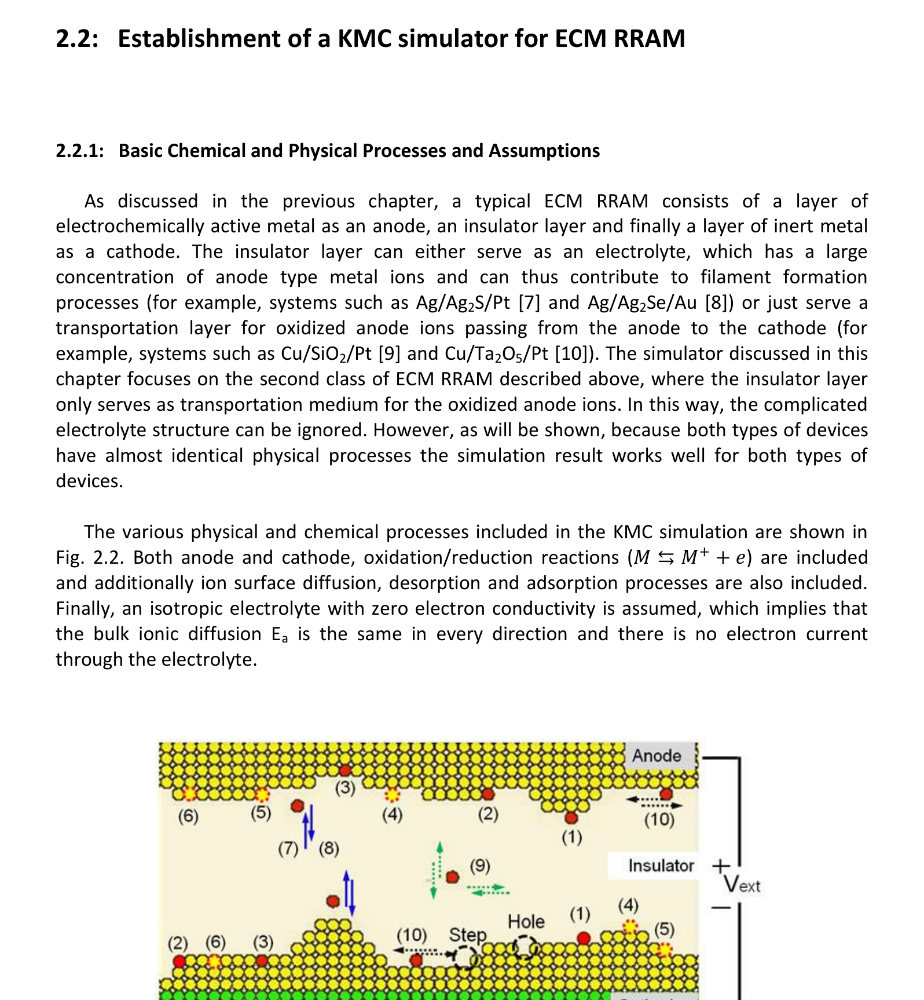
*Figure 2.2: KMC 仿真包含的全部过程与各自 $E_a$（PDF p55）*

**表中隐含的三条设计意图**：`reduction` 的 $E_a$ 随配位数升高而**降低**（0.35→0.30→0.25，即离子更倾向在 step/hole 位点还原 → 低压下各向同性致密沉积的微观根源）；`oxidation` 趋势**相反**（0.65→0.70→0.75）；`oxidation` 系统性大于 `reduction`（代表 Cu/Ag 这类大正 `SEP` 金属 —— 易捕获电子析出、难被氧化）。

#### 2.2.2 KMC 数学骨架（`transition state theory` + `VSSM`）

$$p_{stay,i}(t)=\exp(-\Gamma_i t)\ \ (1)\qquad p_i(t)=\Gamma_i\exp(-\Gamma_i t)\ \ (2)$$
$$\Gamma_{tot}=\sum_i\Gamma_i\ \ (3)\qquad \tau=\frac{1}{\Gamma_{tot}}\ \ (5)\qquad \Delta t=-\frac{\ln r}{\Gamma_{tot}}\ \ (6)$$

`TST` 无场速率（$\nu_o\approx10^{13}$ s⁻¹，近似原子振动频率）：
$$\Gamma_f=\nu_o\exp\!\left(-\frac{E_A}{k_BT}\right)\ (7)\qquad \Gamma_r=\nu_o\exp\!\left(-\frac{E_B}{k_BT}\right)\ (8)$$

有场时正/逆向 $E_a$ 分别修正 $\alpha q\Delta V$ 与 $(1-\alpha)q\Delta V$，**`symmetry factor` α 典型值 0.5**。电场可来自**离子空间电荷分布**与**外部电压源**两者。

#### 2.2.3 ★ 仿真器实际使用的速率公式（eq 9，全模型核心）

$$\sum_i\Gamma_i=\sum_i\nu_o\exp\!\left(-\frac{qE_{a,i}}{k_BT}\right)\exp\!\left(\frac{q\left(V_{initial,i}-V_{final,i}\right)}{2k_BT}\right)\exp\!\left(-\frac{qV_{self,i}}{2k_BT}\right)\tag{9}$$

> **注意等式两侧都有 $\sum_i$** —— 对应正文"both **individual and total** transition rates can be calculated"：左侧 $\sum_i\Gamma_i$ 即式 (3) 的 $\Gamma_{tot}$（式 (6) 所需）；去掉求和号后的被加项即单事件速率 $\Gamma_i$（VSSM 步骤 3 选择概率 $\Gamma_i/\Gamma_{tot}$ 的分子）。**一条公式同时给出个体速率与总速率。**

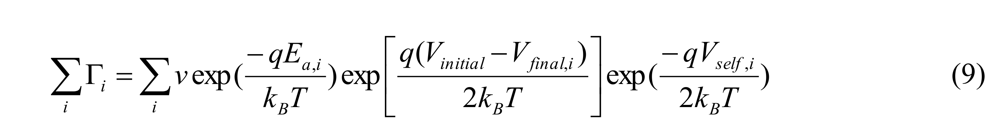
*式 (9) 原文 8× 高清裁剪（PDF p60）*

| 因子 | 作用 |
|---|---|
| ① $\nu_o\exp(-qE_{a,i}/k_BT)$ | 无场 `TST` 速率；$E_{a,i}$ 由「过程类型 × 位点类型」查上表 |
| ② $\exp(q(V_{initial,i}-V_{final,i})/2k_BT)$ | 电场降低势垒；**分母的 2 即 $\alpha=0.5$**（等价于 $k_BT/\alpha$） |
| ③ $\exp(-qV_{self,i}/2k_BT)$ | **排除 self potential** [16] —— 离子自身电势不帮助降低它自己的 $E_a$ |

#### 2.2.4 主循环（Figure 2.6 流程图）

```
初始化：电极各 150 原子/层，绝缘层 10 nm，t=0，构型=pristine
while 未达停止条件:
  1. 求解 Poisson equation（FDM，周期性边界）→ 每格点电势 V
  2. 排除 self potential（V ← V − V_self）
  3. 枚举所有可能跃迁，按 eq(9) 计算 Γ_i
  4. Γ_tot = Σ Γ_i                                    eq(3)
  5. Δt = −ln(RN)/Γ_tot ;  t ← t + Δt                 eq(6)
  6. 以 Γ_i/Γ_tot 概率选中事件 i（第二个随机数 RN'）    VSSM 步骤3
  7. 执行事件 → 更新所有原子/离子构型
  8. overgrowth/RESET 阶段：更新细丝每层电压分布，作为下一步新边界条件
  → 回到 1
电流提取：I = (单位时间到达阴极的金属离子数 × q) / 时间间隔
```

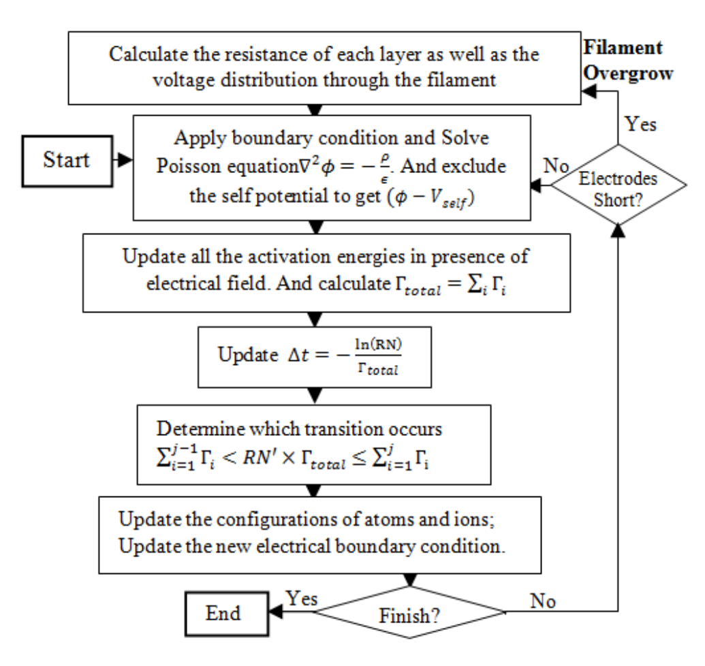
*Figure 2.6: KMC 仿真流程图（PDF p59）*

#### 2.2.5 几何、边界与建模近似（作者自承）

| 项 | 设定 |
|---|---|
| 维度 | **2D**（3D 算力不允许；**忽略面外电场**） |
| 每层电极原子数 | **150** |
| 绝缘层厚度 | **10 nm** |
| 边界条件 | **周期性**（求 Poisson 时）→ 忽略边缘效应，要求**宽厚比大** |
| Poisson 求解 | **有限差分（FDM）**，**每个 KMC 事件后重解** |
| 电解质 | **各向同性、零电子电导**（无电子电流穿过） |
| 中性原子扩散 | **忽略**（有外场时速率远低于离子） |

四条唯象近似（p56–58，作者明确标注为 phenomenological）：
1. **阳极 `oxidation` 机制取 (c) 场助离子注入**，而 Willis [11] 实验实际只支持 (d) 化学氧化辅助（T<450–500 °C、E<1 MV/cm 下）；作者的补救路径是"给 oxidation 指派更小的 $E_a$"。
2. **结晶过程简化**：假设所有被吸附离子**仍带电**，且**只允许被吸附离子做表面扩散**（跳过真实的 adion 部分电荷转移路径）；作者论证这不失普适性，因为仍保证 kink/step 位点比 `adatom` 稳定。
3. **化学反应 $E_a$ 靠实验拟合**，非第一性原理（Bronshtein [12] 三条理论困难：反应物与电极强耦合、路径依赖界面结构、速率依赖溶剂动力学）。
4. **`RESET` 阶段横向电场用二值近似**（小 → 允许离子在细丝尖端累积；大 → 不允许），以规避完整阴极形貌建模的算力开销。

**与已有方法的区别**：vs. `MD` —— 时间尺度从 1 µs 提升到 s 量级；vs. 纯 `Butler-Volmer`/Tafel 连续模型 —— 保留电荷离散性并自洽耦合体内输运；vs. Schindler [9] 的解析模型 —— 后者假设**全部电压降在阴极/SiO₂ 界面**且氧化与体内输运都不限速，作者认为该假设可疑。

**Ch 3/4 的方法**：`YSZ` 器件 fabrication（Structure I 筛选用 30 nm 8mol% YSZ / 100×200 µm²；Structure II 正式用 3–30 nm YSZ / 64×64 到 4×4 µm² / 100 nm PECVD Si₃N₄ 隔离）+ 变温 I-V + endurance/retention + `RTN`/`1/f noise` 谱测量 + `ISPP`（脉冲步进 + 穿插验证读取）。

## 3. 实验与结果

### 3.1 Chapter 2 仿真结果（全部与实验对照）

**设置**：2D，电极 150 原子/层，绝缘层 10 nm，α=0.5，$\nu_o$=10¹³ s⁻¹。

#### (a) 细丝形貌 vs 电压 —— 反直觉的"高压更细"

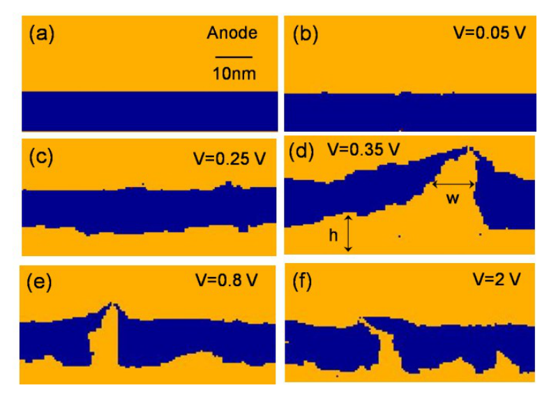
*Figure 2.7: 不同电压下的细丝形貌。(a) 初始；(b) 0.05 V；(c) 0.25 V；(d) 0.35 V（'h'=各向同性沉积厚度，'w'=细丝平均宽度）；(e) 0.8 V；(f) 2 V（PDF p61）*

| 电压 | 行为 | 形貌 |
|---|---|---|
| **远低于 $V_t$** | 氧化→脱附（不被还原回去）→阴极还原（不被重新氧化）三步串联几乎不可能 | **阴极无任何沉积**，Fig 2.7(b) |
| **≈ $V_t$** | 各向同性沉积，阳极–阴极间距基本不变 | **无间隙收缩 → 不成丝**，Fig 2.7(c) |
| **略高于 $V_t$** | 吸附阳离子倾向扩散到更稳定的 step/hole 位点还原 → 各向同性沉积 | **细丝宽度 'w' 大**，Fig 2.7(d) |
| **进一步升高** | `adatom` 形成变易 → 生长更快、更局域 | **宽度显著减小**，Fig 2.7(e)(f) |

**实验验证**：`Ag/Ag2S/W` 与 `Cu/H2O/Cu` **横向器件**（`Cu/H2O` 与仿真系统高度相似 —— **H₂O 不提供阳离子，只作输运介质**）→ 低压得宽细丝、高压得窄图案，与仿真相符（Figure 2.9）。

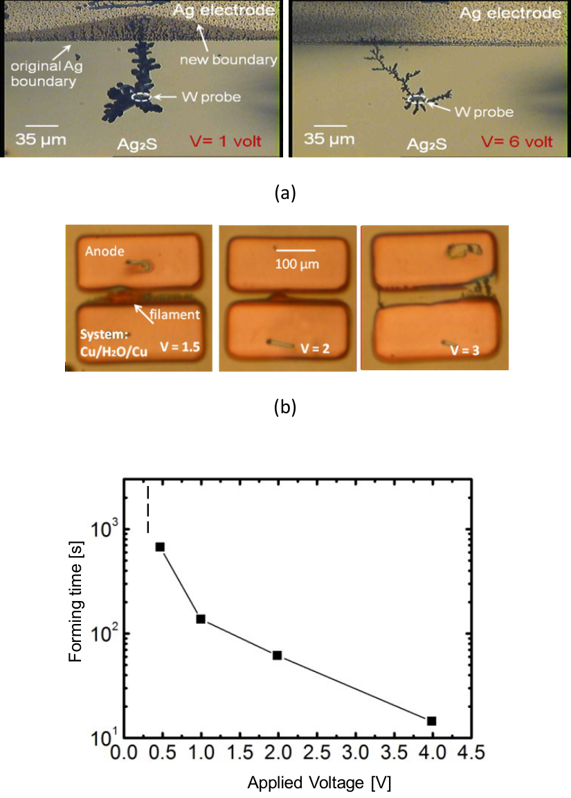
*Figure 2.9: (a) `Ag/Ag2S/W`、(b) `Cu/H2O/Cu` 的实验细丝形貌；(c) `Ag/Ag2S/W` 的 forming 时间 vs 电压实验结果（PDF p62–63）*

#### (b) $t_{Form}$–V 三段律，用 BV → Tafel 解释

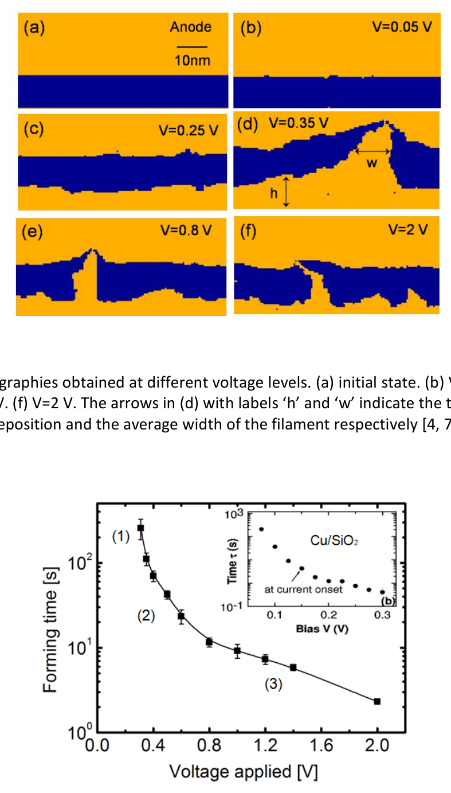
*Figure 2.8: forming 时间 vs 外加电压；插图为 `Cu/SiO2` 实验 [17]（PDF p61）*

| 区域 | 主导机制 | 阳离子通量 | 所需阳离子数 | $t_{Form}$ |
|---|---|---|---|---|
| **1** | 氧化/脱附/还原串联难完成 | 极低 | 极大（无间隙收缩） | 几乎不导通 |
| **2** | `BV` **线性区** | **线性** ∝ $\eta_s$ | 因形貌效应减小 | 随 V 下降（双重作用） |
| **3** | **`Tafel approximation`** | **指数** ∝ $\exp(\alpha nq\eta_s/k_BT)$ | 次要 | **指数**下降 |

关键中间量：$t_{Form}\approx$ 成丝所需阳离子数 / 平均阳离子通量；$\eta_s=V-U$（surface overpotential）；外加电压 = 阳极 $\eta_s$ + 阴极 $\eta_s$ + 介质压降。

#### (c) ★ α 提取值的三方对比 —— KMC 必要性的定量证据

| 来源 | α |
|---|---|
| 液体电解质电化学系统理论典型值 | **≈0.5**（仿真器**有意设为 0.5**） |
| `Cu/SiO2/Pt` 实验提取 [9] | **≈0.1** |
| **KMC 仿真结果提取** | **≈0.05** |

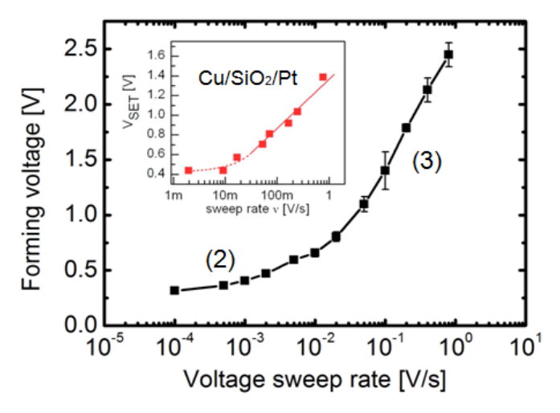
*Figure 2.10: 仿真 $V_{Form}$ vs 电压扫描率；插图 `Cu/SiO2/Pt` 实验 [9]（PDF p64）*

$V_{Form}$–扫描率三特征：扫描率→0 时 $V_{Form}$ **趋于常数**（存在 $V_t$）；扫描率略增时 $V_{Form}$ 略增；扫描率大时 $V_{Form}$ **对数依赖**扫描率（Schindler 解析式 eq 13–15：$V_{Form}=\frac{kT}{\alpha nq}\ln v+\frac{kT}{\alpha nq}\ln\frac{\alpha nqQ_{Form}}{kT\,i_0\,\pi r_f^2}$）。**巨大差异表明 `Butler-Volmer` 单独不能准确描述整个系统。**

#### (d) Scaling 律

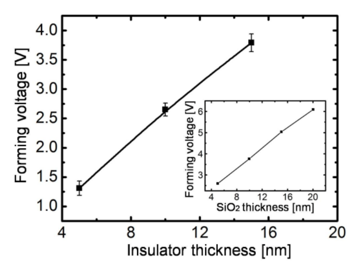
*Figure 2.11: $V_{Form}$ vs 绝缘层厚度（1 V/s）；插图 `Cu/SiO2/Pt` 实验 [9]（PDF p66）*

- **$V_{Form}$ 线性依赖绝缘层厚度**（1 V/s 扫描），与 `Cu/SiO2/Pt` 实验吻合 → **系统纯电场依赖**：有效压降 = 平均电场 × 初末态有效距离；离子每次约只跳一个晶格常数，故只要电场恒定，速率变化相同；电场 ∝ 1/厚度 → $V_{Form}$ ∝ 厚度。**推论：器件足够薄时 `forming` 可被有效消除。**

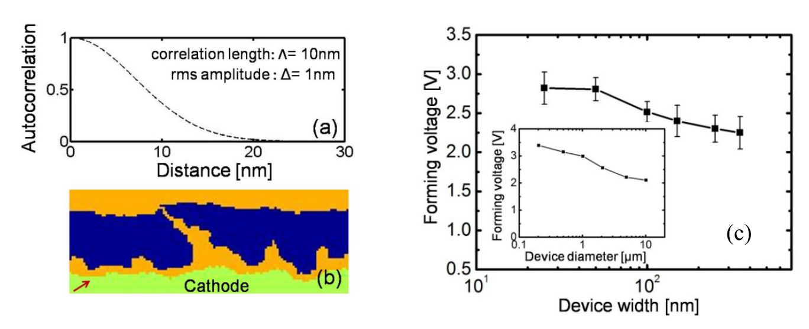
*Figure 2.12: (a) Gaussian 自相关；(b) 仿真粗糙度图案；(c) $V_{form}$ vs 器件宽度 + `Cu/Ta2O5/Pt` 实验 [10]（PDF p67）*

- **面积效应**：用 **Gaussian 自相关**生成阴极粗糙度（**相关长度 10 nm，rms 1 nm**；作者注明因仿真时间限制，相关长度小于真实值）→ **两电极间有效距离最短处最易成丝（该处有效电场最强）**；$V_{form}$ 在小尺寸时**趋近常数**，随尺寸增大**逐渐减小**。与 `Cu/Ta2O5/Pt` 实验一致。

#### (e) I-V 四区域 + `filament overgrowth`

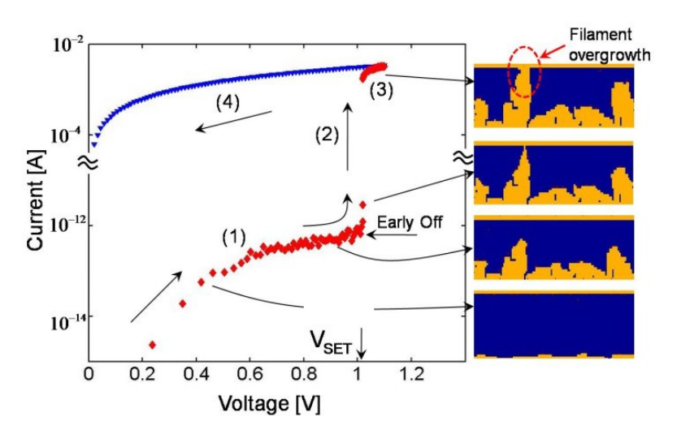
*Figure 2.13: 仿真 I-V 与细丝形状。**扫描率 3 V/s，细丝电阻率 5×10⁻⁸ Ω·m，$R_{ext}$=100 Ω**（PDF p68）*

| 区域 | 电流类型 | 面积依赖 |
|---|---|---|
| **1** | **离子电流**（未成熟细丝） | **∝ 电极面积** |
| **2** | 细丝短接两电极 → **急剧开启** | **面积无关** |
| **3, 4** | **欧姆电子电流** | **面积无关** |

短接后由于细丝电导率非理想、其上仍有大压降 → **化学过程继续 → 细丝变宽、电导率持续升高，直到与外部测试系统达成稳态**；**细丝每层电压分布每步都要更新**。为简化 overgrowth，**采用平坦阳极**（依据：细丝形貌主要由阴极决定 [19]）。**忽略热效应** —— 在细丝电阻大或串联保护电阻（电流有限、热耗散小）时是好近似。

#### (f) `SET` 统计与恒流模式

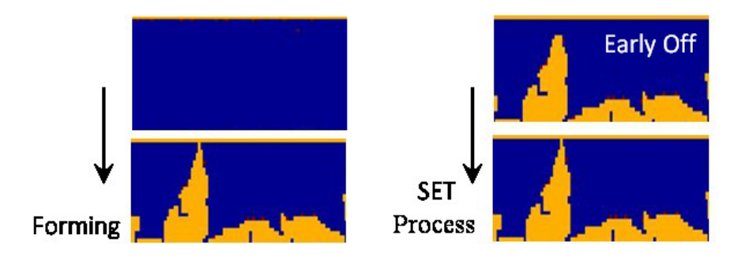
*Figure 2.14: `forming` 与 `SET` 对比 —— SET 只需细丝顶部几层原子（PDF p69）*

**`SET` 初始构型 = 移除顶部 6 层原子** → $t_{SET}\ll t_{FORM}$。

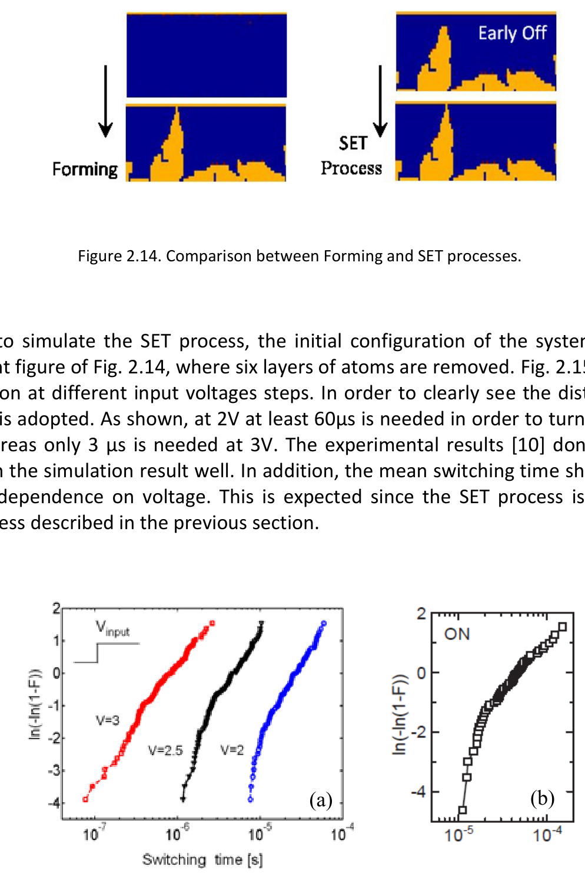
*Figure 2.15: (a) $t_{ON}$ `Weibull` 分布；(b) `Cu/Ta2O5` 实验 [10]（PDF p69）*

- **2 V 下开启 99% 器件至少需 60 µs；3 V 下仅需 3 µs**（`Weibull plot` 以看清分布尾部）；平均开关时间对电压呈**反指数依赖**；与 `Cu/Ta2O5` 实验吻合。

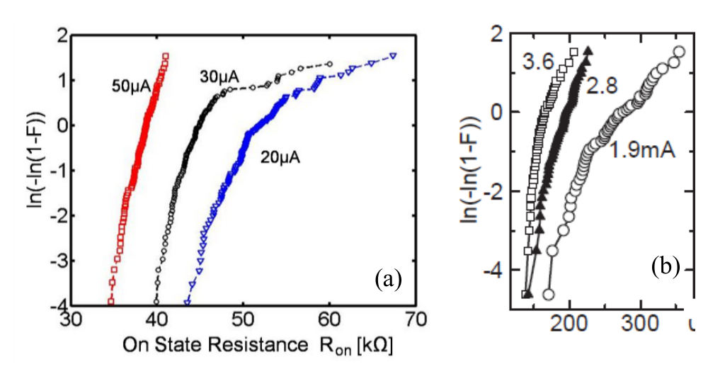
*Figure 2.16: (a) 不同电流输入下的 $R_{on}$ 分布；(b) `Cu/Ta2O5` 实验 [10]（PDF p70）*

- **恒流模式**：每时间步算系统总电阻 → 电压 = 电流 × 电阻，**在细丝每层更新**。结果：**大编程电流 → 更小 $R_{on}$ 且分散性更小**（overgrowth 效应）。

#### (g) `RESET`：断裂位置由横向电场决定

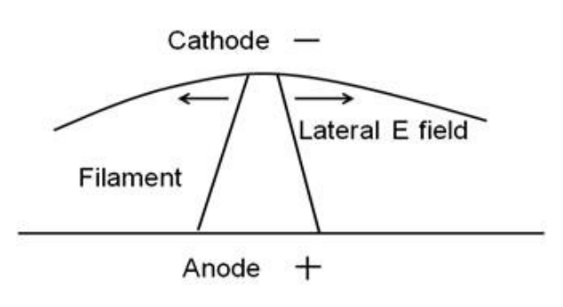
*Figure 2.17: RESET 阶段阴极区附近横向电场示意（PDF p71）*

| 横向电场 | 物理 | 仿真处理 | 断裂位置 |
|---|---|---|---|
| **小** | 溶解离子难从尖端横向扩散出去，倾向垂直漂移并**累积在正对尖端的阴极上** | **允许尖端累积** | **细丝中部** 或 靠近惰性电极（Fig 2.18c 白圈） |
| **大** | 离子可横向扩散 | **不允许尖端累积** | **细丝顶部 / 靠近活性电极**（Fig 2.18a） |

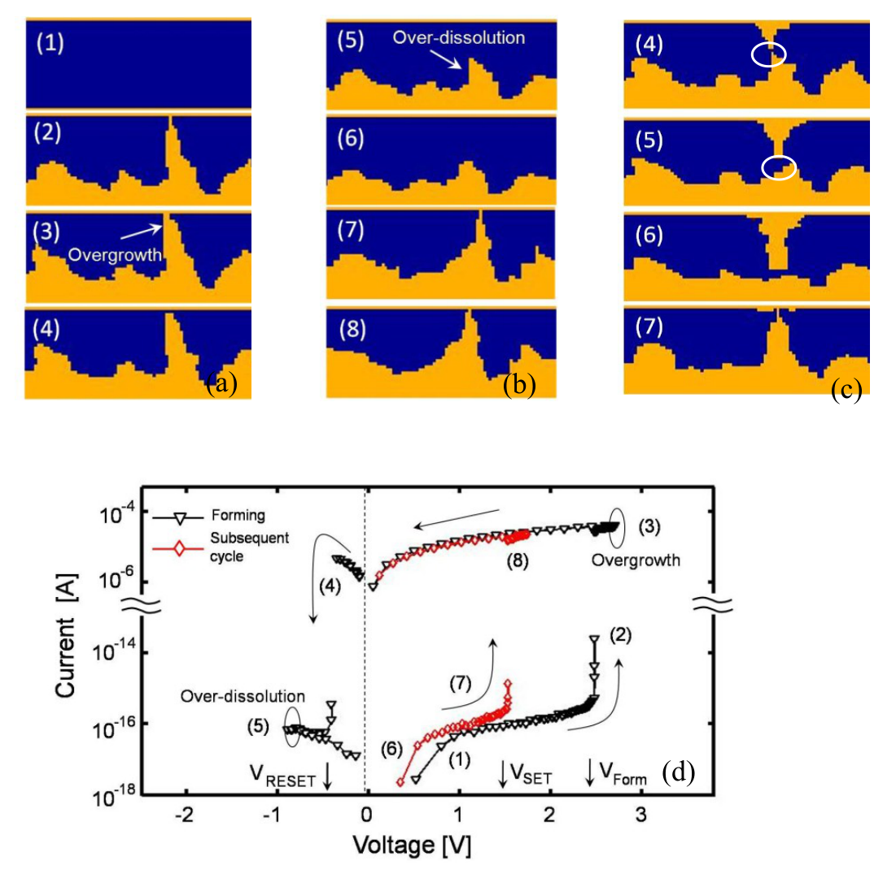
*Figure 2.18: 完整双极循环 (1)→(8)。**扫描率 1 V/s，$R_{ext}$=30 kΩ，细丝电阻率 5×10⁻⁶ Ω·m**；overgrowth 与 over-dissolution 清晰可见；后续循环 $V_{SET}\ll V_{Form}$（PDF p72）*

- 区域 (1) 离子电流 → $V_{Form}$ 处急剧开启 → 欧姆电流 → 细丝有压降 → **overgrowth**（(2)→(3) 变宽、电阻减小）→ 扫回零 → 负压溶解 → **$V_{RESET}$≈0.4 V 处断裂** → **over-dissolution**。
- **后续循环因存在未溶解细丝，$V_{SET}\ll V_{Form}$**。
- **overgrowth/dissolution 期间细丝每层电压分布每步更新，作为 KMC 新边界条件。**

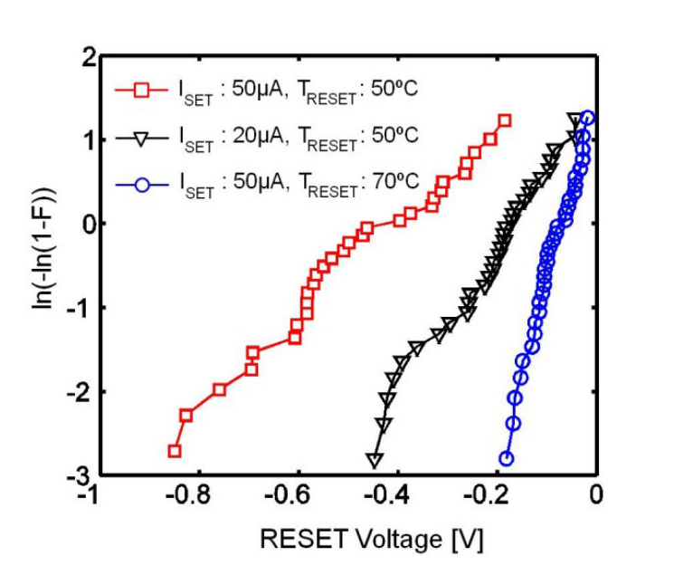
*Figure 2.19: 不同 $I_{SET}$ 与 `RESET` 温度下的 $V_{RESET}$ 分布（PDF p73）*

- **更大 $I_{SET}$ → 更大 $V_{RESET}$**（须溶解更多原子）；**更高 T 加速溶解 → 小得多的 $V_{RESET}$ 且分布更集中**。
- ⚠️ 全章唯一自相矛盾处：2.3.4 开头声明"当前 KMC 仿真器没有实现温度依赖"，而 Fig 2.19 又"包含温度效应"。合理解读：**T 是外部给定参数直接进入 eq(7)(8)(9)，做的是等温扫描，而非自洽 Joule 热耦合**。

#### (h) 材料参数扫描

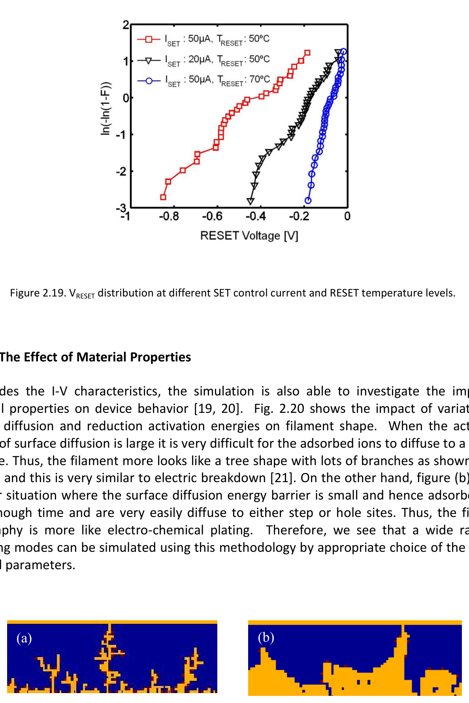
*Figure 2.20: (a) $E_{surf}$ 大、$E_{adatom}$ 小 → **树枝状多分支**（类电击穿分形 [21]）；(b) $E_{surf}$ 小、$E_{adatom}$ 大 → **类电化学电镀**致密（PDF p73）*

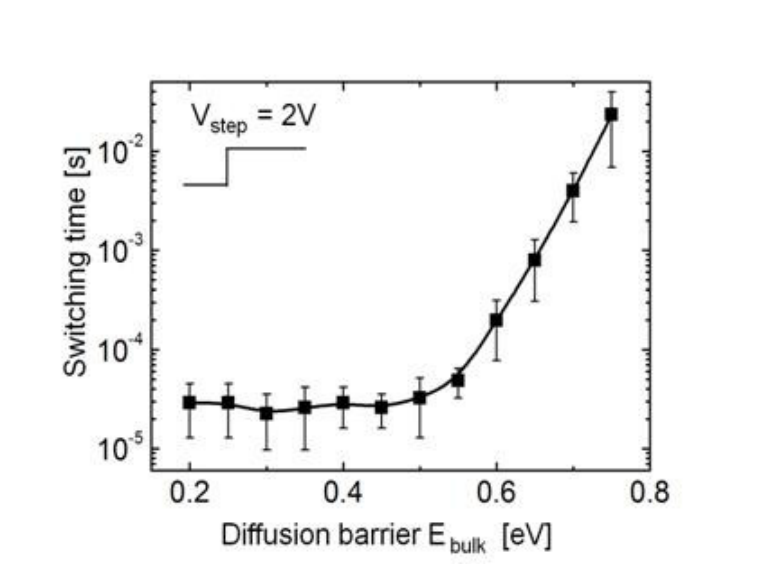
*Figure 2.21: 开关时间 vs 固体电解质扩散势垒（PDF p74）*

| $E_{bulk}$ | 限速过程 | $t_{ON}$ |
|---|---|---|
| **大** | **体相扩散** | $t_{ON}\propto\exp(E_{bulk}/k_BT)$，随 $E_{bulk}$↓ 快速下降 |
| **进一步减小** | **`oxidation` + 金属结晶** | **饱和** |

→ **材料工程最有价值的结论**：提高介质离子迁移率的收益有上限，上限由电极反应 $E_a$ 决定。**"通过适当选择系统物理参数，可以用这一方法仿真出宽泛的开关模式。"**

### 3.2 Chapter 3 `YSZ` 实验结果

**顶电极对比（Structure I，Table I / `./tables/table-i.png`）**：

| 顶电极 | 机制 | $V_{Form}$ | Yield | Endurance | 备注 |
|---|---|---|---|---|---|
| **Au** | — | **最大**，分布均匀 | — | — | **BD 电场 ≈5 MV/cm**（外延单晶 YSZ 4 MV/cm，多晶更低）；forming 后**卡 LRS** |
| **Ni** | — | — | — | — | **完全无开关** |
| **Ti** | **`VO` 型** | 降低、分布大 | **≈60%** | **>10⁴** | 界面 Ti 被氧化 → YSZ 内生成 `VO` → 削弱介质强度；变化源于**不可控自发化学反应** |
| **Al** | ECM（金属性） | 降低、分布大 | **<10%** | **<10** | 易氧化难析出 → 难成稳定细丝；**大量 Al 离子困在膜内 → 卡 LRS** |
| **Cu** | **ECM** | **小得多** | **≈80%** | **≈100** | — |
| **Ag** | ECM | **最小** | — | — | 扩散率≫Cu；**过于可扩散 → 缺乏电压控制**；$V_{RESET}$ 极小 → 易受噪声/read disturb；**易卡 LRS** |

**Ti/YSZ vs Cu/YSZ**：

| 指标 | Ti/YSZ | Cu/YSZ |
|---|---|---|
| **Endurance**（ISPP，$R_{on}$=10 kΩ / $R_{off}$≈100 kΩ） | **几乎所有器件 >10⁴ cycles**（仅受测量时间限制） | **最好器件 ≈180 cycles** |
| **$V_{SET}$/$V_{RESET}$ uniformity** | 变化小得多 | **cycle-to-cycle 变化非常大** |
| **off 态机制** | **`SCLC` + 电子 hopping** | — |
| **on 态机制** | **欧姆 + 电子 hopping** | 欧姆（金属性） |
| **电子 $E_a$ 势垒** | **与电阻态正相关**；$R_{on}$<1 kΩ 时仍约 **0.02 eV** | **找不到这样的势垒** |
| **面积依赖** | $R_{on}$ 无关 → **局域细丝导电**；$R_{off}$ ∝ 1/面积 → **体导电** | — |
| **$R_{off}$ retention** | **稳定，20 kΩ–1 MΩ** | 非常稳定，**通常为常数** |
| **$R_{on}$ retention** | ≈10 kΩ 稳定；**≈1 kΩ 很不稳定**（实测 **400 Ω → 3 kΩ / 10⁴ s**） | **<1 kΩ 很稳定（与 Ti 相反）**；**≈20 kΩ 很差**（细丝变窄 → 少量 Cu 横向扩散即使有效宽度显著减小） |
| **噪声** | **低得多**，且有**噪声恢复能力** | 高，**随电阻增大而恶化**（细丝变窄） |

**Cu/YSZ 差的根源**：ECM 型中**金属结晶是成丝关键过程 → 对界面质量要求极苛刻**。支撑证据 [21]：`Pt/NiO/Pt` 也有大 $V_{SET}$ 变化与 <200 cycles endurance，加入薄 **IrO₂** 后显著改善，TEM 显示 **IrO₂ 增强了 NiO 在界面处的结晶度**。另一因素：惰性电极侧**有机污染物** [23] 阻碍结晶 → on 态不稳定。但作者强调不可一概而论 —— `Cu/amorphous Ta2O5` 文献 [24] 可达约 **10⁴ cycles**；一般而言 **`VO` 型在 endurance 与 uniformity 上倾向优于 ECM 型**。

**Ti/YSZ 的 $R_{on}$ 退化机制**：体相 YSZ 热学化学稳定 → $R_{off}$ 稳定；但 **Y 阳离子与 O 阴离子键合极强** → `SET` 生成的 `VO` 倾向与 O²⁻ 复合成稳定相 → $R_{on}$ 随复合进行而增大；**封装不良会加速**（吸收环境氧气/水汽）。

### 3.3 Chapter 4 `MLP` 与 `ISPP` 结果

- **Cu/YSZ**：`SET`/`RESET` 均尖锐；电导降到一个最小值 —— **那是 HRS 唯一稳定态** → **RESET 阶段 MLP 不可能**。
- **Ti/YSZ**：`SET` 尖锐但 **`RESET` 非常平滑**（Fig 4.1b）；**超过 $V_{RESET}$ 阈值后 $R_{off}$ 随电压指数增长**（ISPP，脉冲宽度 **1 µs**，Fig 4.2）；**新器件 on/off 窗口 >10⁴**。
- **四级 MLP 实现**（Fig 4.4）：**$R_{on}$ ~8 kΩ + 三个高阻态最高 ~2 MΩ**。
  - ⚠️ Fig 4.4(b) 器件在**前 3000 cycles** 成功后出现**电容充电效应** → $R_{on}$（红点）跌破 1 kΩ → 第一级 $R_{off}$（蓝点）升高并与第二级（黑点）混叠。物理链：$R_{on}$↓ → 同 $V_{RESET}$ 下 **Joule 热更多** → 削弱 **Ti/YSZ 界面 Ti-O 键** → 极短时间生成**过量 O²⁻** → 与 `VO` 复合 → 电阻剧增；过量热还帮 YSZ 克服 **LRS→HRS 相变势垒** → $R_{off}$ **急剧而非渐进上升** → 编程错误。**结论：MLP 必须最小化寄生电容。**
- **平滑 RESET 的物理判据（本章核心论点）**：
  1. **半导体相/hopping 系统优于金属相** —— 给定电阻下**细丝横截面积大得多**、同 RESET 电流下**热密度更小**；
  2. **反馈方向决定性** —— 金属性物种溶解是**自加速**且因**正温度电阻系数**对 Joule 热敏感 → **易形成 weak spots**；hopping 型是**负反馈** → **难形成 weak spots**；
  3. **`SEP` 定量判据**：**Y = −2.37 V，Zr = −1.53 V，Ni = −0.25 V，Cu = +0.34 V**（越正越易捕获电子）→ Y/Zr 难还原、Ni/Cu 易还原 → **`CuxO`/`NiO` 器件呈金属导电且 RESET 尖锐**。
- **`ISPP` vs 单脉冲（Fig 4.6a）**：单脉冲下**两类失效都出现** —— 黑曲线**卡 LRS**（`SET` 期间额外电应力）、蓝曲线**卡 HRS**（$V_{RESET}$ 无效）；**ISPP 下 endurance >10⁴ cycles（红线），两类失效均未出现**。
- **窗口 vs endurance 折中（Fig 4.6b）**：**窗口 >3000 时某些器件仅 100 cycles；窗口 =10 时几乎所有器件 >10⁴**。
- **$V_{SET}$–$V_{RESET}$ 关联（Fig 4.5）**：$V_{SET}$ 在**约 3000 cycles 突降 ~1 V**，$V_{RESET}$ **同时相应降低**（电容充电效应：小 $V_{SET}$ → 电容放电电流小 → overgrowth 少 → RESET 更易）；**10⁴ cycles 测试中二者近乎线性相关，斜率 ≈1**；**约 5000 cycles 处又逐渐回升**。
- **$V_{SET}$ 突降的微观起因**：HRS 下细丝–电极间隙中可能**热产生额外 `VO`**；`RESET` 时细丝尖端部分 `VO` **逃脱湮灭** → 残余 `VO` 降低局部介质强度。
- **HRS 退化机制**：大窗口需大 $V_{RESET}$ 从 Ti 电极抽更多 O²⁻ 送到 `VO` 位点；**只有局部 O²⁻ 充足时才不损伤器件**；随机发生**局部 O²⁻ 不足**时 O²⁻ 输送饱和，**更大的 $V_{RESET}$ 反而削弱介质键合并产生更多 `VO`（类 `SET` 过程）** → HRS 逐渐退化。
- **ISPP 唯一缺点：编程更耗时** → 可**增大相邻脉冲电压差**（0.3 V 或 0.5 V 代替 0.1 V）折中 endurance 与速度。

### 3.4 作者特别强调的发现

- **"there is no fundamental difference"** between metal-cation and `VO` based RRAM —— 二者是描述同一组原子过程的两种方式（1.3.4、4.2、5.1.3 反复重申）。
- **"KMC cannot generate new physics"** —— 所有物理必须在仿真前定义；**原子尺度仿真的挑战不在算法，而在构建有意义的化学反应机制**（引 Battaile [3]）。
- **"the width of the filament is inversely proportional to the applied voltage"**（短接瞬间）—— 但**紧接着被 overgrowth 反转**：最终平衡态下大电压/大电流 → 更宽细丝。
- **"when the device becomes thin enough, the forming process can be effectively eliminated"** —— 厚度 scaling 的理想性质。
- **"switching speed is limited by oxidization and crystallization"** —— 提高介质离子电导的收益有上限。

## 4. 创新点 · 局限 · 后续思考

### 4.1 创新点 / Contributions（以作者声称为骨架）

1. **建立了 ECM `RRAM` 的 `KMC` 仿真器**，纳入 `oxidation`、`reduction`、金属结晶、`adsorption`、`desorption`、离子输运等**绝大多数重要物理化学过程**，速率基于 `transition state theory`，并与 `Poisson equation`（FDM，周期性边界）**自洽耦合**、显式排除 **self potential**。
2. **系统给出了 scaling 与统计规律**：$t_{Form}$–V 三段律、$V_{Form}$–扫描率对数律、$V_{Form}$ ∝ 厚度、$V_{Form}$–面积对数律、$t_{ON}$ `Weibull` 分布、$R_{on}$–$I_{CC}$ 分布、$V_{RESET}$–$I_{SET}$/T 关联；**并用 `Ag/Ag2S/W`、`Cu/H2O/Cu` 横向器件实验验证**。
3. **预测了 `RESET` 断裂位置对横向电场的依赖**（小横向场 → 中部/近惰性电极断裂；大横向场 → 近活性电极断裂），并演示 `filament overgrowth` / over-dissolution 与 $V_{SET}\ll V_{Form}$。
4. **（实验部分）** 系统比较 Au/Cu/Ni/Al/Ti/Ag 六种顶电极在 `YSZ` 上的机制归属与性能，阐明 `Ti/YSZ` ≫ `Cu/YSZ` 的界面微观结构根源与噪声差异。
5. **（实验部分）** 用 **hopping 导电 + 负反馈 + `SEP`** 三条论证解释**平滑 RESET 的物理判据**，据此实现 `Ti/YSZ` **四级 MLP**；证明 **`ISPP` 可为每器件每循环定制最优 $V_{SET}$/$V_{RESET}$**，显著提升 endurance/可靠性并优化窗口–寿命折中。

### 4.2 局限性 / Limitations

**作者自承**：
- **无温度依赖 / 无自洽 Joule 热耦合**（靠"细丝电阻大或串联大保护电阻"正当化）；
- **2D，忽略面外电场**（"Ideally the simulation should be carried out in 3D"）；
- **周期性边界 → 忽略边缘效应**，要求宽厚比大；
- **阳极 `oxidation` 机制 (c) 与 Willis 实验支持的 (d) 不符**；
- **化学反应 $E_a$ 靠实验拟合**，非第一性原理；
- **`RESET` 横向电场只做二值近似**，未完整建模阴极形貌；
- **表观 α 的 0.5 → 0.05 巨大差异未被解释**（"Further detailed studies are needed"）；
- **粗糙度相关长度 10 nm 小于真实值**（仿真时间限制）；
- **多数过程是 phenomenological**；`KMC` 不能生成新物理。

**(reviewer's note) 作者未明说但影响复现的**：
- **未给出晶格类型与格点间距的显式数值**：只说"每层电极 150 原子、绝缘层 10 nm"，需自行反推格点尺寸（若 150 原子对应约 40 nm 宽、10 nm 约 30–40 个格点行，则格点间距约 0.25–0.33 nm，接近 Cu 晶格常数 —— 但这是我的推断，原文未写）。
- **未给出 Poisson 方程的具体形式与介电常数取值**：只说 FDM + 周期性边界 + 排除 self potential；空间电荷如何映射到格点、$V_{self,i}$ 如何计算（解析扣除还是数值求解两次）均未说明。
- **未给出 $\nu_o$ 是否对所有 10 个过程统一取 10¹³ s⁻¹**（原文只在 eq(7) 处泛述）。
- **未给出离子电荷态**（Cu⁺ 还是 Cu²⁺）：eq(9) 中 q 的取值直接影响电场修正项大小；Figure 2.5 [14] 显示扩散势垒依赖电荷态（0.15–0.2 eV），但仿真取 0.15 eV 对应哪一价态未说明。
- **"停止条件"从未具体定义**：VSSM 步骤 1 要求"choose conditions when to step the simulation"，但形成判定（细丝桥接？电流超阈？）未给判据。
- **Figure 2.13 与 2.18 的细丝电阻率相差 100 倍**（5×10⁻⁸ vs 5×10⁻⁶ Ω·m）：后者是为了让细丝上有足够压降驱动化学过程而人为放大，属建模手段而非物理值 —— 复现时若统一取金属真值，overgrowth 会显著减弱。
- **$R_{ext}$ 在两处差 300 倍**（100 Ω vs 30 kΩ），与"忽略热效应"的前提绑定，须成套采用。

### 4.3 后续 / Future directions

**作者在 5.2 提出的、与 KMC 直接相关的四条缺口**：
1. ⭐ **温度依赖 / Joule 热自洽耦合**；
2. ⭐ **3D 仿真**；
3. ⭐ **纳入 O₂/H₂O 辅助的化学氧化机制 (d)**（作者给的实现路径：调小 `oxidation` 的 $E_a$）；
4. ⭐ **厘清各物理化学过程对表观 α 的影响**。

**实验方向**：`YSZ` 界面微观结构控制与表征（IrO₂ 类界面工程）、封装对 retention 的影响、`MLP` 寄生电容最小化、隧穿电流温度依赖性缺乏显式数学形式。

**可复现性 / 代码与数据公开性**：
- ❌ **论文未提供任何仿真器源代码**，未提及代码或数据仓库（2012 年博士论文，无 supplementary code）。
- ✅ 但 Chapter 2 有**四篇配套已发表论文**可作为方法细节的补充来源，建议按此顺序追读：**[7] Pan, Yin, Subramanian, IEEE EDL 32(7):949-951, 2011**（forming 专题，最详细）→ **[4] Pan, Yin, Subramanian, IMW 2011** → **[19] Pan & Subramanian, SISPAD 2010, pp.19–22**（`SET` 专题）→ **[20] Pan & Subramanian, DRC 2010, p.255**。
- ✅ **方法学上游文献**（复现 eq(9) 与 FDM-KMC 耦合所必需）：**[1] Voter** 的 KMC 综述、**[2] Jansen** arXiv:cond-mat/0303028（VSSM 四步）、**[5] Saedi** J. Electroanal. Chem. 588 (2006) 267-284（**FD-KMC 耦合，与本研究最接近的完整方法论**）、**[16] Modak & Lusk** Solid State Ionics 176 (2005) 2181-2191（**self potential 排除的具体做法**）、**[18] Kaya** SISPAD 2001（Gaussian 自相关粗糙度生成）、**[15] Newman & Thomas-Alyea** *Electrochemical Systems* 3rd ed.（BV/Tafel/SEP）。

---

## 附录 / Assets index

由资产抽取脚本自动生成（**编号严格跟随论文原序**，Figure 2.N → `figure-N.png`）：

- **Figures**: **21 张**（Chapter 2 全部 Figure 2.1–2.21），见 `./figures/figure-1.png` … `./figures/figure-21.png`
  - 位图直接抽取：figure-1, 5, 6, 7, 8, 9, 10, 11, 12, 13, 14, 15, 16, 17, 18, 19, 20, 21
  - 矢量图按整块页面区域截取（3× 分辨率）：figure-2, 3, 4
- **Tables**: **4 张**（Chapter 1/3 的表格；Chapter 2 无编号表格，其参数表以 Figure 2.2 caption 形式给出），见 `./tables/table-1-1.png`, `table-1-2.png`, `table-1-3.png`, `table-i.png`
- **Equations（额外补充，非 skill 标准项）**: **6 张**高清公式裁剪（4×/8×），见 `./code/equation-1-5.png`, `equation-6-vssm.png`, `equation-7-8.png`, `equation-9.png`（8×）, `equation-10-12.png`, `equation-13-15.png`
  - 补充原因：原文公式由 **Symbol 字体的分段括号/分数线图像**拼合，纯文本抽取严重错位；`equation-9.png` 为 **8× 放大**，用于核对 `*.zh-full.md` 中 LaTeX 重构的准确性
- **manifest.json**: 全部资产的页码、caption、像素尺寸与 warnings

---
*Generated by paper-analyzer skill · 中文版*
