# KMC 搭建过程与论文研究拆解

**论文：** Feng Pan, *Experimental and Simulation Study of Resistive Switches for Memory Applications*, UC Berkeley，学位论文 Fall 2012，技术报告 UCB/EECS-2013-38（2013）。

**核心结论：** 第 2 章建立的是一个二维、电场与构型逐事件耦合的 ECM 金属细丝 KMC 模型。模型把氧化、还原、吸附、脱附、体扩散、表面扩散分解成 10 类带能垒的事件，通过泊松方程更新局部电势，再按事件速率抽样推进真实时间。它主要研究 forming / SET，也用近似方法研究 RESET。

本报告以本文件夹中的完整译文、原图和公式截图为起点，并核对了[伯克利原论文](https://www2.eecs.berkeley.edu/Pubs/TechRpts/2013/Archive/EECS-2013-38.pdf)。原文保存在 [source/EECS-2013-38.pdf](source/EECS-2013-38.pdf)。**以下页码均为 PDF 文件页码；论文正文页码 = PDF 页码 − 8。**

为区分证据，本文使用三个标记：**原文** 表示正文、图注或公式明确给出；**图解** 表示结合原图与正文所作的解释；**复现建议** 表示为了写成程序而补充的方案，不能当成作者源码细节。

## 1. 论文研究内容细分

### 1.1 全文的两条研究线

| 部分 | PDF 页码 | 研究问题 | 方法与结果 | 与 KMC 的关系 |
|---|---:|---|---|---|
| 第 1 章：存储器与 RRAM 背景 | 9–50 | Flash 为何受缩放限制？ECM 与氧空位型 RRAM 如何工作？ | 综述存储、阻变机制、性能和多级编程问题 | 为后续研究提供背景，不是作者的 KMC 事件库 |
| 第 2 章：ECM RRAM 的 KMC | 51–76 | 金属细丝怎样形成、增粗、断裂？随机过程如何产生器件分布？ | 二维 KMC + 有限差分泊松求解；形貌、时间、电压、电阻及其统计 | **本报告的建模核心** |
| 第 3 章：非晶 YSZ RRAM 实验 | 77–102 | 顶电极怎样改变阻变机制与可靠性？ | 比较 Au、Ni、Al、Ti、Cu、Ag；详细研究 Ti/YSZ 与 Cu/YSZ 的 I–V、耐久、保持、噪声 | 是独立实验线；不是第 2 章模型对 YSZ 的直接拟合 |
| 第 4 章：多级编程与编程方法 | 103–112 | 怎样获得稳定的多个电阻态？怎样减少过编程与失效？ | Ti/YSZ 的平滑 RESET、四级存储、ISPP 及电阻窗口与寿命的折中 | 器件应用与可靠性实验，未建立新的 KMC 事件库 |
| 第 5 章：结论与未来工作 | 113–118 | 总结规律及尚缺的物理和算法 | 强调热传导耦合、减少无效快速运动的计算开销，以及改善 YSZ 制备与统计 | 区分已完成的模型与后续改进方向 |

**不要把第 3 章引述的 YSZ 离子电导 KMC 文献，当成作者在第 2 章建立的 ECM 模型。** 也不要把 Ti/YSZ 的氧空位生成、氧离子复合直接加入这 10 类金属离子事件，再称为原论文复现。

### 1.2 第 2 章按“问题—变量—输出”拆开

| 原文小节 | PDF 页码 | 具体任务 | 主要输入或控制变量 | 主要输出 / 原图 |
|---|---:|---|---|---|
| 2.1 KMC 基础 | 51–54 | 建立连续时间随机跃迁与过渡态速率 | 事件速率、温度、随机数 | 等待时间和事件选择，式 (1)–(8)，图 2.1 |
| 2.2.1 过程与假设 | 55–58 | 定义允许发生的原子过程 | 过程类型、表面位点、零场能垒 | 10 类事件；图 2.2–2.5 |
| 2.2.2 仿真程序 | 58–60 | 将电荷、场、能垒、事件、时间闭合 | 当前构型、电极边界、局部电势 | 主循环图 2.6；速率式 (9) |
| 2.3.1 细丝形成 | 60–65 | 解释形貌与 forming 时间、电压扫描率 | 恒压、扫描率 | 图 2.7–2.10；三段时间–电压关系、扫描率效应 |
| 2.3.2 尺寸效应 | 65–67 | 分离厚度与横向尺寸的影响 | 介质厚度、器件宽度、阴极粗糙度 | 图 2.11–2.12；厚度近线性关系、宽度与粗糙度效应 |
| 2.3.3 I–V 与 SET | 67–70 | 从原子轨迹提取电流和开关分布 | 扫压、残余细丝、电压 / 电流输入 | 图 2.13–2.16；过生长、SET 时间分布、Ron 分布 |
| 2.3.4 RESET | 70–73 | 研究反偏下断裂及断裂位置 | 横向场近似、SET 电流、温度条件 | 图 2.17–2.19；完整循环、过溶解、VRESET 分布 |
| 2.3.5 材料参数 | 73–74 | 解释不同形貌和限速步骤 | 表面扩散、adatom 还原、体扩散能垒 | 图 2.20–2.21；树枝状 / 致密形貌，速度饱和 |

### 1.3 YSZ 实验线的研究成果

第 3 章先筛选顶电极，再比较 Ti/YSZ 的氧空位相关导电与 Cu/YSZ 的金属细丝导电。作者结合变温 I–V、面积依赖、保持与噪声进行机制判断。所测条件下，Ti/YSZ 耐久超过 10⁴ 次，而详细对照中的 Cu/YSZ 最好约 180 次；这些数值有工艺与编程条件，不能扩展成所有 ECM 与氧空位器件的普遍性能排名。

第 4 章利用 Ti/YSZ 较平滑的 RESET 控制高阻态，演示了四级编程，低阻态约 8 kΩ，高阻态最高约 2 MΩ。ISPP 在脉冲间穿插读验证，按每个器件、每个循环的实际状态停止编程；它改善寿命，但会增加编程时间。更大的电阻窗口仍会损害耐久。上述实验解释涉及热效应，并不意味着第 2 章已经实现自洽热求解。

## 2. 搭建前先确定建模对象

【原文，PDF 55–58】对象是“活性金属 / 绝缘输运层 / 惰性电极”型 ECM 器件：阳离子主要由活性电极提供，介质作为输运媒介。电解质被当成各向同性介质，体扩散零场能垒各向相同，介质电子电导设为零。

在 SET 极性下，活性金属氧化，离子脱附后穿过介质，在阴极附近吸附、还原并长成金属细丝；细丝首次桥接两极后出现电子导电。反向偏压使原 SET 阳极成为 RESET 阴极，原 SET 阴极成为 RESET 阳极，细丝发生氧化溶解。

**这一模型同时包含两侧金属表面的氧化 / 还原，不是把所有正向、反向反应永久绑定到某一侧。** 但这不意味着应把惰性基底的原子也按 Cu 的参数溶掉；需要区分基底和表面沉积的活性金属。

## 3. 格点、状态与边界：论文给了什么

### 3.1 明确给出的空间设置

| 项目 | 原文可确认的内容 | 定位与解释 |
|---|---|---|
| 维度 | **二维** | PDF 58–59，2.2.2；忽略面外电场 |
| 横向原子数 | **每层电极 150 个原子** | 不是“整个器件 150 个原子”，也不是“150 × 150 网格” |
| 初始介质厚度 | **10 nm** | 是物理长度，不等于 10 层格点 |
| 泊松离散方法 | **有限差分 FDM** | 原子位点与电场网格是否一一对应，未明确说明 |
| 边界 | 泊松求解采用**周期边界** | 用于忽略边缘效应；正文未逐边列出边界方程 |
| 介质离子扩散 | 零场能垒各向相同 | 加电场后不同方向的速率仍会不同 |
| 基本反应电荷 | 图 2.2 正文写 **M ⇌ M⁺ + e**，式 (9) 使用 q | 最贴近原文的是单价离子模型；没有独立的 Cu⁺ / Cu²⁺ 多价态事件库 |
| 中性原子运动 | 忽略中性原子扩散 | 表面扩散对象为仍带电的吸附离子 |

### 3.2 原文未充分说明的格点细节

**无法仅凭这篇论文给出一个唯一的、逐格点完全相同的复现。** 缺少的设置包括：

| 缺项 | 为什么影响结果 | 应如何记录 |
|---|---|---|
| 晶格类型与横纵格距 ax、az | 决定跳跃距离、局部场降、空间分辨率 | 单独声明所选离散模型，不从示意图反推确定值 |
| 介质有多少排位点、电极各多少层 | 不能由“150 原子 / 层 + 10 nm”唯一确定 | 记录 Nx、Nz 与电极厚度 |
| 最近邻 / 次近邻 / 斜跳规则 | 改变可用事件数量及形貌各向异性 | 明确邻接集合与边界处邻接 |
| adatom / step / hole 的程序判定 | 决定事件应使用哪一个还原、氧化能垒 | 给出局部模板或配位数规则 |
| 介电常数、离子电荷到网格的映射 | 决定空间电荷引起的电势 | 给出介质参数、插值及等效面外厚度 |
| 自势的离散计算 | 自相互作用会改变速率 | 明确采用的离散 Green 函数或其他排除方法 |
| 连通性、首次导通及终止判据 | 决定 tForm、tSET 和最终形貌取样时刻 | 明确桥接、电流阈值、时间上限等 |
| 二维细丝如何转成三维截面积 | 影响绝对电阻和电流 | 声明面外有效厚度或其他换算约定 |

图 2.2 的圆点有错行排列的画法，**这不足以证明程序使用了某个确定的六邻居晶格**。图 2.5 的 SiO₂ 晶胞是引用文献的第一性原理扩散计算，用于讨论能垒来源，**也不是这套 KMC 的实际格点图**。

【复现建议】可先选一个简单的二维规则位点网络，并单独配置电场网格。若选择规则矩形位点，10 nm ≈ Nz × az，横向周期长度约为 150 × ax。只有先指定格距和边界计数约定，才能计算 Nz 与实际宽度。不要把任意选定的 0.25 nm 或 0.3 nm 写成论文参数。

### 3.3 建议的数据结构

【复现建议】原文没有公开状态数组，以下是便于落实事件库的表示法。

| 状态 | 含义 | 允许的主要改变 |
|---|---|---|
| D | 未被金属占据的介质输运位点 | 可被移动离子占据 |
| M_bulk⁺ | 介质中的移动阳离子 | 体跳跃、吸附 |
| M_ads⁺ | 金属表面吸附、仍带电的离子 | 表面跳跃、脱附、还原 |
| M⁰ | 电极或沉积细丝中的中性活性金属 | 暴露表面可氧化；不做中性原子扩散 |
| E_inert | 惰性电极基底 | 固定基底 / 电边界；不自动套用活性金属的反应参数 |

每个位点至少保存：坐标、占据状态、物种 / 电荷、邻接信息；另保存金属连通分量、电极连接标志、电势和局部位点类别。吸附状态可以单独存储，也可以由“带电离子 + 与金属相邻”推导，但应保证两种判据不会重复产生同一事件。

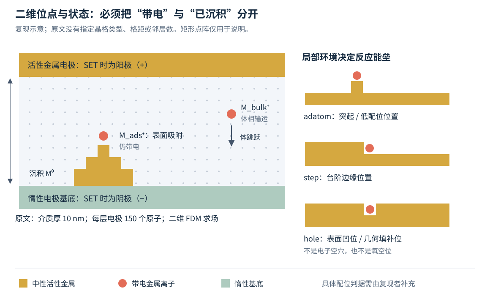

**图解 A：上图是解释所需状态的示意，不是原论文指定的晶格。** adatom 指表面突出的低配位位置；step 是台阶边缘；hole 是表面凹位 / 几何填补位，**不是电子空穴，也不是氧空位 VO**。原文给出了位点类别及能垒的稳定性次序，但没有给出精确配位数阈值。

## 4. 事件库：6 类过程如何成为 10 类事件

【原文，图 2.2 图注，PDF 55】下表是这套模型最直接可用的能垒清单。它们是**零场基准能垒**，不是最终带场速率。

| 图中编号 | 事件 | 位点 | Ea / eV | 执行后怎样更新状态 |
|---:|---|---|---:|---|
| 1 | 氧化 | adatom | **0.65** | M⁰ → 表面 M_ads⁺；向电子库交出电子 |
| 2 | 氧化 | step | **0.70** | 同上，按台阶局部环境取能垒 |
| 3 | 氧化 | hole | **0.75** | 同上，按凹位局部环境取能垒 |
| 4 | 还原 | adatom | **0.35** | M_ads⁺ → M⁰；从电子库获得电子，增加金属占据 |
| 5 | 还原 | step | **0.30** | 同上，台阶位更易沉积 |
| 6 | 还原 | hole | **0.25** | 同上，凹位更易填充 |
| 7 | 吸附 | 金属 / 介质界面 | **0.15** | M_bulk⁺ → M_ads⁺；仍带电 |
| 8 | 脱附 | 金属 / 介质界面 | **0.30** | M_ads⁺ → M_bulk⁺；离开表面进入可达输运位点 |
| 9 | 体扩散 | 介质内部 | **0.15** | 带电粒子从一个位点移动到允许的目标位点 |
| 10 | 表面扩散 | 金属表面 | **0.20** | M_ads⁺ 沿表面移动，保持带电并改变局部配位 |

上表“状态更新”是按原文过程整理的实现表示，不是作者公开的内存结构。**氧化不等于已经脱附；吸附也不等于已经还原。** 将它们直接合成一个事件会改变竞争关系。

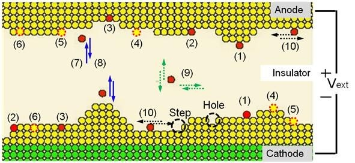

**为何有这个能垒次序？** 还原能垒从 adatom → step → hole 逐步降低，氧化能垒反向升高。因此较高配位的位置更容易沉积、更不容易溶解。这是低压下致密、平滑沉积的重要原因。

【图解】在相同局部电势、相同频率因子下，仅比较 0.35 eV 与 0.25 eV 两个还原能垒：若示例温度取 300 K，低能垒事件快约 exp(0.10 / 0.02585) ≈ **48 倍**。300 K 是此处的算例温度，不是声称论文所有仿真的统一温度。

### 4.1 事件实例应怎样枚举

【复现建议】一次循环通常有很多事件实例，远不止 10 个。每个实例至少是：

```text
事件 = {过程类型, 粒子 / 位点, 起点, 终点或反应界面, 位点类别, Ea, Γ}
```

例如，某个体相离子若有三个允许的跳跃方向，就贡献三个竞争事件；两个不同位置的 step 还原也属于两个事件。枚举时检查目标占据、表面可达性和电子库连接，避免重叠占据、重复计数及无电子来源的体相还原。金属事件发生后，邻近位置的 adatom / step / hole 分类也可能改变，需要重算。

## 5. 事件流程：物理路径与随机执行不是一回事

### 5.1 一个金属原子的典型净输运路径

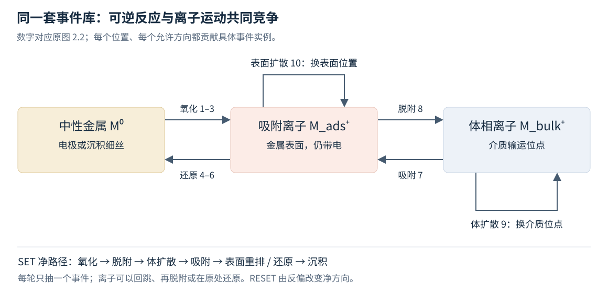

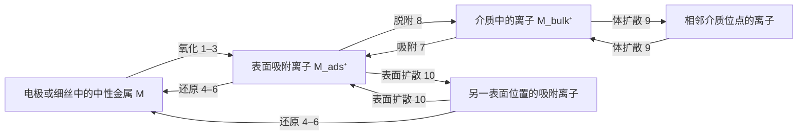

SET 时常见的净路径为：活性电极氧化 → 脱附 → 多次体扩散 → 阴极侧吸附 → 表面扩散或原地还原 → 金属沉积 → 细丝接近并桥接对电极。

但 **KMC 不会强制每个离子按此顺序走完**。任一步都可能发生反向反应，吸附离子可能再次脱附，体相离子可能回跳，氧化后的离子也可能在原处还原。所有位置的合法事件一起竞争，单次循环只执行一个被抽中的事件。

RESET 使用同一套基本过程；反偏改变电势、速率与净输运方向，使已形成的细丝溶解。无需凭空增加一个“整条细丝断裂事件”；断裂应由金属连接逐步丢失而产生。

### 5.2 原文采用的简化

| 简化 | 原文位置 | 对复现的含义 |
|---|---|---|
| 氧化采用简化的场辅助注入机制 | PDF 56–57，图 2.4 | 不显式求 O₂ / H₂O 参与的多步反应；原文讨论了此近似的局限 |
| 所有吸附离子保持带电，仅吸附离子可表面扩散 | PDF 57 | 不需要额外实现部分电荷转移 adion 或中性 adatom 的扩散分支 |
| 体扩散 Ea = 0.15 eV | PDF 58 | 用低迁移势垒代表易扩散介质或循环后的快速离子通道 |
| 化学反应能垒多为唯象建模 | PDF 57–58 | 图 2.2 不是整套 DFT 计算得到的数据库；图 2.5 仅支持体扩散能垒讨论 |
| RESET 横向场以两种累积情景近似 | PDF 71–72 | 不等于完整三维场、形貌与热耦合 |

## 6. 电势、速率和时间：实际计算闭环

### 6.1 先解场，不直接把端电压代入每个跳跃

【原文，图 2.6，PDF 59】流程图明确写出泊松方程：

> ∇²φ = −ρcharge / ε

φ 是电势，ρcharge 是离散离子产生的空间电荷密度。它同时受外加边界和当前构型影响。图 2.6 还要求排除自势。原文给了方程形式，但没有完整列出介电常数、空间电荷映射和离散线性系统。

【复现建议】若采用均匀矩形电场网格与常数 ε，常用五点差分写为：

```text
(φm+1,n − 2φm,n + φm−1,n) / Δx²
+ (φm,n+1 − 2φm,n + φm,n−1) / Δz² = −ρcharge,mn / ε
```

可采用横向周期边界，上下金属端设置相应电势。这里“横向周期、上下电势边界”是结合器件结构所作的具体实现方案，原文没有逐边给出方程。桥接后还应计算有限电阻金属内的电压分布，不能继续强迫整条细丝与一侧电极等势。

### 6.2 式 (9) 的单事件形式

【原文，PDF 60】式 (9) 两侧都有求和号。右侧一个被加项对应单个事件，全部相加才是总速率。保留原文能量换算记号，可写成：

```text
Γi = ν0 · exp[−q Ea,i / (kB T)]
        · exp{q(Vinitial,i − Vfinal,i) / (2 kB T)}
        · exp[−q Vself,i / (2 kB T)]

Γtotal = Σi Γi
```

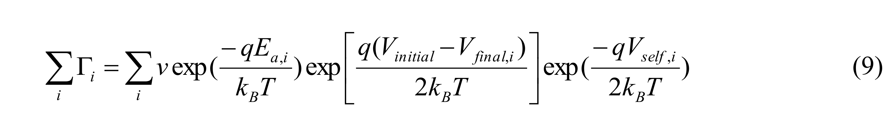

| 项 | 含义 | 编程时的关键点 |
|---|---|---|
| ν0 | 频率因子，正文给出原子振动量级约 10¹³ s⁻¹ | 原文没有逐类标定 10 个独立前因子 |
| Ea,i | 按过程与位点类别查询的零场能垒 | 不能对所有位置固定用一个“平均 Ea” |
| Vinitial − Vfinal | 一次具体跃迁两端的局部电势差 | 不是两电极总电压；跳跃距离会影响该差值 |
| 分母中的 2 | 对应对称因子 α = 0.5 | 反向跳跃的电势差会反号，反应本身的基准能垒也要查对应表项 |
| Vself,i | 排除该粒子自身电势对其速率的影响 | 原文未给出可直接照抄的离散计算方法 |

**自势只排除一次。** 可保留完整电势并显式使用式 (9) 的最后一项，或采用与之等价、已做事件自势修正的电势差；不要先减掉自势，又重复乘一次排除因子。不同离子的自势贡献不同，也不能把某一个离子的自势图从所有事件中一律扣除。

**单位只换算一次。** 表中能垒的数值以 eV 给出，原文用 q 将能垒数值换成 SI 能量。若代码直接用 kB = 8.617333262 × 10⁻⁵ eV/K，就应统一在 eV 下计算：单价离子跨越 1 V 对应 1 eV。不要同时转换 Ea 和再乘一次 q。原文也没有交代高场下有效能垒为负时是否截断，不能自行截断后仍称其为原始算法。

### 6.3 两个随机数各做一件事

【原文，PDF 52–54、59–60】采用 VSSM，令 u1、u2 为独立均匀随机数，实际实现取 0 < u1,u2 < 1：

```text
Δt = −ln(u1) / Γtotal
t ← t + Δt

选择 j，使： Σi<j Γi < u2 Γtotal ≤ Σi≤j Γi
```

第一个随机数决定等待多久，第二个决定哪个事件发生。平均等待时间是 1 / Γtotal，**单步实际等待时间并不恒等于这个平均值**。事件也不是等概率抽取，更不是给 10 类事件各 10%。

【算例】若三个事件速率人为设为 1、2、7 s⁻¹，总速率 10 s⁻¹；u2 = 0.42 时，阈值 4.2 落在第三个累计区间，因此执行第三个事件。若 u1 = exp(−1)，该步 Δt = 0.1 s。此算例仅解释抽样，不是论文的器件参数。

## 7. KMC 框图与可落实的程序顺序

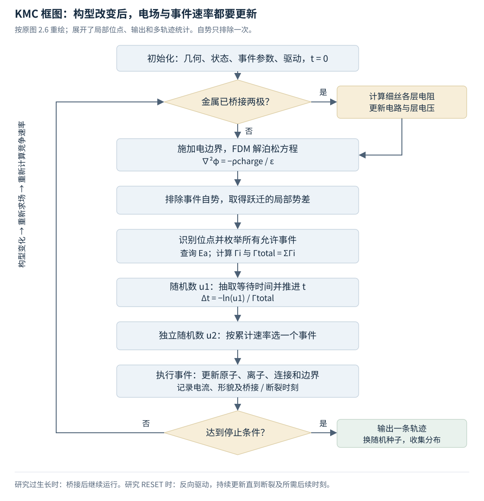

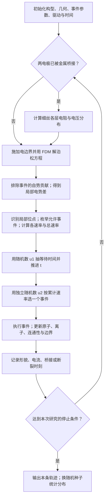

此图按原图 2.6 重绘，另外展开了位点识别、输出和多轨迹统计。**自势计算、连通判定与输出细节属于复现时必须补足的实现。** 原图保留于 [图 2.6](../figures/figure-6.png)。

### 7.1 一步一步搭建

1. **建立空间与初态。** 定义电极、10 nm 介质、150 原子 / 电极层，以及所选格距和邻接；forming 从无贯穿细丝的初态开始。
2. **建立状态与局部位点分类。** 区分中性金属、体离子、吸附离子与惰性基底，识别 adatom、step、hole。
3. **实现 10 类事件和零场能垒表。** 为当前所有合法位置建立事件实例，包括反向事件。
4. **实现电场求解与自势排除。** 以离子电荷和金属边界求电势，为每个事件取得局部电势差。
5. **实现带场速率和 VSSM。** 计算 Γtotal，用两个独立随机数决定等待时间和事件；每次执行一个事件。
6. **更新构型后重新求场。** 一次沉积或溶解既会改变邻居类别，也会改变电荷、电极几何与局部场，不能一直用初始场。
7. **检测首次桥接。** 记录 tForm 或 tSET；若研究过生长，应继续运行，加入细丝电阻和外部电路反馈。
8. **切换极性研究 RESET。** 从导通细丝出发，在反偏下继续执行事件，记录首次断开和后续过溶解。
9. **按场景收集统计。** 不同随机种子形成不同轨迹，统计时间、电压、电阻分布及未开关样本。

### 7.2 论文流程的实现伪代码

```text
输入：几何、状态、邻接、能垒、介质参数、驱动波形、外部电路、停止准则
初始化 t = 0、构型 S、随机数发生器

循环：
    根据 S 识别金属连接、电极边界及当前编程阶段
    若已桥接：计算金属 / 细丝电阻，更新电路与各层电势
    求解当前 S 下的 Poisson 电势
    枚举所有合法事件，并识别各自局部位点
    对每个事件计算“仅排除一次自势”的速率 Γi
    Γtotal = 所有事件速率之和
    若没有可执行事件：记录停滞状态，按研究目标处理
    抽取 u1、u2
    Δt = −ln(u1) / Γtotal
    按累计速率，用 u2 选中事件 j
    推进时间；执行 j；更新 S 与电边界
    记录桥接 / 断裂、形貌、电流及所需统计量
    若满足当前研究的停止条件：退出
```

**扫压需要额外处理。** 上式等待时间公式严格对应一次等待期间速率固定的情形。如果 V(t) 在等待时间内明显改变，应采用足够细的分段恒定驱动，或在固定构型下用累计总速率积分确定事件时间，再用事件时刻的速率选事件。累计危险度条件为 ∫₀^Δt Γtotal(S,V(t+s)) ds = −ln(u1)。这是数值复现建议；论文未给出其扫压时间处理的实现细节。

## 8. 从格点形貌到 I–V、电阻和控制电流

### 8.1 导通前后的电流来源不同

【原文，PDF 67–70】导通前，通过给定时间窗内到达阴极的金属离子数计算输运电荷，再除以时间：

> Iion ≈ q × Narrival / Δtwindow

实际实现宜明确反向输运的符号、计数面和时间窗，避免将表面反复吸脱附都算成新的净通过电荷。不能把“所有体扩散跳跃次数 × q”直接当成端口电流。

首次桥接后，I–V 的区域 2–4 由局部金属细丝导电控制，区域 3、4 为欧姆电流；这时仅靠计数离子不能得到论文的导通电流，需要有限电阻细丝与外部电路。介质电子电导为零的假设，也意味着这套模型没有完整描述 HRS 的隧穿、陷阱辅助电子输运等通道。

### 8.2 细丝过生长为何需要电路反馈

【原文】金属细丝电导不是无穷大，桥接之后其上仍有压降，化学反应继续，细丝变宽、电阻下降，直至与外部测试系统达到稳态。图 2.6 要求逐层计算电阻与电压，每一步将其作为新的电边界。

【复现建议】一种直观的层电阻近似是：

```text
Rlayer = ρmetal × Δz / Alayer
Rfilament = Σlayer Rlayer
电压源 + 串联电阻时：I ≈ Vapplied / (Rext + Rfilament)
恒流驱动时：ΔVlayer = Iprogram × Rlayer
```

原文明确要求逐层更新，但未完整给出 Alayer 的二维到三维换算。若用 Alayer = Nmetal,layer × Δx × heffective，heffective 就是你另行选定的等效面外厚度。复杂多分支网络仅靠逐层原子总数不能准确表示串并联关系，是否改用电阻网络应单独声明。

**首次桥接和最终稳态必须分开取样。** 否则可能得到“高压细丝较窄”却无法解释“大编程电流使 Ron 更小”的表面冲突。

## 9. 形貌图逐图解答

### 9.1 先读懂颜色与方向

【图解】图 2.7、2.13、2.14、2.18、2.20 中，橙黄色表示金属区域，既可能包括上电极，也可能包括下方沉积金属；深蓝色表示尚未被金属占据的介质区域。它们是**占据 / 形貌图，不是电势热图**。图 2.12 的绿色单独标出阴极基底及粗糙度。不要把这些图的蓝色直接称作“阴极”。

图 2.2 则使用原子圆点表达金属、离子和基底，画法与后面的像素形貌图不同，不能跨图强行套同一套颜色图例。RESET 时阳极 / 阴极名称随极性互换；描述“靠近活性电极”比只说“靠近阴极”更不容易混淆。

### 9.2 图 2.7：为何电压越高，初成细丝反而越窄？

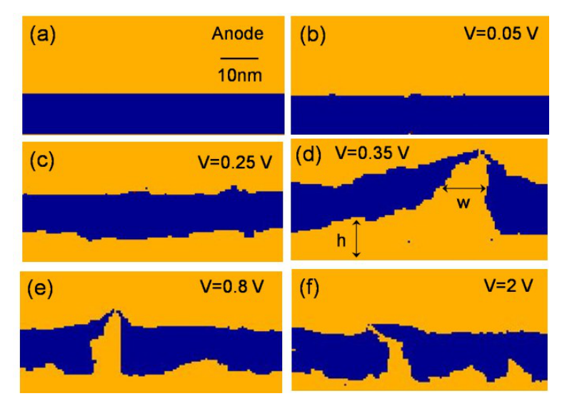

| 子图 | 条件 | 图上看什么 | 过程解释 |
|---|---|---|---|
| a | 初始状态 | 平直的金属 / 介质界面 | 尚无沉积形成的贯穿通路 |
| b | 0.05 V | 几乎没有有效沉积 | 氧化、脱附、迁移、还原的净输运链很难持续完成 |
| c | 0.25 V | 有较平滑、较均匀的沉积，但仍有蓝色间隔 | 离子倾向扩散到稳定位置再还原；一侧溶解、一侧沉积并不保证间距有效缩短 |
| d | 0.35 V | 较宽的金属桥；标有 h 与 w | h 是各向同性沉积厚度，w 是细丝平均宽度；略过阈值时仍有充分表面重排 |
| e | 0.8 V | 桥接处明显变窄 | adatom 还原更容易，局部突起更快向前生长 |
| f | 2 V | 很窄的首次桥接金属路径 | 局域生长快，形成通路所需的横向铺展较少 |

**适用时刻是首次短接附近，不是过生长后的最终 LRS。** 第 5.1.1 节（PDF 113）专门重申：短接后很快会增粗，最终较大电压 / 电流对应更宽、更导电的细丝。

原文将低压区称为具有阈值的区域。数值复现时应报告观察时间和停止条件；有限观察时间内没有桥接，并不能单凭图证明所有微观事件速率严格为零。

与形貌配套的图 2.8 可按下表理解：

| 时间–电压区间 | 主要解释 | 对模型的要求 |
|---|---|---|
| 极低偏压 / 阈值附近 | 净供离子很少，沉积偏均匀，间隙不容易有效收缩 | 同时保留正反反应及表面重排，不能只模拟单向漂移 |
| 略高于阈值 | 离子通量增加，形貌也使所需沉积量减少，形成时间下降 | 需要把“输运速度”与“达到桥接所需原子数”分开分析 |
| 较高偏压 | 界面反应进入类似 Tafel 的指数依赖区，时间随电压快速下降 | 必须使用局部势差修正事件速率，而非人为规定时间–电压曲线 |

论文用 Butler–Volmer / Tafel 关系解释趋势，但**实际模拟使用式 (9)**。BV 本身只描述界面电荷转移，未包含体输运和表面输运，也不能直接给出离散形貌。模型输入的微观 α = 0.5，而将宏观扫描率结果按简化公式拟合得到的表观 α 约 0.05；这不等于作者把 α 改成了 0.05。原文也没有完整解决各过程如何贡献这一差异的问题（PDF 63–65）。

### 9.3 图 2.9：实验验证了哪些形貌结论？

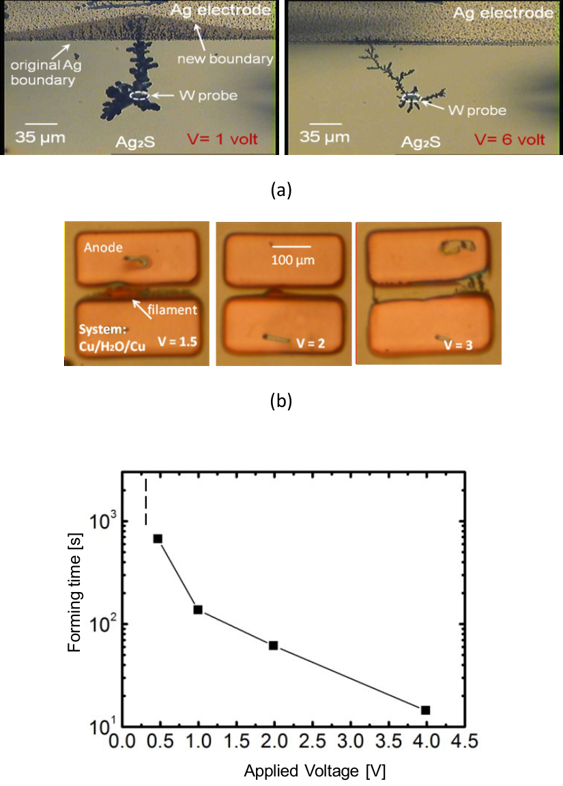

图 a 是 Ag/Ag₂S/W，图 b 是 Cu/H₂O/Cu 的横向器件形貌，支持低压形成较宽沉积、高压形成较窄图案的趋势；图 c 给出 Ag/Ag₂S/W 的 forming 时间–电压实验。Cu/H₂O/Cu 中 H₂O 主要作输运媒介，与模型“介质不自带金属阳离子”的设定更接近。

这些实验主要验证 forming 的形貌和时间趋势，**不能据此声称 RESET 断裂位置、所有分布或 Ti/YSZ 机制都已被同一实验直接验证**。图 2.15、2.16 等另有文献实验对照。

### 9.4 图 2.12：为什么粗糙度和宽度会改变 VForm？

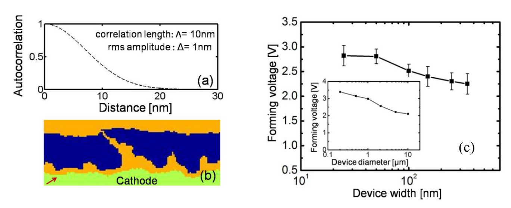

【原文】用 Gaussian 自相关生成阴极轮廓，相关长度 10 nm，rms 高度 1 nm。绿色轮廓的突起使局部有效间距较小、电场较强，细丝更容易在这些位置形成。器件横向尺寸增大后，出现有利成核位置的机会增加，VForm 逐渐下降；小尺寸区趋于平台。

二维图直接扫描的是器件**宽度**，文献实验常用面积或直径，二者的统计与几何转换要另作约定，不能把它们当成相同单位。相关长度也不等于格距。

### 9.5 图 2.13：为什么已经桥接，还会继续增粗？

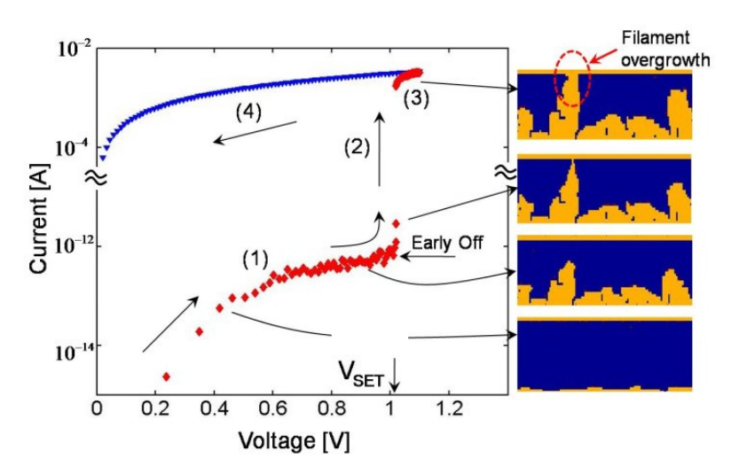

区域 1 是形成过程中的离子电流；区域 2 是金属首次贯通导致的陡升；区域 3、4 以欧姆电子电流为主。右侧图中桥接路径随后增粗，原因是桥接时细丝仍有有限电阻，仍承受压降，沉积继续发生。这正是图 2.6 顶部“计算每层电阻与电压分布”分支存在的理由。

### 9.6 图 2.14：forming 与 SET 的初态怎样区分？

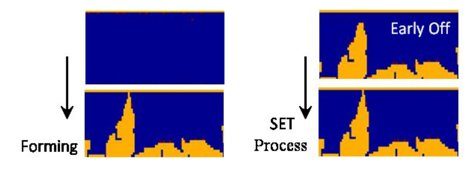

forming 左列从没有残余通路的初态开始，需要长出整条细丝。SET 右列从残余细丝开始，只需补上顶部缺口。**论文的 SET 算例通过去掉细丝顶部 6 层原子构造初态**（PDF 69），因此 tSET 远小于 tForm。

“6 层”不是 6 nm；缺少原子层距时不能换算缺口物理长度。该操作是作者设置 SET 初态的方法，不表示所有真实 RESET 都恰好移除 6 层。

### 9.7 图 2.17–2.18：RESET 在哪里断，为什么？

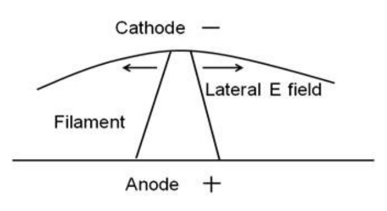

【原文】反偏后，活性金属电极变成阴极。细丝溶解出的离子向这一侧移动。尖端附近的横向场决定它们是否容易离开尖端前方，从而影响再沉积与最终断裂位置。

| 原文近似情景 | 采用的处理 | 图上结果 |
|---|---|---|
| 横向场较大 | 离子不易在尖端前方累积，可横向分散 | 图 2.18a：靠近活性电极的细丝顶部断开 |
| 横向场较小 | 允许离子在尖端对面的电极表面累积、再析出 | 图 2.18c：可能在细丝中部断开；结论还讨论靠近惰性电极的情况 |

这是一种两情景近似，没有给出一个可直接套用的“横向场超过多少 V/m 就切换”的数值阈值。

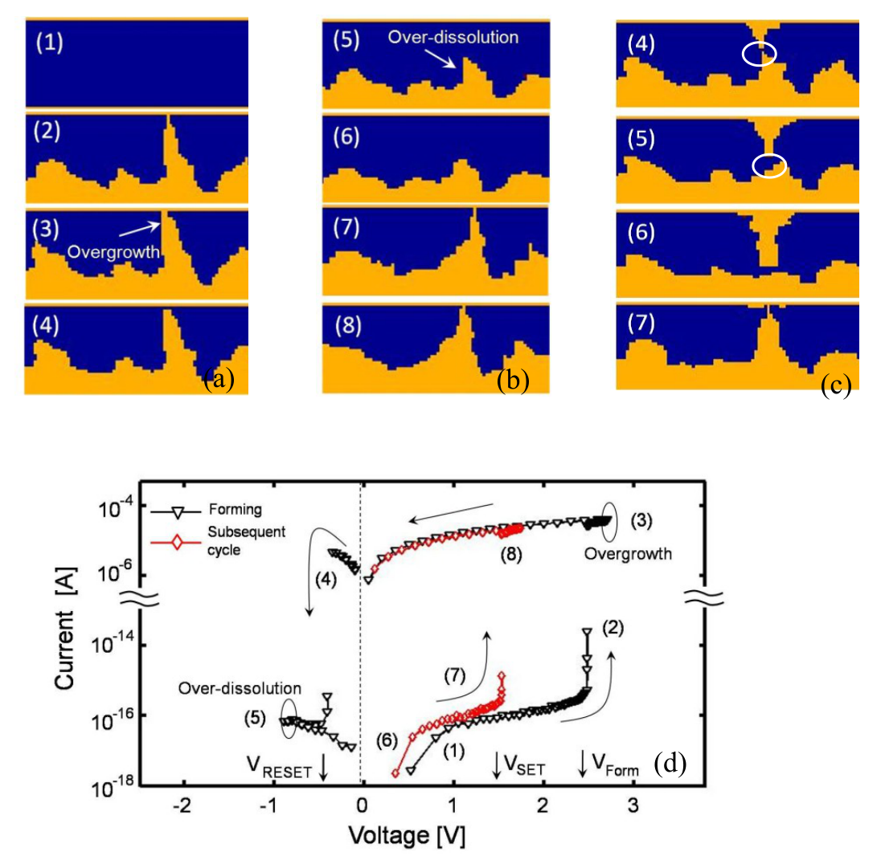

| 状态号 | 怎样解读 |
|---:|---|
| 1 | 初始 forming，离子电流，尚无贯通金属通路 |
| 2 | 首次桥接，电流陡升 |
| 3 | 桥接后过生长，金属颈增粗 |
| 4 | 反偏后开始断裂，LRS → HRS |
| 5 | 已断开但继续溶解，缺口进一步加大，即过溶解 |
| 6 | 保留不贯通的残余细丝，等待下一次 SET |
| 7 | 再次桥接，只需填补剩余间隙 |
| 8 | 再次进入低阻及后续增粗阶段 |

图 2.18d 的循环说明 VSET 小于 VForm，因为残余细丝没有全部消失。曲线 RESET 位于负电压侧，正文提到约 0.4 V 应理解为该图中的 **|VRESET| 量级**，不要把 RESET 错写成正偏。

### 9.8 图 2.20：树枝状与致密形貌由什么决定？

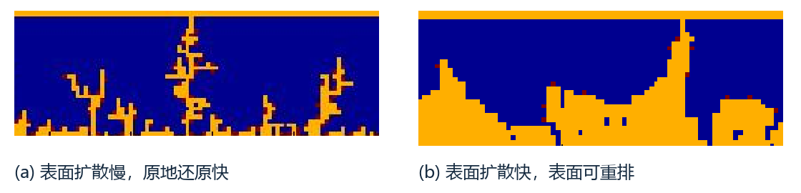

| 条件 | 事件竞争 | 形貌 |
|---|---|---|
| Esurf 较大、Eadatom 较小 | 吸附离子难沿表面重排，却容易就地还原固定 | 树枝状、分支多，类似电击穿图案 |
| Esurf 较小、Eadatom 较大 | 离子有机会沿表面到达 step / hole 再还原 | 更平滑、致密，类似电镀沉积 |

这里 Eadatom 指 adatom 位点还原相关的基准势垒。原图讨论的是材料参数的相对改变，没有给出这两个扫描算例的一套完整新数值，不能自行补成原论文参数。

### 9.9 图 2.21：为什么降低体扩散势垒最终不再加速？

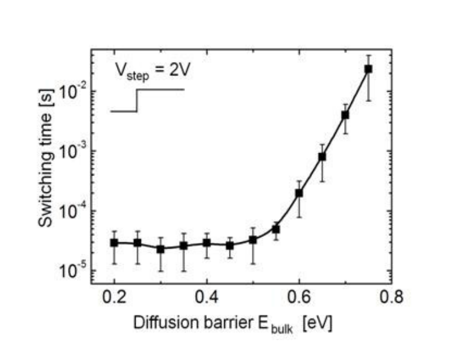

高 Ebulk 区，离子穿过介质很慢，体扩散限速，降低势垒可显著缩短开关时间；低 Ebulk 区，离子已经来得足够快，氧化与金属结晶开始限速，时间趋于平台。**只优化迁移率无法无限提高开关速度**，需要同时考虑供离子和沉积过程。

## 10. 研究场景与参数不能混用

| 场景 / 原图 | 已明确的设置 | 初态 / 取样目标 |
|---|---|---|
| 形貌与恒压 forming，2.7–2.9 | 图 2.7 电压 0.05、0.25、0.35、0.8、2 V | 原始态；比较形成行为和首次桥接形貌 |
| 扫描率，2.10 | 改变电压扫描率；模型 α = 0.5 | 记录 VForm 与扫描率关系 |
| 厚度，2.11 | 扫压 **1 V/s** | 改变介质厚度，记录 VForm |
| 宽度 / 粗糙度，2.12 | Gaussian 相关长度 **10 nm**，rms **1 nm** | 改变宽度；包括粗糙阴极 |
| I–V / 过生长，2.13 | **3 V/s；Rext = 100 Ω；ρmetal = 5×10⁻⁸ Ω·m** | 桥接后继续运行 |
| SET 时间，2.14–2.15 | 残余细丝顶部移除 **6 层**；恒压阶跃 | 2 V 下 99% 导通约需至少 60 μs，3 V 约 3 μs |
| 恒流 SET，2.16 | 每步计算系统电阻及各层电压 | 比较不同编程电流的 Ron 分布 |
| 双极循环 / RESET，2.18 | **1 V/s；Rext = 30 kΩ；ρmetal = 5×10⁻⁶ Ω·m** | forming → 过生长 → 断裂 → 过溶解 → 再 SET |
| RESET 温度比较，2.19 | 图例含 ISET = 20 / 50 μA，TRESET = 50 / 70 °C | 比较 VRESET 的幅值与分布 |
| 材料参数，2.20–2.21 | 改变表面、还原或体扩散势垒；2.21 为 2 V 阶跃 | 分离形貌竞争与限速机制 |

**两套细丝电阻率相差 100 倍，两套外部电阻相差 300 倍。** 它们属于不同算例，应逐图保留。原文没有明确解释为何选取不同电阻率；不能把“作者为了维持压降而人为放大参数”当作已证实的动机。

**温度存在叙述张力。** PDF 71 说现有模型未实现温度依赖，PDF 72–73 的图 2.19 又比较了温度；PDF 117 将耦合热传导方程列为未来工作。可以确定的是**没有展示完整的自洽焦耳热闭环**。将 T 作为外加参数做等温扫描，是复现图 2.19 的合理起点，但这属于对不完整说明的处理，不能说作者已交代全部热实现。

## 11. 建议的复现顺序与必要检查

以下是从论文提炼出的实施路线，**不是已存在的作者源码，也不是本报告已经运行出的仿真结果**。

| 阶段 | 先实现什么 | 用什么判断是否合理 |
|---|---|---|
| A：空间与事件 | 位点、占据、局部模板、事件前置条件 | 粒子不重叠；扩散守恒金属数；氧化 / 还原只改变状态并向电子库交换电荷 |
| B：场与速率 | 泊松、自势排除、带场速率 | 无电荷平板结构的电势近线性；零场体跳跃各向速率相同；反转电势差后漂移方向相反 |
| C：随机时钟 | 总速率、等待时间、累计选择 | 简单已知速率事件池能给出相应选择比例与平均等待时间 |
| D：forming | 从原始态生长、桥接判据 | 比较图 2.7 的形貌变化与 2.8 的时间趋势，明确观察时间 |
| E：SET 统计 | 残余细丝 + 顶部 6 层缺口，多随机种子 | 比较图 2.15 的分布尾部与未导通比例，不只比较均值 |
| F：过生长与电路 | 有限电阻、外部保护、逐层电势 | 比较图 2.13、2.16；区分首次桥接和最终 Ron |
| G：RESET | 反偏、金属氧化、横向累积近似 | 比较图 2.18 的断裂位置与后续 SET；报告近似的作用 |
| H：尺寸与材料扫描 | 粗糙度、宽度、厚度、能垒 | 检查图 2.11–2.12、2.20–2.21 的趋势，不把参数补偿误认为唯一物理解释 |

每条轨迹建议保存：随机种子、时间、端电压、执行事件、离子数、金属连通状态、首次桥接 / 断裂时刻、形貌快照、电流与电阻。没有开关的轨迹也应保留，避免丢掉分布尾部。原文没有给出一套完整的样本数、收敛阈值或误差预算。

对快速表面往返事件，普通 KMC 仍可能花大量计算却几乎不推进结构。第 5.2 节把减少这些无效运动的计算开销列为改进方向。若以后引入加速算法，应验证它保留了目标时间与事件统计。

## 12. 对文件夹旧笔记的关键校正

| 容易被误读的表述 | 核对后的处理 |
|---|---|
| “没有泊松方程形式” | 图 2.6 实际写出 ∇²φ = −ρ/ε；缺的是材料常数与离散实现 |
| “模型从未交代离子价态” | 图 2.2 正文给出 M ⇌ M⁺ + e，式 (9) 使用 q；没有多价态专门模型 |
| “氧化只在阳极，还原只在阴极” | 正文明确两侧均包含氧化 / 还原；随偏压改变净方向 |
| “可由 150 原子推得确定格距” | 无法唯一推出；原子晶格、格距、邻接必须声明为补充选择 |
| “先减自势，再乘式 (9) 的自势因子” | 两者可能重复修正；应只排除一次 |
| “高压一定形成更细的最终细丝” | 初次桥接更窄；最终过生长后的细丝可更宽 |
| “高场、大电流的行为已包含自热反馈” | 未展示完整自洽热求解；温度比较与热耦合应分开 |
| “图 2.18 提高电阻率的动机已由作者解释” | 原文只给出取值差异，动机不能当成事实 |
| “所有 KMC 预测都由两种横向器件直接验证” | 横向器件主要支持 forming 形貌与时间；其他结果有不同文献对照或属于模型预测 |

## 附录 A：第 2 章全部图号索引

| 原图 | PDF 页 | 图在研究中的作用 | 本文件夹中的原图 |
|---|---:|---|---|
| 2.1 | 53 | 过渡态能量图，解释热激活和场修正 | [打开](../figures/figure-1.png) |
| 2.2 | 55 | 10 类过程、位点、能垒与器件结构 | [打开](assets/figure-2-2.png) |
| 2.3 | 56 | 局部结构如何改变氧化 / 还原能垒 | [打开](assets/figure-2-3.png) |
| 2.4 | 57 | Cu 注入的四种机制及采用的近似 | [打开](../figures/figure-4.png) |
| 2.5 | 58 | 引用 DFT 的 Cu 扩散能垒；不是 KMC 晶格 | [打开](../figures/figure-5.png) |
| 2.6 | 59 | 原始 KMC–场–电阻更新流程 | [打开](../figures/figure-6.png) |
| 2.7 | 61 | 电压与初成细丝形貌 | [打开](../figures/figure-7.png) |
| 2.8 | 61 | forming 时间–电压的三个区间 | [打开](../figures/figure-8.png) |
| 2.9 | 62–63 | 横向器件形貌及形成时间实验 | [打开](../figures/figure-9.png) |
| 2.10 | 64 | VForm 与扫描率；宏观拟合参数的局限 | [打开](../figures/figure-10.png) |
| 2.11 | 66 | VForm 与介质厚度 | [打开](../figures/figure-11.png) |
| 2.12 | 67 | Gaussian 粗糙度与横向尺寸效应 | [打开](../figures/figure-12.png) |
| 2.13 | 68 | I–V、首次桥接和过生长 | [打开](../figures/figure-13.png) |
| 2.14 | 69 | forming 与残余细丝 SET 初态的区别 | [打开](../figures/figure-14.png) |
| 2.15 | 69 | 不同电压下的 SET 时间统计 | [打开](../figures/figure-15.png) |
| 2.16 | 70 | 控制电流与 Ron 统计 | [打开](../figures/figure-16.png) |
| 2.17 | 71 | RESET 阴极附近的横向电场示意 | [打开](../figures/figure-17.png) |
| 2.18 | 72 | 双极循环、过生长、过溶解和断裂位置 | [打开](../figures/figure-18.png) |
| 2.19 | 73 | RESET 电压的电流 / 温度条件分布 | [打开](../figures/figure-19.png) |
| 2.20 | 73 | 表面扩散与 adatom 还原势垒对形貌的影响 | [打开](assets/figure-2-20.png) |
| 2.21 | 74 | 体扩散势垒与时间饱和，限速步骤转移 | [打开](../figures/figure-21.png) |

其中原有 figure-2.png、figure-3.png 和 figure-20.png 带有整页文字或截取边界问题，本报告从原 PDF 提取图 2.2、2.3 的内嵌图片，并将图 2.20 的两个原始形貌子图并排整理；原文件均保留。

## 附录 B：哪些后续文献值得用于补足实现

以下均来自论文第 2.5 节的参考文献，本报告没有进一步核验它们是否公开了缺失的全部参数。

| 需求 | 原文编号与文献 |
|---|---|
| KMC / VSSM 基础 | [1] A. F. Voter, *Introduction to the Kinetic Monte Carlo Method*；[2] A. P. J. Jansen, *An Introduction to Monte Carlo Simulations of Surface Reactions* |
| 有限差分与 KMC 耦合 | [5] A. Saedi, *Journal of Electroanalytical Chemistry* 588 (2006), 267–284 |
| 自势排除背景 | [16] A. U. Modak, M. T. Lusk, *Solid State Ionics* 176 (2005), 2181–2191 |
| 作者 forming 前作 | [7] F. Pan, S. Yin, V. Subramanian, *IEEE Electron Device Letters* 32(7), 949–951 (2011)；[4] IMW 2011 |
| 作者 SET / 动态开关前作 | [19] F. Pan, V. Subramanian, SISPAD 2010, 19–22；[20] DRC 2010, p.255 |

本文件夹的 `code/` 只有公式图片。原论文没有附可直接运行的仿真源码。因此这里完成的是**模型机制、流程和复现需求的提炼**；尚不能声称获得了作者的完整原始程序。
