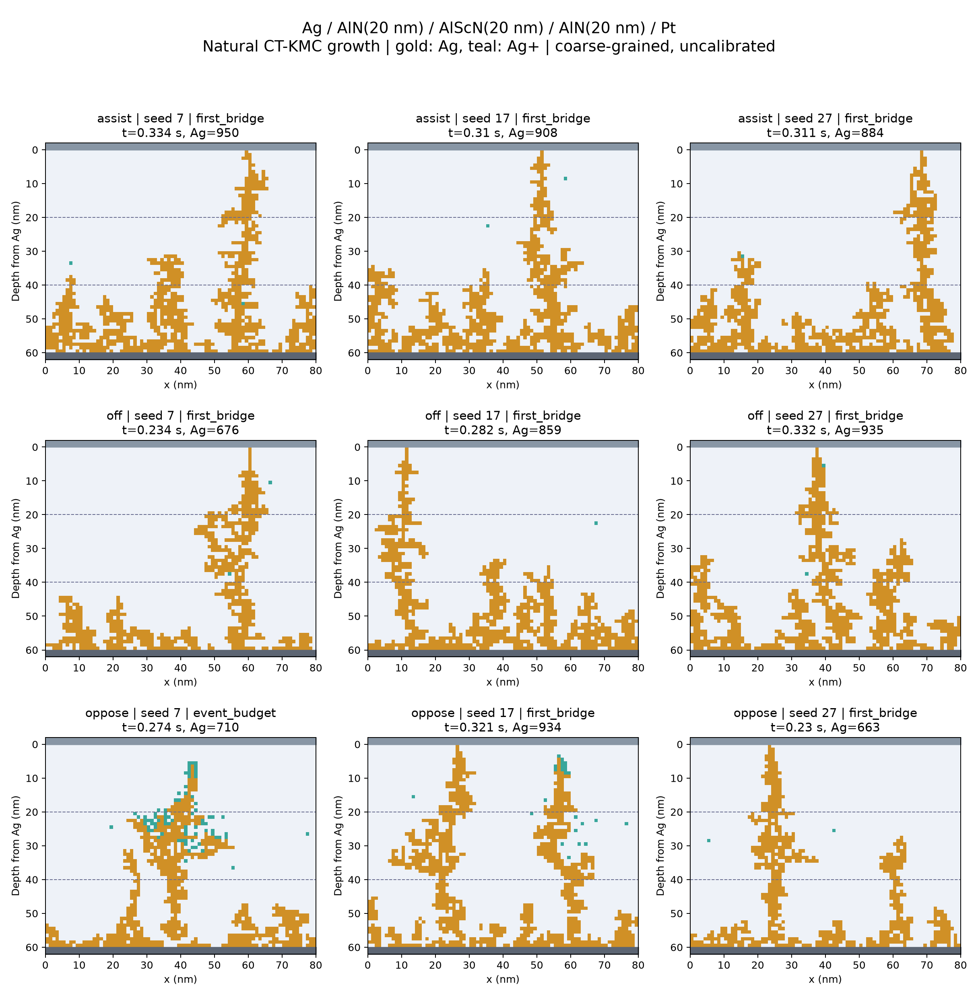
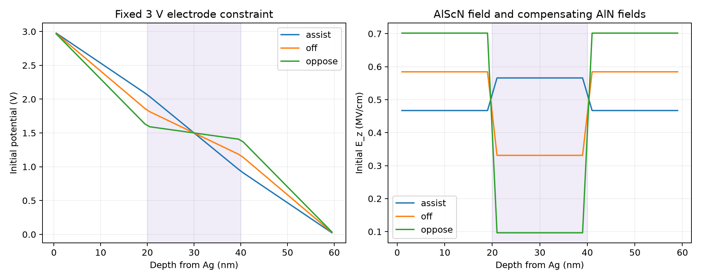

# 基础模型首轮运行记录

完整60 nm目标厚度，80 nm局部截面，1 nm有效格点；3 V、300 K。九条轨迹均从空介质开始。

|内建场组|种子|停止原因|模型时间/s|事件数|中性Ag有效单元|Ag守恒误差|
|---|---:|---|---:|---:|---:|---:|
|assist|7|first_bridge|0.333541|159438|950|0|
|assist|17|first_bridge|0.310161|152385|908|0|
|assist|27|first_bridge|0.310562|145661|884|0|
|off|7|first_bridge|0.234453|116647|676|0|
|off|17|first_bridge|0.281855|143268|859|0|
|off|27|first_bridge|0.332253|152003|935|0|
|oppose|7|event_budget|0.27387|350000|710|0|
|oppose|17|first_bridge|0.321144|194235|934|0|
|oppose|27|first_bridge|0.229542|139317|663|0|

三组描述统计（只对已成桥轨迹取均值；事件预算截断不计入）：

|组别|成桥轨迹/总数|模型成桥时间均值/s|
|---|---:|---:|
|assist|3/3|0.318088|
|off|3/3|0.282853|
|oppose|2/3|0.275343|

assist/off/oppose分别为P_eff=−0.004/0/+0.004 C/m²。assist指中层场方向，不保证全器件生长更快。每组仅3种子，结果是探索性描述，不能估计可靠成丝概率或证明极化因果。模型时间是未标定参数下的CT-KMC输出，不是实验时间预测。

oppose组有事件预算截断，已成桥样本均值存在选择偏差，不可用三组均值直接排列成丝快慢。

每帧Ag占据数已独立核对源库净注入。电势文件在first_bridge终态记录的是最后一次成桥事件执行之前的场，JSON的potential_state已标明；桥接后的金属电流/压降未求解。

形貌可用于检查枝状生长与局部竞争，不作为TEM定量复现。尚无电流、限流、热、RESET/保持或极化翻转，完整边界见../../README.md。
